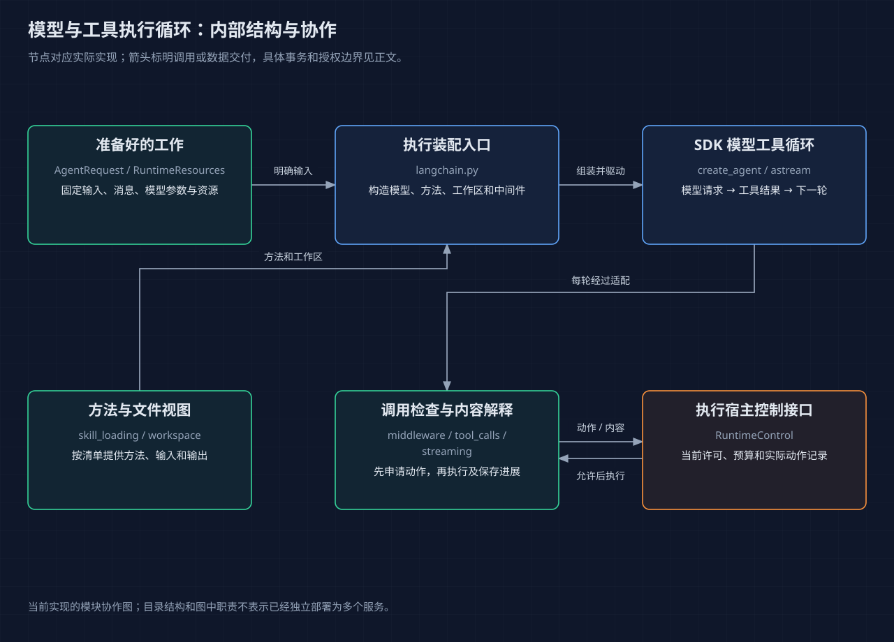
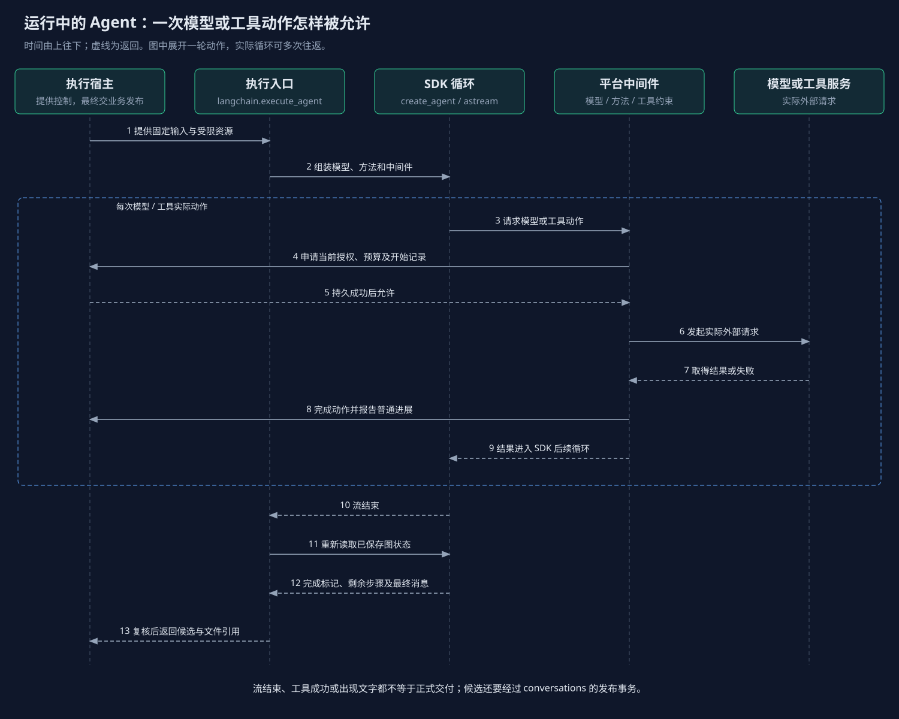

# 模型与工具执行循环

本模块把已经准备好的输入交给模型，并驱动「模型决定下一步 → 使用获准方法或工具 → 模型继续回答」的执行循环。这里的运行中 Agent 是一个程序实例；员工目录中的 Agent 是被它读取的岗位配置。

例如整理材料时，程序先提供岗位指令、历史和可用资源；模型可直接回答，也可读取方法、调用工具取得材料，再继续生成。模块最终返回候选正文、用量及已保存文件引用，由对话业务完成正式交付。

## 模块设计



图展示 SDK 循环与宿主控制的结构关系。返回候选前另核对保存状态和输出文件；下排控制接口是同进程受信边界，不是进程隔离。 [PNG 导出](diagram/module-design@2x.png)。

### 输入是已经确认的工作，不是整个平台服务

调用方传入 `AgentRequest`，其中有本轮固定配置、消息及稳定输入/输出消息标识、模型参数、预算和恢复引用。固定配置称为 `AgentSnapshot`，记录接受时的方法及资源依据。额外能力通过 `RuntimeResources` 注入，例如读取输入文件、保存来源/输出、读取技能字节、调用 MCP 和申请沙箱。

`RuntimeControl` 是向执行宿主申请动作、报告进展和通知存档的受限接口。程序不取得业务数据库或用户服务；需要继续调用时，必须再次通过宿主检查。这样模型 SDK 的内部变化不会直接改变用户、员工或消息表。

### 程序怎样组装起来

`langchain.execute_agent` 先调用 `prepare_skills`，把可用方法主文和文件依据准备一次，使技能中间件与实际可读文件一致。`WorkspaceBackend` 把输入、方法、来源、工作文件和成果映射到受许可限制的路径，按模式选择虚拟工作区或沙箱文件适配。

随后创建受管理的模型客户端，组合模型执行、方法加载和工具执行中间件，调用 LangChain 的 `create_agent`。系统指令由岗位输入加本轮获准工具指引及已确认服务说明组成；完整工具定义来自同一份固定依据。DeepAgents 提供文件/方法相关能力，平台额外施加授权、预算和资源策略。

### 一次模型与工具往返

1. 模型中间件选取当前允许使用的历史和本轮消息，计算包含工具定义的上下文大小，再向宿主申请模型动作。预算与开始记录成功后才发请求。
2. 模型若产生工具请求，工具执行中间件校验本轮操作，申请工具动作和范围许可，调用注入资源并保存结果。方法读取由技能加载规则识别，支持文件按固定清单校验。
3. SDK 把工具结果送回模型，继续下一轮。流解析器只把模型文字/思考转成普通内容更新；工具返回的技能主文不会被当作员工回答展示。
4. 最后一次结果必须是有正文且没有待执行工具请求的模型消息。程序还核对已保存状态的本轮完成标记及剩余步骤，重新检查当前许可、网页读取证据并收集输出引用，然后返回候选。

流结束只是传输结束。当前实现重新读取已保存 SDK 状态确定完整结果，避免最后一段事件缺失或只剩工具请求时误判成功。上下文、次数和递归限制失败会转为平台运行错误，供宿主统一收束。



这张时序图把「SDK 循环」展开到一次真实动作，显示宿主记录成功后才执行，以及流结束后重新核对完整状态的位置。[PNG 导出](diagram/action-sequence@2x.png)。

### 工作区、来源与恢复各自保存什么

技能目录保存只读方法及支持文件；输入路径只暴露明确选择的材料；来源保存本轮取得的证据；工作区允许中间操作；输出目录用于收集候选成果。虚拟路径不等于任意宿主路径，命令执行另经已验收沙箱。

checkpoint 保存 SDK 的消息、执行位置与完成依据；`checkpoints.py` 以运行标识隔离并通知宿主存档引用。它帮助继续原处理，不替代正式消息历史。候选只携带已经保存的输出引用，是否关联到回复仍由对话发布检查。

## 目录与职责

```text
agent_runtime/
├── contracts.py                   # 约定固定配置、执行请求、候选结果及宿主控制接口，校验持久输入的必需结构
├── langchain.py                   # 组装方法、工作区、模型与中间件，启动或恢复 SDK 循环，核对完整状态后返回候选
├── middleware.py                  # 在模型请求前筛选上下文并申请实际动作，记录模型结果、次数和用量，组合 SDK 中间件
├── streaming.py                   # 将 SDK 模型片段和完整消息归到实际动作，合并文字/思考并生成有界普通内容更新
├── skill_loading.py               # 生成可发现的方法文件，控制按需/预加载及真正激活，检查本轮定义和支持文件依据
├── resources.py                   # 定义注入的工具调用、文件保存/读取、技能字节与沙箱句柄，让执行不直接访问业务服务
├── tool_calls.py                  # 把已获准操作暴露给 SDK，校验请求，申请工具动作并执行和保存结果
├── tool_results.py                # 分段提供本轮长结果，核对外部阅读证据，使搜索摘要、网页正文与失败来源有明确区别
├── workspace.py                   # 把方法、输入、来源、工作及输出组织成受权限限制的文件视图，并收集成果引用
├── sandbox_backend.py             # 将文件/命令操作转到 OpenSandbox，投递已激活方法，限制日志并取回输出
└── checkpoints.py                 # 按 Run 读写 SDK 状态、保存引用和可信完成标记，使恢复与产品历史分开
```

## 与其他模块协作

[conversations](../conversations/README.md) 准备请求和资源，最终发布候选；[execution](../execution/README.md) 提供控制接口和预算，决定工作是否仍可继续；[llm](../llm/README.md) 只用明确参数创建模型客户端。

工具、文件、技能和沙箱通过注入接口消费，各资源的业务归属仍在原模块。SDK 消息及图状态留在这里，跨边界仅交换普通内容、动作请求和结果。管理 API 不会因为存在就自动成为模型工具，服务说明和技能正文也不授予许可。

## 维护与验证

固定输入的协议和恢复资格由业务准备与宿主共同核对；本模块只在获准范围内读取可信存档。SDK 完成与业务交付的关系见[运行分工](../../../docs/architecture/agent-runtime.md)，工具和工作区规则见[工具契约](../../../docs/reference/agent-tools.md)。

阅读实现可从 [langchain.py](langchain.py) 下钻到 [middleware.py](middleware.py)、[tool_calls.py](tool_calls.py) 和 [workspace.py](workspace.py)。[运行边界测试](../../tests/test_runtime_boundaries.py)及[工具运行测试](../../tests/test_capability_runtime.py)覆盖输入、动作与候选边界；真实模型和沙箱部署需另验。


知识由knowledge.py注册search_knowledge/read_knowledge_source，宿主门仍通过tool_calls.py执行；always在首次进图前使用固定的受管预检索动作，恢复复用结果前仍授权。RuntimeResources只注入调用和引用验证操作，适配器不导入知识ORM或自行读取任意文档。当前个人目录和提示规则只辅助模型选择，真正范围与证据权限留给知识服务，发布事务再次验证来源。
