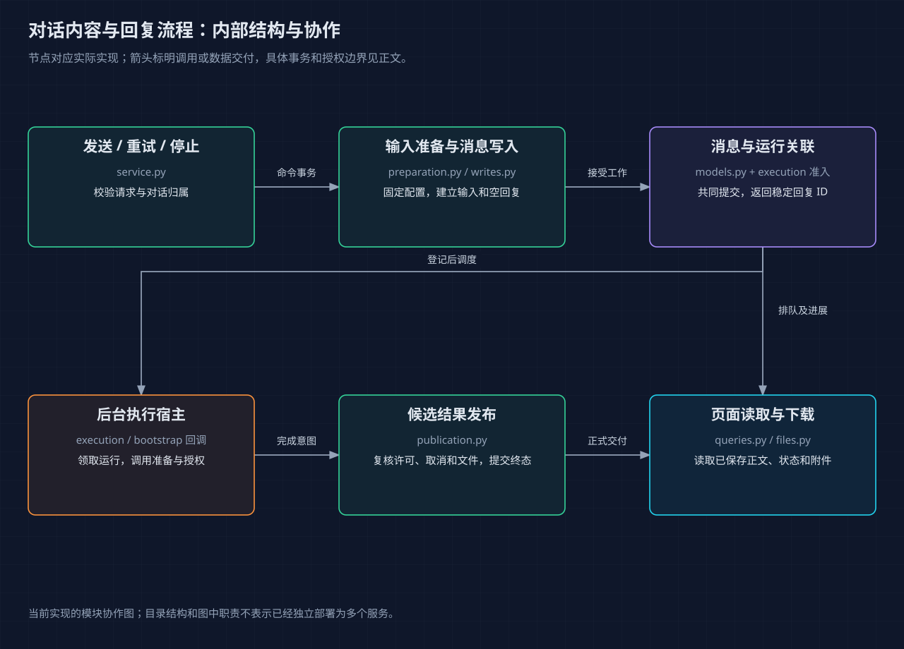

# 对话内容与回复流程

用户向一位员工连续提问形成一段对话。本模块保存这段交流的归属、输入和回复，也负责将一次处理从「请求已接受」推进到「结果正式交给用户」。它是发送、历史、停止、重试和文件交付的业务入口。

## 模块设计



箭头表示一条用户输入从接受到读取的业务链。准备、授权和发布由启动装配注入后台；跨模块网络执行发生在写事务之外。 [PNG 导出](diagram/module-design@2x.png)。

### 消息与处理尝试怎样关联

`Conversation` 表示一名使用者与一位员工的交流容器；`Message` 是一条输入或一份回复；`Run` 是系统处理输入的一次尝试，其调度状态由 execution 维护。`ConversationRun` 把一个运行明确关联到输入消息和回复消息，并记录是否仍占用这段对话。`MessageFile` 关联消息附件。

接受时就创建正文为空的回复，因此排队阶段也有稳定的观察、停止目标，`response_id` 就是这条助手消息的 ID。失败重试沿用原输入，新增一份运行与回复，原过程保留；消息与运行不能按「相邻两条」或同一个 ID 随意配对。

选取成功历史问答后，queries.context_sources只按本对话实际选入的回复ID取得来源Run。knowledge重新核验允许沿用的来源，接受事务把这些证据登记到新Run，并由writes记录“核对历史知识来源”动作；该动作代表接受时的实际核验，不表示新检索。SDK获得重新核验的原文片段，失效引用从送模副本清理，原始历史消息仍保持不可覆盖。相关规则见[知识契约](../../../docs/reference/knowledge.md#员工个人装配与正式问答)。

### 接受事务固定什么

`service.submit` 先核对请求标识：同一用户、同一操作的相同请求可以返回原接受结果，内容不同则冲突。随后检查容量、对话归属和活动占用，调用 `preparation.prepare` 取得当前员工、规则、可用方法及模型/工具依据，捕获已选择文件并按预算选择历史上下文。

`writes.py` 在当前事务内创建或复用输入，准入服务登记 Run，随后绑定空回复和运行。所有记录共同提交才返回接受结果。模型调用尚未发生；接受成功表示后端承担了处理责任，不代表生成已经完成。

### 准备、授权与发布怎样接入后台

应用启动时把本模块的准备、授权和发布能力注入执行协调器。准备流程检查快照结构及协议，解析指定版本的模型凭据，提供按本轮资源构造的执行函数；授权流程组合当前会话、员工状态、方法关系及模型/工具版本检查。

Agent 返回正文和文件引用后，`publication.py` 先检查运行是否仍活动、是否已取消和当前许可，再检查每个输出的运行归属、用户归属、用途及内容摘要。随后在一个事务内写入正文、消息文件关联、终态和占用释放。发布失败时不会留下「运行成功但成果没有交付」的公开状态。

### 读取为什么单独组织

页面同时需要正文、排队/执行状态、用量、动作及可重试资格。`queries.py` 将消息和运行记录组成统一回复视图，历史、单回复、提交核对和 SSE 使用相同含义；SDK 恢复存档不参与页面历史。文件下载由 `files.py` 检查当前对话范围，再让文件服务读取字节。

## 目录与职责

```text
conversations/
├── models.py                      # 保存对话、输入/回复消息、运行关联与附件关系，用约束保持消息顺序和单活动运行
├── schemas.py                     # 定义发送接受结果、对话快照及统一助手回复视图，让历史、核对与观察返回一致结构
├── service.py                     # 组织创建、发送、重试和停止事务，将输入、固定依据、运行及回复关系一起接受
├── writes.py                      # 在调用方事务内创建消息、绑定运行并写入最终正文，不另行提交
├── preparation.py                 # 接受时组合岗位、全员规则和资源快照，启动时校验并生成带当前模型参数及资源的执行函数
├── authorization.py               # 将当前身份、员工装配、模型版本和已用工具检查组合成运行及发布可复用的授权入口
├── publication.py                 # 接收完成意图，检查取消与交付文件，在共同事务内保存正式正文、文件关系和运行终态
├── queries.py                     # 按访问范围组织列表、连续历史、可见问答导航、预览及回复快照，并计算当前重试资格
└── files.py                       # 检查某文件能否被当前对话列出或下载，并为后台清理提供业务保留关系
```

## 与其他模块协作

本模块组合 [agents](../agents/README.md)、[skills](../skills/README.md)、[organization_rules](../organization_rules/README.md)、[model_connections](../model_connections/README.md) 和 [tools](../tools/README.md) 的资源依据，使用 [execution](../execution/README.md) 的准入和运行契约，通过 [agent_runtime](../agent_runtime/README.md) 执行。

执行宿主不反向导入对话模型，靠 bootstrap 注入回调完成协作。文件字节和配额归 [files](../files/README.md)，附件可见性与交付位置归本模块；API 负责网络传输，前端负责交互和观察。

## 停止、重试与兼容

停止是显式命令：排队时可直接取消，运行中写入取消意图，由宿主收束，取消优先于迟到成功。断开 SSE 只释放观察。重试要求最后一次处理处于允许的失败、取消或中断状态，按当前配置重新接受并保留原输入；不能恢复已退役的历史试验。

运行准备的模型连接、checkpoint 和执行回调为必需构造参数，执行输入由有类型的 RunSpec 构造并纳入 mypy；资源可选入口在使用前确认已装配。运行准备只接受受支持快照，识别旧协议不代表重新开放退役工作。正式运行、文件与恢复语义见[运行契约](../../../docs/reference/runtime.md)、[对话契约](../../../docs/reference/conversations.md)及[文件与交付](../../../docs/reference/agent-tools.md#文件与交付)。实际实现可沿 [service.py](service.py) → [preparation.py](preparation.py) → [publication.py](publication.py) 阅读，关联验证见[对话测试](../../tests/test_conversations.py)和[运行边界测试](../../tests/test_runtime_boundaries.py)。

个人知识装配由knowledge独立维护。preparation接受其目录快照、增加运行使用说明并注入knowledge回调；authorization复核Run拥有者、发起者、个人装配及已取得证据。publication在最终写事务中再次调用注入的prepare_content，以knowledge完成后的正文发布，不能让替代SDK执行器绕过来源校验。该入口只对精确证据链接补回遗漏的根斜杠，不改写模型自然语言。模型仍可能推理错误，发布验证不宣称语义结论正确；规则见[知识契约](../../../docs/reference/knowledge.md#员工个人装配与正式问答)。
