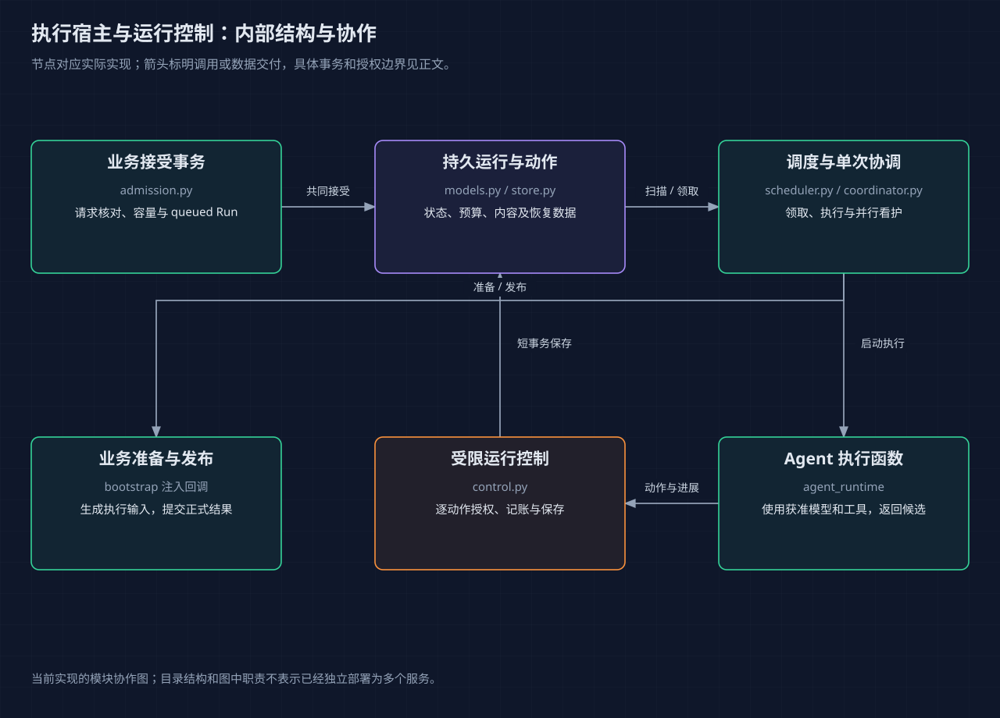

# 执行宿主与运行控制

用户的请求被接受后，即使浏览器离线，后端也必须知道它是在排队、正在处理还是已经结束。执行宿主负责这份持续处理责任：分配容量、调度运行、限制动作和预算、响应停止，并在失败或重启时给出明确状态。

一次处理尝试称为运行（Run）；其中实际开始的模型、方法或工具操作称为动作（RunAction）。业务内容和成果交给哪条消息，由对话模块决定。

## 模块设计



箭头表示运行生命周期中的调用与数据交付；业务回调由启动时注入。模型和工具执行在数据库事务之外，持久状态通过 store 更新。 [PNG 导出](diagram/module-design@2x.png)。

### 准入与执行分为两个阶段

`admission.py` 在业务服务已有的事务中核对请求标识和摘要、检查容量并创建待处理运行。它参与接受事务，不创建后台任务。这样消息、运行及关联一起提交，调度器只会看到已经接受的工作。

`scheduler.py` 持有当前数据目录的宿主锁，启动时处理恢复记录，随后按并发限制扫描队列并看护运行任务。`coordinator.py` 负责其中一次运行：检查当前授权，领取记录，调用准备回调取得执行函数，再建立运行控制对象和看护任务。当前是同进程单宿主，锁不提供跨主机租约。

### 控制对象怎样约束实际调用

Agent 通过控制接口申请模型或工具动作。`control.py` 将请求交给 `store.py`，在短事务内复核当前授权、检查预算并保存开始记录；提交成功后才允许外部调用。返回后再完成动作、保存用量和必要内容。未报告的用量保持未知，失败尝试不会因为重启或异常自动退还预算。

运行控制只接收普通内容更新。它缓冲并按频率刷新进展，使每个文字片段不必单独打开写事务；SDK 工具消息怎样编码、何时形成完整回答，由 agent_runtime 解释。公开过程由对话查询从已保存动作组织，不从模型自述猜测执行。

### 为什么同时运行执行任务与看护任务

模型/工具请求可能长时间等待。协调器在执行的同时检查取消、授权、期限和保存状态；任一条件失效都可阻止继续。执行和看护几乎同时结束时，已保存的停止或存储错误优先，避免迟到结果把取消改成成功。

协调器最终生成完成意图，交给注入的业务发布回调。存储失败时停止后续动作并让宿主降级，而不是绕过数据库宣布成功；业务发布负责最终正文、附件与终态的一致提交。

### 状态与恢复的含义

正常主路径是 `queued → running → succeeded`；停止可经过 `cancelling → cancelled`，错误或无法继续时进入相应失败/中断终态。运行状态保存在数据库，HTTP 连接只观察它。

重启恢复先处理取消，再检查快照协议和接受时的恢复标记。符合条件的运行回到队列，控制对象从持久动作恢复计数、用量及已激活方法；准备流程继续核对存档和授权。捕获外部 MCP、不可重放原生操作或沙箱配置的运行，在接受时就禁止自动恢复，不能只因尚无工具动作而认定安全。

## 目录与职责

```text
execution/
├── models.py                      # 保存运行状态、输入与配置依据、预算计数和实际动作，约束同一尝试的持久事实
├── contracts.py                   # 约定接受数据、准备后的执行函数、宿主就绪状态和完成意图，使业务与执行交换普通数据
├── admission.py                   # 在业务接受事务中核对请求摘要、返回同键记录、检查容量并登记待处理运行
├── scheduler.py                   # 管理单宿主进程锁、启动恢复、队列扫描、并发运行任务及停服等待
├── coordinator.py                 # 驱动一次运行，组合准备、控制、并行看护、超时和结果发布，处理停止与完成竞争
├── control.py                     # 把 Agent 的动作申请和内容更新转成受控存取，缓冲进展并恢复已用预算
├── store.py                       # 在短事务中领取、转移状态、保存动作和进展，向控制对象返回可恢复的普通数据
├── queries.py                     # 为受信协作核对运行存在性与资源范围，产品消息视图继续由对话模块组织
├── errors.py                      # 把运行失败原因归为公开代码、提示和终态，单独表达发布存储失败
└── config.py                      # 定义容量、各类预算、并发、检查频率和期限，供准入、协调与看护共同使用
```

## 与其他模块协作

[conversations](../conversations/README.md) 使用准入并提供准备、授权、发布能力；bootstrap 创建具体对象后将回调注入宿主。宿主不直接导入对话 ORM 或 HTTP 实现，因此换接入方式不需要让运行器理解 Cookie 或路由。

[agent_runtime](../agent_runtime/README.md) 调用受限控制协议并返回候选，执行核心不解析 SDK 消息。数据库提供短事务，具体业务规则留在授权与发布回调。同库引用和锁限制是当前部署条件，拆出独立 worker 需重新设计领取、租约、发布和恢复。

## 实际动作

动作开始记录表示平台已经允许并开始一次实际尝试；工具请求只是模型意图，成功激活的方法才进入后续授权集合。工具重放还需核对调用指纹、绑定、当前许可及已保存结果，无法确认的外部结果不能当作未执行。

完整状态及恢复语义见[运行契约](../../../docs/reference/runtime.md)。[执行边界测试](../../tests/test_execution_boundaries.py)核对依赖方向，[运行边界测试](../../tests/test_runtime_boundaries.py)覆盖保存失败不调用模型及候选/交付隔离，[checkpoint 测试](../../tests/test_checkpoint_runtime.py)覆盖进程恢复。
