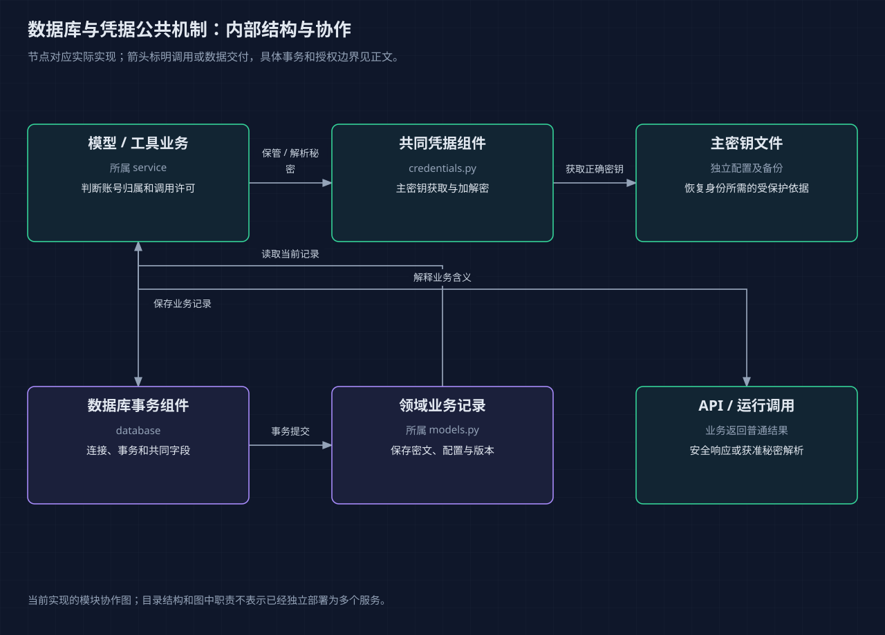

# 数据库与凭据公共机制

公共基础设施支持业务保存数据和保管外部身份：数据库事务让一组记录共同提交，凭据组件把模型/工具秘密加密存储。这里维护技术机制，员工是否可编辑、账号属于谁等判断由业务模块完成。

## 模块设计



箭头表示业务对公共机制的使用。密钥文件、数据库记录和 HTTP 响应属于不同边界，基础设施不统一它们的业务归属。 [PNG 导出](diagram/module-design@2x.png)。

### 两种机制共享哪些责任

数据库组件管理连接、事务、共同字段与驱动错误；凭据组件管理主密钥获取、加密及解密。它们共同提供可复用机制，但没有共同的业务生命周期：删除一个模型连接不意味着删除主密钥，更换工具账号不意味着重新创建数据库。

模型连接和工具账号各自调用 `CredentialVault`，把返回密文随所属业务记录保存，执行时在获准路径解析秘密。加解密故障由调用方转换为模型或工具的业务错误；基础组件不能自行生成含业务含义的提示，也不能把原始秘密或密文当作安全响应。

### 配置、备份与反向依赖

主密钥文件和业务库分别配置及备份。已有密文而正确密钥丢失时，重新生成密钥不能恢复原身份，必须明确失败。业务恢复需要同时核对数据库、对应密钥和文件资产，而不是仅复制源代码。

基础设施不导入业务服务。数据库模型注册为迁移发现元数据会反向导入领域模型，这是限定装配关系；业务仍从所属模块导入模型。技术错误的分类、业务含义和 HTTP 状态分层处理，避免基础层依赖产品术语。

## 目录与职责

```text
infrastructure/
├── concurrency.py                 # 等待已启动同步工作结束后再取消或释放，不解释业务并发政策
├── settings.py                    # 正数配置校验与环境值解析；默认值及业务含义仍由所属模块定义
├── credentials.py                 # 读取受管主密钥并进行凭据加解密，返回技术结果，由模型/工具模块决定业务错误
└── database/
    └── README.md                  # 进入数据库子模块说明，了解连接、短事务、写入资格、字段、错误识别和模型注册
```

## 与其他模块协作

[model_connections](../../../docs/reference/model-connections.md) 和 [tools](../mcp/README.md) 消费共同凭据机制，各业务服务消费[数据库子模块](README.md)。bootstrap 组合具体路径并创建组件，API 继续负责安全响应，基础设施不自行决定资源权限。

## 维护入口

路径与备份规则见[后端操作](../../../docs/guides/backend-operations.md)，业务错误与机制的对应关系分别在模型/工具 README 维护。数据库测试覆盖共同存储，凭据恢复还需要对应业务的密钥失效场景。

## 执行日志关联

observability 在原 logging 上增加核心执行事件的轮转 JSONL 输出与有界查询，复用 run_id/action_key；不保存正文、异常字符串或任意参数，不新增业务表。失败不阻断执行。见[契约](../../../docs/reference/runtime.md)。

## 取消与线程等待

[concurrency.py](concurrency.py) 的 run_sync/settle 只处理 asyncio 与工作线程的取消顺序，供 execution 和 agent 共用，不访问 Run、数据库、账号或预算。线程被取消等待并不停止其同步操作，因此等待其结束后才能释放资源或事务。队列容量、预算和同一 Run 去重仍由 execution 负责；这也是该公共机制归 infrastructure 的依据。
