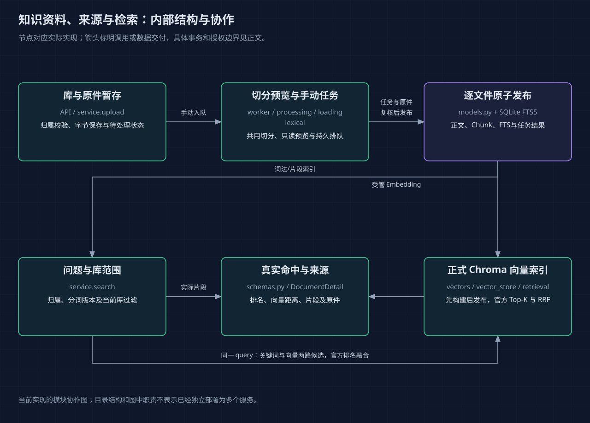

# 知识资料、来源与检索

本模块把用户上传的资料保存成可核对的固定正文和片段，提供限定在本人知识库内的关键词、向量及混合检索，并独立管理用户为员工装配的私人资料范围。员工运行通过注入操作取得本轮证据和来源，模型回答仍由运行模块负责；资料建设和检索服务不承担模型生成。

目录同时保留独立检索实验，用于向量、混合检索和带引用回答验证。产品入库链路与实验发布链路共用来源和切片结构，但拥有不同存储及授权入口。

## 模块设计



图聚焦文本入库与检索数据流；右下角是独立实验分支，没有与员工对话或产品向量检索相连。员工装配与运行协作见后文。 [PNG 导出](diagram/module-design@2x.png)。

### 库、原件、固定正文和片段怎样关联

`KnowledgeBase` 归当前用户所有，`LibraryDocument` 关联库、文件服务原件、内容摘要和固定正文快照，`LibraryChunk` 保存有位置的片段。正文用 `KnowledgeDocument` 表达，来源区间和片段带稳定标识，使检索命中能回到具体文档和正文位置。

原件是上传字节，固定正文是解析后的文本，片段是检索/阅读单元，索引是由片段派生的查询副本。不能以第一次文本匹配猜来源位置，也不能把索引当成原文的唯一副本。库的访问在业务入口严格按所有者检查，管理员身份也不自动跨用户读取。

### 原件上传与手动处理怎样衔接

API先检查库归属，再有界接收不超过128 KiB的UTF-8 Markdown/TXT。service校验编码与内容、保存原件和去重关联，返回待处理状态；上传阶段不切分或调用模型。未处理详情的正文为null，原件仍可下载。

loading保留章节父标识与完整路径，chunking仅将同父相邻短章节组成受限组，再按原文连续区间切分。合并片段用多个SourceSpan覆盖来源，不以标题文字或首次文本匹配猜位置；不同父、长章节和顶级主题不合并。默认阈值可按库覆盖或由本次任务临时指定，0关闭。

processing提供只读分页预览，并接收手动处理批次，冻结最终字符规则与原件摘要、拒绝同文件重复活动任务。worker由bootstrap生命周期持有并加进程锁，逐项领取；文件读取、loading.text_document、LangChain切分和中文分词在事务外完成。提交前复核任务及文件仍有效，再在同一写事务发布该文件正文/Chunk/FTS和完成状态。

预览和后台复用prepare入口，计算每份原件的完整统计，最多返回20片段一页；不发布索引或创建任务，提交明确规则后冻结同一参数。5000片段的计算上限避免极端重叠放大内存。

成功文件立即可查，批次不构成统一发布开关。重处理失败保留旧版，成功才切换关键词内容并清除该文件旧向量。排队项跨重启保留，原执行中项明确中断后可手动重试；删除或取消使迟到结果无法提交。并发重复上传留下的未关联暂存原件走files清理，已关联原件受到保留查询保护。单纯修改库名称、用途或默认覆盖不重建索引。

### 检索如何限定范围和解释结果

问题由 `lexical.py` 使用固定的中文分词规则转换成查询词。服务先确认库归属及已入库分词版本，再在当前库范围连接 FTS5、片段及文档，按实际 BM25 分数和稳定片段标识排序，返回排名、分数与片段。

BM25 分数越小越靠前，是当前词法排名依据，不是模型置信度。结果包含库和文档来源；分词规则/词典版本改变时明确提示索引过期，不能静默混用不一致依据。移除文档在共同事务中删除索引和片段/文档关系，文件原件随后按正常保留策略处理。

来源卡片通过service.citation_preview只读一个当前片段，校验库所有者、文档归属及固定正文版本，返回有界标题、章节、最多600字符摘录和精确原文链接。它不进入模型补读工具或通用文件下载，也不因浏览回答就读取所有原文；不存在、错配或已重处理的片段返回404。接口边界和测试见[知识契约](../../../docs/reference/knowledge.md#身份与接口)及[片段预览测试](../../tests/test_knowledge_citation_preview.py)。

### 员工如何使用本人资料

`EmployeeKnowledgeService`拥有用户/员工唯一设置、选库关系及Run范围证据。共享员工不拥有私人资料；个人装配不修改员工System Prompt或公共资源数量。保存时验证所有选库均为本人所有，使用独立revision保护；接受任务时捕获目录与召回配置，通过会话装配点提供给运行模块。

运行侧注册真实知识工具并走宿主预算、授权和动作记账，knowledge仅接受隐藏身份与范围已经确定的Run。每库检索复用现有search服务，auto仅在向量未就绪时使用BM25；真实上游错误明确返回失败。跨库按名次融合，受全局Top-K及约18KiB结果预算约束。未处理原件只有能力状态，不将全文送入模型。

命中登记固定Chunk快照及Run范围证据编号。补读只允许当前Run已登记片段，不进入通用files来源通道；每次使用及最终发布检查当前装配、所有权、文档版本和实际Chunk快照。即使文档version未变，规则重切或Chunk被移除也使证据失效。finalize_answer仅为本轮编号和完整来源逐字配对的Markdown链接补回遗漏的根斜杠，再调用verify_answer；不允许sandbox协议、外站或其他相对前缀，编号与路径错配仍拒绝。模型动作保留原文，正式消息保存规范化正文；引用校验不证明自然语言结论得到充分支持。

context.py处理连续追问的来源衔接。会话模块只交付实际纳入当前上下文的成功回复Run与正文，本模块再核对同用户、同员工、当前库范围及完整片段快照，按预算选取匹配的历史引用。接受事务把证据重新登记到本Run并冻结原文片段与来源Run；模型收到原文而非仅有旧回答摘要。失效引用仅从送模副本移除，已保存历史不变。接受后撤权或资料变化仍被每次动作及发布阻止。不会在最终答案中发现旧编号后才跨Run查找来源，也不额外调用模型或向量服务。

会话拥有者与发起者必须一致才能引入私人知识，防止管理员将自己的库内容写入他人会话。已有会话历史的管理员访问语义仍沿用会话模块。实施依据与验收从[员工知识方案](../../../docs/proposals/knowledge-assistant/employee-knowledge.md)及[服务测试](../../tests/test_employee_knowledge.py)进入。

### 实验核心验证另一条链路

实验 `loading` 支持受控 TXT/MD、文字 PDF 和 DOCX，`chunking` 固定来源，`indexing` 将同批原文、片段、FTS5 和 Chroma 向量绑定为发布，`retrieval` 支持词法/向量及按名次融合（RRF），`answering` 校验基于本次编号证据的模型回答，`evaluation` 独立计算覆盖。

这些实验不能把字符散列向量夹具当语义质量证明，也不能让 PDF/DOCX 加载器直接成为不可信上传入口。产品当前没有调用实验向量发布或问答流程；后续接入须定义权限、版本、任务取消、模型预算与最终交付。

## 目录与职责

```text
knowledge/
├── demo.py                        # 登记四份虚构技术资料与受控差旅样例，只供用户显式导入并复用普通入库服务
├── models.py                      # 保存用户知识库、原件关联、固定文档快照及有序片段，使归属、去重和来源关系可查询
├── schemas.py                     # 定义库/文档管理及 BM25 预览的输入输出，返回片段来源和实际分数，不伪装模型回答
├── service.py                     # 管理本人库、设置与原件暂存，提供读取/删除和限定范围的检索
├── employee.py                    # 维护个人员工装配、捕获目录、执行多库查询及本轮证据补读和引用复核
├── context.py                     # 重新核验选入上下文的历史引用，限定预算登记本轮证据并清理送模副本中的旧引用资格
├── processing.py                  # 共用只读预览与后台切分计算，持久记录批次、冻结规则、原子发布、取消和恢复中断
├── worker.py                      # 在lifespan内单文件消费持久队列，通过进程锁避免重复执行，停止时等待写入完成
├── vectors.py                     # 管理共享向量连接与快照，按当前文件片段计算实际覆盖并执行向量/混合查询
├── contracts.py                   # 定义固定文档、来源区间、片段、检索候选和回答结构，供产品与实验核对同一来源含义
├── loading.py                     # 校验正式MD/TXT并解析固定正文；另保留隔离实验文件Loader及来源位置
├── chunking.py                    # 按明确计长预算拆分固定正文，生成可重建来源区间和稳定片段
├── lexical.py                     # 共享中文词法规范化与版本依据，绑定分词器、词典和 SQLite 版本
├── indexing.py                    # 为独立实验生成并校验原文/片段/词法/向量发布，验证摘要和向量空间一致性
├── retrieval.py                   # 对实验发布执行词法、向量或融合检索，去重并组织有编号证据
├── answering.py                   # 调用实验回答模型并校验回答结构及引用，保留证据不足或非法引用失败
└── evaluation.py                  # 读取隔离评分材料计算检索覆盖，参考答案不进入检索或生成输入
```

## 与其他模块协作

API 的[知识路由](../api/routes/knowledge.py) 实施有界上传和下载协议；[files](../files/README.md) 保存原件，本模块提供保留关系，由 bootstrap 与对话保留查询合并。auth 提供 knowledge:use，库所有权在本模块进一步检查。

[前端知识页](../../../frontend/src/pages/knowledge/README.md) 和 KnowledgeStore 读取库、文档及检索结果，员工个人装配通过会话准备注入目录、知识工具与完成回调。Chroma实验后端不进入产品运行，正式向量由vectors.py处理。

## 当前容量与验证范围

当前代码限制每用户100库、每库200文档或5000片段，产品上传限UTF-8文本。个人员工装配最多10库，最终Top-K最多12；正式向量已接入硅基流动，员工问答支持受管来源引用。PDF/DOCX和Chroma仍按独立实验入口验证。源码装配不代表当前数据库已升级或目标环境已完成真实上游验收。

现行接口与边界见[知识库契约](../../../docs/reference/knowledge.md)，本机迁移和页面证据见[实施记录](../../../docs/records/knowledge-library.md)。产品行为与测试按[测试目录](../../tests/)核对，实验结果见[POC 记录](../../../docs/records/knowledge-poc.md)。下面命令属于实验，不是知识页面的入库步骤。

## 独立实验运行

在仓库根执行 `make verify-knowledge`，安装前需 `cd backend && uv sync --group knowledge-poc`。词表首次使用可能需要下载；离线测试本身使用注入计长器，不要求联网。

```bash
cd backend
uv run --group knowledge-poc python -m experiments.knowledge_poc smoke \
  --output /tmp/niuma-knowledge-poc
```

该命令使用真实 FTS5、Chroma 和 tokenizer，但向量由明确标注的字符散列夹具产生，只证明接线、持久化与开发题 BM25 诊断。`evaluate` 拒绝用夹具发布生成语义质量结果。

真实 Embedding 的非秘密配置结构见[示例](../../experiments/knowledge-embedding.example.json)。`api_key_env` 指向本机环境变量，文件不存 Key。当前实验适配 OpenAI-compatible Embedding API 与已声明兼容的 tiktoken 编码；其他 tokenizer 需显式适配，不能直接套示例。

```bash
uv run --group knowledge-poc python -m experiments.knowledge_poc evaluate \
  --output /tmp/niuma-knowledge-poc --embedding-config /absolute/path/embedding.json
```

可加 `--chat-connection-id <现有连接ID>` 调用已有聊天模型；这会向所选服务发送实际证据，运行者必须已授权该数据流。结果逐题保存，失败保留状态；未知用量不记零。`ask` 可对 smoke 发布单独运行 BM25 + 真实聊天验证，需要 release、connection ID 与 question；它不代表向量语义验证通过。

## 实验限制

实验文件来自操作者明确选择的受控样本，已有大小、PDF 页/内容流和 DOCX 展开限制，但没有不可信二进制解析所需的独立进程/硬回收保证。发布目录和共享向量目录分别保留；实验发布不能代替产品库事务、作业恢复或备份协议。

## 正式向量检索

vectors在写事务外调用llm/embeddings.py，复核来源与连接修订后将完整快照发布到SQLite，不启动Chroma。暂存原件不改变已有向量；删除只移除目标文件向量，关键词新代发布只清除该文件旧向量。部分文件仍有匹配向量时允许partial语义覆盖，页面明确数量。完整异步增量向量构建仍待后续，本期保留同步构建入口。详情见[现行契约](../../../docs/reference/knowledge.md#硅基流动向量接入)。

混合检索复用产品 BM25 与向量查询，在查询向量返回后的同一读取事务取各前 30 候选，以等权 RRF（k=60）融合去重。当前接口、就绪要求和限流见[知识库契约](../../../docs/reference/knowledge.md)。
