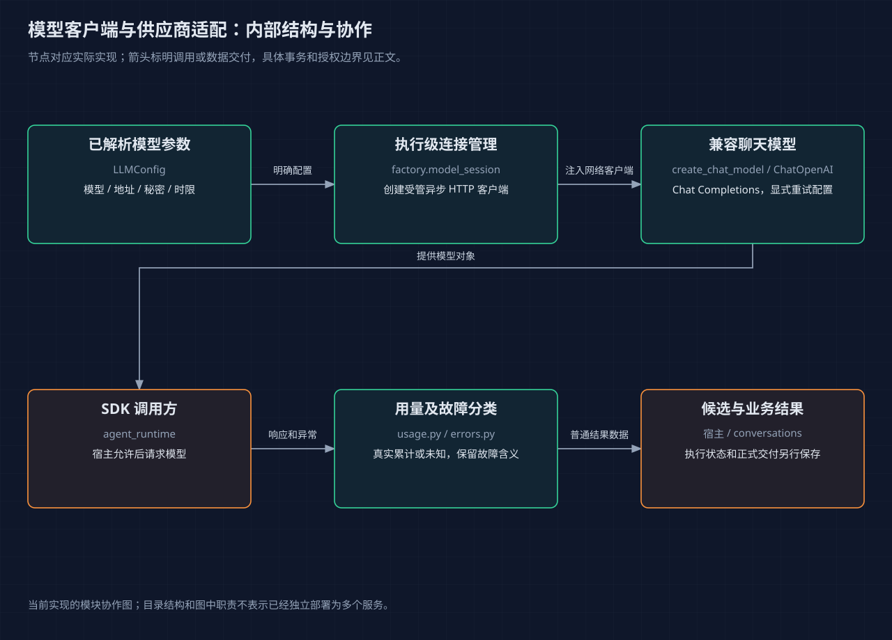

# 模型客户端与供应商适配

本模块使用明确的模型地址、模型标识和凭据创建聊天客户端，并解释供应商故障与用量。它是数字员工生成内容所需的技术接入，不保存岗位或账号，也不决定是否允许运行。

## 模块设计



箭头表示模型接入的数据交付，不是新的业务编排层；客户端生命周期覆盖一次 Agent 执行，动作预算由宿主控制。 [PNG 导出](diagram/module-design@2x.png)。

### 连接参数先解析，模型工厂再构造

模型连接服务检查当前授权与版本，解析秘密并生成不可变 `LLMConfig`。配置中的 `SecretStr` 减少常规打印暴露凭据，但不是加密存储；密文保管在 model_connections。

`factory.py` 根据这份参数构造 ChatOpenAI，当前采用兼容 Chat Completions 协议。新增非兼容供应商需要新适配，客户端可配置地址不代表平台管理界面已开放任意服务。

### 网络客户端为什么跟随一次 Agent 执行

`model_session` 为一次 Agent 执行创建受管理的异步 HTTP 客户端，传给模型工厂；这次执行可能有多轮模型请求。上下文结束或取消时关闭客户端，避免停止后连接仍占用资源。宿主负责逐次授权、次数和预算，SDK 默认重试为零，业务重试由调用方明确决定。

### 用量和失败怎样回到平台

`usage.py` 解析供应商实际报告的 token 用量并跨轮累计，某一累计字段缺失就保持未知，不用正文长度伪造消耗。`errors.py` 只把已知认证、限流、超时等供应商故障分类为平台运行错误，数据库或程序错误不包装成网络故障。

模型输出仍由 agent_runtime 解释并交给业务发布。当前不保留第三方非标准 `reasoning_content` 等字段，需要时应在模型适配明确接入，不能让执行核心解析供应商原始 JSON。

## 目录与职责

```text
llm/
├── config.py                      # 定义不可变模型参数及受保护的秘密表示，使调用方显式选择连接而不是工厂查库
├── factory.py                     # 构造兼容聊天模型，为一次 Agent 执行创建和关闭受管 HTTP 客户端，传递时限与输出上限
├── usage.py                       # 解析并累计供应商实际报告的用量，保留缺失字段和未知尝试，供运行计费/展示使用
└── errors.py                      # 识别已知供应商失败类别并保留未知异常，让宿主按真实原因收束
```

## 与其他模块协作

[model_connections](../model_connections/README.md) 决定参数来源、版本和秘密；[agent_runtime](../agent_runtime/README.md) 使用模型并解释消息；[execution](../execution/README.md) 逐动作记账及收束。工厂只依赖模型 SDK、HTTP 库与明确配置，因此可由脚本复用，无需加载平台数据库。

## 维护入口

模型协议的公开范围见[连接契约](../../../docs/reference/model-connections.md)，实际运行分工见[Agent 架构](../../../docs/architecture/agent-runtime.md)。[模型工厂测试](../../tests/test_llm.py)及[对话测试](../../tests/test_conversations.py)核对参数、流关闭、取消、传播和用量，不证明当前供应商连接可用。

## 文本向量客户端

`embeddings.py` 用明确的 `EmbeddingConfig` 创建 `OpenAIEmbeddings`：发送原文、限制批量与字节、校验向量数量/维度/数值，处理脱敏错误并关闭 HTTP 客户端。知识模块负责授权、模型修订、构建预算与原子发布，本模块不查库，不加载本地模型，也不以 OpenAI tokenizer 冒充 BGE 分词器。
