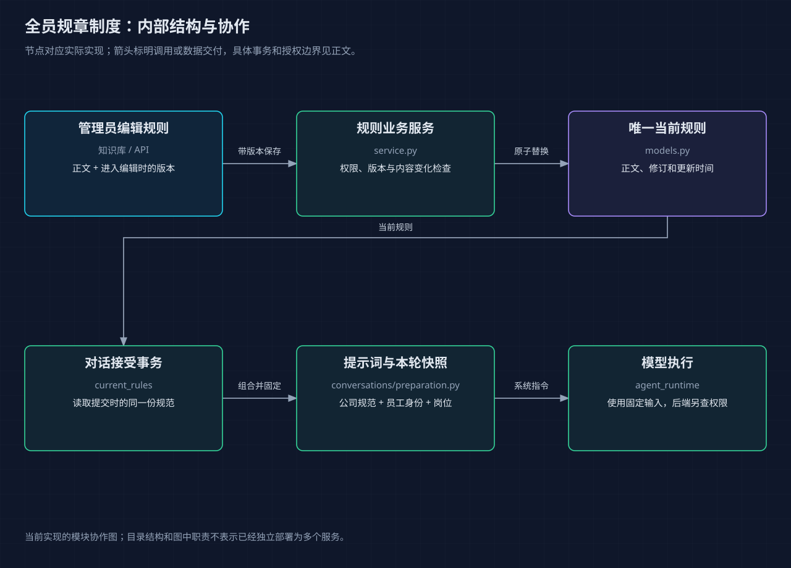

# 全员规章制度

规章制度是一份全体数字员工自动继承的工作规范。例如管理员希望所有员工标记未核实信息，可以统一维护一次。岗位工作指令仍定义各员工职责，员工不能把全员规则作为可选技能取消。

## 模块设计



箭头表示管理保存和提交时继承。规范不复制到每位员工，已接受工作不重新读取当前正文。 [PNG 导出](diagram/module-design@2x.png)。

### 保存的是一份当前规范

数据库保存唯一的规则记录、正文和版本。管理员读取当前正文，在保存时带上预期版本；`service.py` 在事务中核对权限与版本，再原子替换。内容未变不推进版本，旧稿冲突则保留客户端输入，让用户核对差异。

迁移创建主键为 1 的空记录。清空正文是合法操作，意味着不再加入公司规范这一段；记录缺失则是数据库异常，不能把故障默默当成无规则。

### 一份规范怎样影响所有员工

接受工作时，对话准备在同一事务调用 `current_rules`，把公司规范、员工身份和岗位指令组合成系统提示词，并固定正文及版本。这里管理规则，提示词组合属于掌握岗位和本轮输入的对话模块，组合函数只处理文字。

已经接受的工作使用固定输入，保存新规范不会中途改变它；已有对话的下一轮以及新建重试重新读取当前规则。这一生效时点使一次结果能对应明确规范，也让更新无需逐个改员工。

### 全员继承的范围

当前是一份部署级规则，没有部门覆盖或多租户层次。自然语言要求只能约束模型指引，真正的文件/工具权限仍由后端检查；规则不包含密钥，也不扩大岗位职责。公开读取及保存都检查业务能力，游客不能读写，获准运行的内部读取不要求使用者拥有规则管理权。

## 目录与职责

```text
organization_rules/
├── models.py                      # 保存唯一的全员规则正文及版本，保持部署内共同来源而不复制到员工
├── schemas.py                     # 定义规则读取和带预期版本的替换输入，让正文与并发保存依据分别明确
└── service.py                     # 检查管理能力、读取或原子替换规则，并为对话准备提供当前事务中的内部读取
```

## 与其他模块协作

知识页的[规则编辑器](../../../frontend/src/pages/knowledge/README.md) 通过 API 维护正文；[conversations/preparation.py](../conversations/preparation.py) 负责组合员工身份、岗位指令与规则并固定本轮输入。auth 提供操作能力，数据库提供共同事务，执行宿主只使用已固定依据。

## 维护入口

接口、前端冲突及生效时机见[规则契约](../../../docs/reference/organization-rules.md)。[规则测试](../../tests/test_organization_rules.py)及迁移/对话测试覆盖空规则、并发和输入组合。修改继承范围时需同时设计读取权限、覆盖顺序及运行快照。
