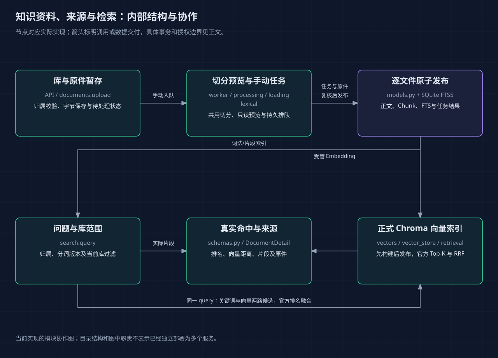

# 知识资料、来源与检索

本模块维护组织知识资料，将上传原件保存为可核对的固定正文和片段，提供关键词、向量及自动混合检索。员工模块维护固定选库范围与使用策略，执行宿主先确定授权范围，再通过只读 guard 使用本模块检索。员工运行通过注入操作取得本轮证据和来源，模型回答仍由运行模块负责；资料建设和检索服务不承担模型生成。

目录同时保留独立检索实验，用于向量、混合检索和带引用回答验证。产品入库链路与实验发布链路共用来源和切片结构，但拥有不同存储及授权入口。

## 模块设计



图展示产品入库与检索数据流，右下角为正式 Chroma 向量存储；独立 POC 的发布与问答不进入产品链路。员工装配与运行协作见后文。 [PNG 导出](diagram/module-design@2x.png)。

### 库、原件、固定正文和片段怎样关联

`KnowledgeBase` 是组织资产，`created_by_user_id` 只记录创建人用于审计、幂等及配额，`LibraryDocument` 关联库、文件服务原件、内容摘要和固定正文快照，`LibraryChunk` 保存有位置的片段。正文用 `KnowledgeDocument` 表达，来源区间和片段带稳定标识，使检索命中能回到具体文档和正文位置。

原件是上传字节，固定正文是解析后的文本，片段是检索/阅读单元，索引是由片段派生的查询副本。不能以第一次文本匹配猜来源位置，也不能把索引当成原文的唯一副本。管理员通过 `knowledge:manage` 管理全部组织库；成员的 `knowledge:use` 只允许员工受管查询与已授权 Run 的证据阅读，不能列库或直接读取任意文档。游客保留 `knowledge:read` 例外，可只读全平台知识资料、向量状态及处理记录，并使用关键词检索；写入和模型操作仍被拒绝。权限与页面行为见[身份契约](../../../../docs/reference/auth.md)。

### 原件上传与手动处理怎样衔接

API先检查管理权限及库存在，再有界接收不超过128 KiB的UTF-8 Markdown/TXT。service校验编码与内容、保存原件和去重关联，返回待处理状态；上传阶段不切分或调用模型。未处理详情的正文为null，原件仍可下载。

loading保留章节父标识与完整路径，chunking仅将同父相邻短章节组成受限组，再按原文连续区间切分。合并片段用多个SourceSpan覆盖来源，不以标题文字或首次文本匹配猜位置；不同父、长章节和顶级主题不合并。默认阈值可按库覆盖或由本次任务临时指定，0关闭。

processing提供只读分页预览，并接收手动处理批次，冻结最终字符规则与原件摘要、拒绝同文件重复活动任务。worker由bootstrap生命周期持有并加进程锁，逐项领取；文件读取、loading.text_document、LangChain切分和中文分词在事务外完成。提交前复核任务及文件仍有效，再在同一写事务发布该文件正文/Chunk/FTS和完成状态。

每份发布结果在processing_rules中记录有效规则、split_version及result_digest。摘要覆盖原件摘要、正文快照、有序片段及FTS行；读取时同时检查解析和词法版本，向页面投影processing_reusable。提交在同一写入资格下复核，完整且同条件的项直接记录reused，不入计算队列、不清除向量。缺少依据或损坏时重新处理，摘要不暴露到页面规则。批次成功统计包含reused。

预览和后台复用prepare入口，计算每份原件的完整统计，最多返回20片段一页；不发布索引或创建任务，提交明确规则后冻结同一参数。5000片段的计算上限避免极端重叠放大内存。

成功文件立即可查，批次不构成统一发布开关。重处理失败保留旧版，成功才切换关键词内容并清除该文件旧向量。排队项跨重启保留，原执行中项明确中断后可手动重试；删除或取消使迟到结果无法提交。并发重复上传留下的未关联暂存原件走files清理，已关联原件受到保留查询保护。单纯修改库名称、用途或默认覆盖不重建索引。

### 检索如何限定范围和解释结果

问题由 `lexical.py` 使用固定的中文分词规则转换成查询词。服务先确认管理权限或执行宿主提供的范围 guard，以及已入库分词版本，再在当前库范围连接 FTS5、片段及文档，按实际 BM25 分数和稳定片段标识排序，返回排名、分数与片段。

BM25 分数越小越靠前，是当前词法排名依据，不是模型置信度。结果包含库和文档来源；分词规则/词典版本改变时明确提示索引过期，不能静默混用不一致依据。移除文档在共同事务中删除索引和片段/文档关系，文件原件随后按正常保留策略处理。

管理侧 `documents.citation_preview` 仍可预览当前单片段，受管理/游客读取权限约束。成员回答来源通过执行侧 `knowledge_evidence.preview` 读取：先检查 Run 阅读权限与该 Run 登记证据，再核对原冻结范围、文档版本和完整 Chunk 快照。返回最多2000字符，不开放任意正文或原件下载。来源页和卡片使用 `/knowledge/sources/{run_id}/{evidence_id}`，详情见[知识契约](../../../../docs/reference/knowledge.md#回答来源与历史阅读)。

### 员工如何使用组织资料

选库关系、`mode` 和 `top_k` 属于员工配置，统一使用员工修订，捕获由 `employees.knowledge.capture_knowledge` 提供。旧个人设置模型、`assignments.py` 和个人 API 已删除；不再按当前用户覆盖员工范围，也不将算法保存为员工字段。资料处理与索引维护仍独立于员工的调用时机。

运行授权、跨库协调、Run 证据登记、历史引用与最终答案校验归[执行模块](../../runtime/execution/README.md#知识范围与运行证据)。资源查询接受明确库 ID、普通请求和只读 guard，每次读取或发布前调用 guard，随后在资源内部加载库记录；不会接收 Run 或工具反馈。`sources` 只根据普通来源值核对文档版本与完整片段。

### 实验核心验证另一条链路

实验 `loading` 支持受控 TXT/MD、文字 PDF 和 DOCX，`chunking` 固定来源，`indexing` 将同批原文、片段、FTS5 和 Chroma 向量绑定为发布，`retrieval` 支持词法/向量及按名次融合（RRF），`answering` 校验基于本次编号证据的模型回答，`evaluation` 独立计算覆盖。

这些实验不能把字符散列向量夹具当语义质量证明，也不能让 PDF/DOCX 加载器直接成为不可信上传入口。产品当前没有调用实验向量发布或问答流程；后续接入须定义权限、版本、任务取消、模型预算与最终交付。

## 目录与职责

```text
knowledge/
├── samples.py                        # 登记四份虚构技术资料与受控差旅样例，只供用户显式导入并复用普通入库服务
├── models.py                      # 保存组织知识库、原件关联、固定文档快照及有序片段，使归属、去重和来源关系可查询
├── schemas.py                     # 定义库/文档管理及 BM25 预览的输入输出，返回片段来源和实际分数，不伪装模型回答
├── libraries.py                   # 维护库、规则和只读库概要
├── documents.py                   # 原件暂存、文档读取、预览、删除与样例导入
├── access.py                      # 管理与游客读取库的权限和存在性
├── search.py                      # 单库检索策略与受控查询
├── sources.py                     # 当前来源、片段与索引有效性
├── references.py                  # 文档文件保留、向量连接占用的具名只读查询
├── processing.py                  # 共用只读预览与后台切分计算，持久记录批次、冻结规则、原子发布、取消和恢复中断
├── worker.py                      # 在lifespan内单文件消费持久队列，通过进程锁避免重复执行，停止时等待写入完成
├── vectors.py                     # 捕获来源与模型依据，构建并发布当前索引，核验查询及有效覆盖
├── vector_store.py                # 持有 Chroma 客户端和单进程目录锁，执行官方 Top-K、删除与延迟回收
├── retrieval.py                   # 调用官方 EnsembleRetriever 融合可信候选，不重复计算 RRF 分数
├── contracts.py                   # 定义固定文档、来源区间、片段、检索候选和回答结构，供产品与实验核对同一来源含义
├── loading.py                     # 校验正式MD/TXT并解析固定正文；另保留隔离实验文件Loader及来源位置
├── chunking.py                    # 按明确计长预算拆分固定正文，生成可重建来源区间和稳定片段
├── lexical.py                     # 共享中文词法规范化与版本依据，绑定分词器、词典和 SQLite 版本
└── __init__.py                    # 标记知识模块；独立实验实现位于 experiments/knowledge_poc
```

## 与其他模块协作

API 的[知识路由](../../api/routes/knowledge.py) 实施有界上传和下载协议；[files](../files/README.md) 保存原件，本模块提供保留关系，由 bootstrap 与对话保留查询合并。auth 提供 knowledge:manage、knowledge:use 与游客 knowledge:read；本模块检查管理权限和库状态，执行侧负责 Run 范围。

[前端知识页](../../../../docs/reference/knowledge.md) 和 KnowledgeStore 读取库、文档及检索结果，员工模块提供统一知识配置，执行侧捕获目录并组合运行范围、知识工具与证据能力。正式向量由 vectors.py 管理构建与发布，vector_store.py 调用 Chroma 公开存储接口；实验使用独立目录。

## 当前容量与验证范围

当前代码限制每用户100库、每库200文档或5000片段，产品上传限UTF-8文本。员工固定选库最多10库，最终Top-K最多12；正式向量已接入硅基流动，员工问答支持受管来源引用。PDF/DOCX 仍按独立实验入口验证；本地 Chroma 已进入产品向量链路。源码装配不代表当前数据库已升级或目标环境已完成真实上游验收。

现行接口与边界见[知识库契约](../../../../docs/reference/knowledge.md)，本机迁移和页面证据见实施记录。产品行为与测试按[测试目录](../../../tests)核对，实验结果见POC 记录。下面命令属于实验，不是知识页面的入库步骤。

## 独立实验运行

在仓库根执行 `make verify-knowledge`，安装前需 `cd backend && uv sync --group knowledge-poc`。词表首次使用可能需要下载；离线测试本身使用注入计长器，不要求联网。

```bash
cd backend
uv run --group knowledge-poc python -m experiments.knowledge_poc smoke \
  --output /tmp/niuma-knowledge-poc
```

该命令使用真实 FTS5、Chroma 和 tokenizer，但向量由明确标注的字符散列夹具产生，只证明接线、持久化与开发题 BM25 诊断。`evaluate` 拒绝用夹具发布生成语义质量结果。

真实 Embedding 的非秘密配置结构见[示例](../../../experiments/knowledge-embedding.example.json)。`api_key_env` 指向本机环境变量，文件不存 Key。当前实验适配 OpenAI-compatible Embedding API 与已声明兼容的 tiktoken 编码；其他 tokenizer 需显式适配，不能直接套示例。

```bash
uv run --group knowledge-poc python -m experiments.knowledge_poc evaluate \
  --output /tmp/niuma-knowledge-poc --embedding-config /absolute/path/embedding.json
```

可加 `--chat-connection-id <现有连接ID>` 调用已有聊天模型；这会向所选服务发送实际证据，运行者必须已授权该数据流。结果逐题保存，失败保留状态；未知用量不记零。`ask` 可对 smoke 发布单独运行 BM25 + 真实聊天验证，需要 release、connection ID 与 question；它不代表向量语义验证通过。

## 实验限制

实验文件来自操作者明确选择的受控样本，已有大小、PDF 页/内容流和 DOCX 展开限制，但没有不可信二进制解析所需的独立进程/硬回收保证。发布目录和共享向量目录分别保留；实验发布不能代替产品库事务、作业恢复或备份协议。

## 正式向量检索

Embedding 继续由 llm/embeddings.py 在写事务外生成，Chroma 只接收已校验向量。vectors 先构建不可见的新 collection，核对完整成员，随后在 SQLite 短事务中复核资料及连接修订，提交当前指针和成员。失败不改变旧索引；旧 collection 等在途查询释放后清理。vector_store 只调用公开客户端接口，不实现相似度或 Top-K 算法，不下载默认模型。

原文、正文、Chunk、FTS 和成员资格仍在 SQLite。删除或重切先原子移除成员，向量查询按当前成员过滤并在返回后复核；物理删除失败由启动核对重试。新文件尚未生成向量时，其余成员保持 partial 覆盖。默认索引目录为业务库旁 knowledge-vectors，可用 KNOWLEDGE_VECTOR_DIR 覆盖；目录锁明确限制为单进程。

关键词路径继续在公共 lexical_search 内分词；向量路径将同一 query 原文送给 Embedding。Agent 的 query 来自工具参数，测试页的 query 来自输入框；两者共用搜索核心。retrieval 使用官方 EnsembleRetriever（RRF、c=60、等权、chunk_id 去重）合并 BM25/向量及多库候选，不新增改写或精排模型。向量结果显示 cosine 距离，混合结果只显示排名。

当前结构、删除重建和权限边界见[知识契约](../../../../docs/reference/knowledge.md)。三组许可清晰的公开资料与独立问题集见[验收输入](../../../datasets/public-knowledge/README.md)，实际验证与未覆盖项见[08 记录](../../../../docs/records/关键故障与质量验证.md)。
