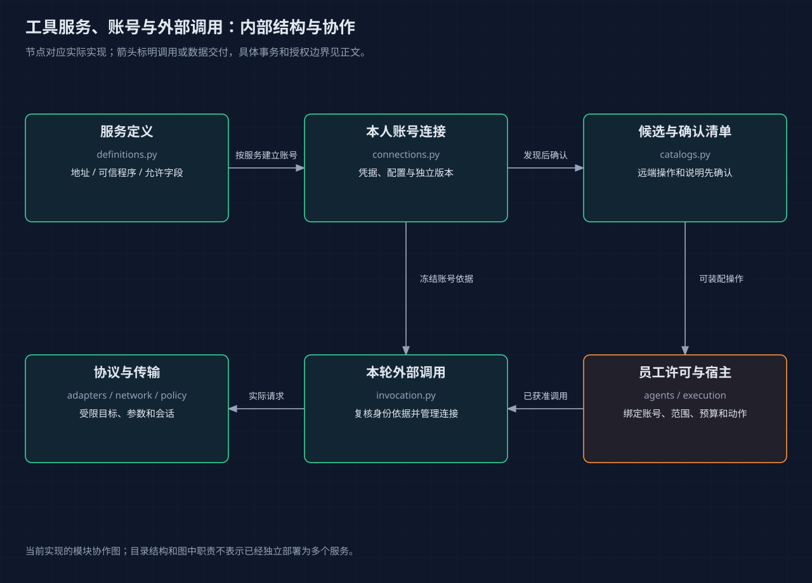

# 工具服务、账号与外部调用

工具服务为员工提供读取资料、访问外部系统等实际操作。接入一个 MCP 服务后，用户先配置账号并确认它提供的工具，再为员工选择获准操作；模型提出调用时，平台使用本次选定身份执行。

MCP 是交换工具定义和结果的协议。本模块负责服务、账号、清单和外部调用，员工的操作许可与个人账号选择由 agents 保存。

## 模块设计



箭头表示服务接入到实际调用的依据流转。工具清单供装配选择，运行许可来自员工和宿主；协议适配不自行扩大许可。 [PNG 导出](diagram/module-design@2x.png)。

### 服务、账号和工具清单为什么是三个对象

服务定义保存 HTTP 地址或可信程序及允许配置字段；账号连接保存某位用户的访问身份、加密凭据与非秘密设置；工具清单保存通过该账号发现并确认的操作、参数和服务说明。员工许可另指向相容操作及范围。

同一服务可以有多人的账号，账号可见工具也可能变化。如果直接把远端即时清单给模型，服务升级就可能绕过用户确认改变权限。因此发现结果先保存为候选，经确认后才成为员工装配和运行的依据。

### 管理链路怎样接受远端结果

`definitions.py` 登记和修改服务，检查接入方式及部署限制。`connections.py` 创建账号、保管秘密及版本；更换配置/凭据时，与版本推进和旧清单失效共同提交。`catalogs.py` 先取得指定连接，在写事务外进行远端发现，再重新检查连接修订并保存候选，确认时把工具定义和服务说明一起作为依据。

管理操作显式检查当前身份的工具能力及资源归属。管理员角色不能代替账号所有权，可信程序登记另要求管理员且部署允许。读取只返回秘密是否存在，不返回 Token、环境值或密文。

### 一次实际调用怎样通过三道检查

1. Agent 根据本轮固定的操作定义提出请求，执行宿主检查当前会话、员工许可、调用范围及预算，并保存实际动作。
2. `invocation.py` 依据本轮绑定重新检查账号、凭据、清单及服务说明版本；不在凭据变化后默默使用新身份。
3. 参数策略校验允许的值和资源范围，网络策略限制目标地址及请求路径，协议适配器才向服务发请求。结果有大小限制、来源信息和脱敏，返回后由宿主完成动作。

原生文件/命令的目录定义可在本模块登记，但工作区实际实现归 agent_runtime；外部 MCP 调用由这里的协议适配器负责。工具说明和方法主文只能指导使用，不能授予上述许可。

### 谁关闭连接与程序

每次运行取得专用调用对象，运行结束、异常、取消或停服时关闭其客户端。目录发现与真实调用共用可信 stdio 进程名额，关闭一个失败仍尝试释放其余资源。stdio 启动的是部署者明确信任的宿主程序；需要隔离执行脚本时使用 sandboxes，而不是依赖 stdio 本身提供安全隔离。

## 目录与职责

```text
tools/
├── definitions.py                 # 登记服务地址或可信程序、导入配置并检查接入限制，服务定义不保存个人秘密
├── connections.py                 # 维护本人账号及加密凭据，管理配置/凭据/目录版本，并按指定依据解析执行身份
├── catalogs.py                    # 发现远端操作、保存候选、确认或丢弃清单，重新核对发现期间账号是否改变
├── invocation.py                  # 为运行创建调用范围，复核固定账号及清单后执行 MCP，限制/脱敏结果并释放客户端
├── models.py                      # 分别保存服务定义和账号连接，使服务共用信息、个人秘密及确认目录具有独立归属
├── schemas.py                     # 定义服务/账号配置、工具确认与安全响应，只允许声明的配置字段进入管理接口
├── access.py                      # 按当前用户检查账号所有权与服务管理资格，为管理事务提供一致归属判断
├── contracts.py                   # 定义工具请求指纹、许可和结果结构，提供原生操作目录及稳定暴露名称
├── policy.py                      # 检查工作区路径、参数和资源范围，把员工许可落实到本次实际调用参数
├── network.py                     # 校验远程地址及解析结果，并使用受控传输限制请求路径、响应大小和连接行为
├── config.py                      # 集中定义目标限制、调用/发现时限及可信程序开关和进程上限
├── stdio_runner.py                # 按已登记定义在受管子进程启动可信程序，配合协议适配跟踪和释放进程
└── adapters/
    ├── mcp.py                     # 适配 HTTP MCP 会话、操作描述和结果，保留平台网络限制并识别认证失败
    └── stdio.py                   # 为可信程序构造标准输入输出 MCP 会话，管理子进程环境和关闭
```

## 与其他模块协作

[agents](../agents/README.md) 使用已确认操作建立员工许可并解析本人绑定；[agent_runtime](../agent_runtime/README.md) 通过注入的调用接口使用工具；[execution](../execution/README.md) 拥有运行和真实动作，本模块不修改 Run。

本模块使用 auth、数据库和[共同凭据机制](../infrastructure/README.md)。定义/账号删除通过注入引用检查保护员工关系。网络和 SDK 适配只提供技术调用能力，业务许可仍由员工和宿主共同核对。

## 失败处理与验证

连接修改与发现结果保存都检查修订，防止确认旧身份看到的清单。外部调用不能被数据库回滚，失败或结果未知不等于上游没有发生操作，不能盲目自动重放。秘密不进入快照、清单或公开结果，凭据故障由本模块转换为工具相关错误。

管理与执行规则见[MCP 契约](../../../docs/reference/mcp.md)和[工具契约](../../../docs/reference/agent-tools.md)。[服务边界测试](../../tests/test_tool_service_boundaries.py)、[MCP 账号测试](../../tests/test_mcp_accounts.py)及[stdio 测试](../../tests/test_stdio_mcp.py)覆盖离线边界；真实账号和服务需单独验证。
