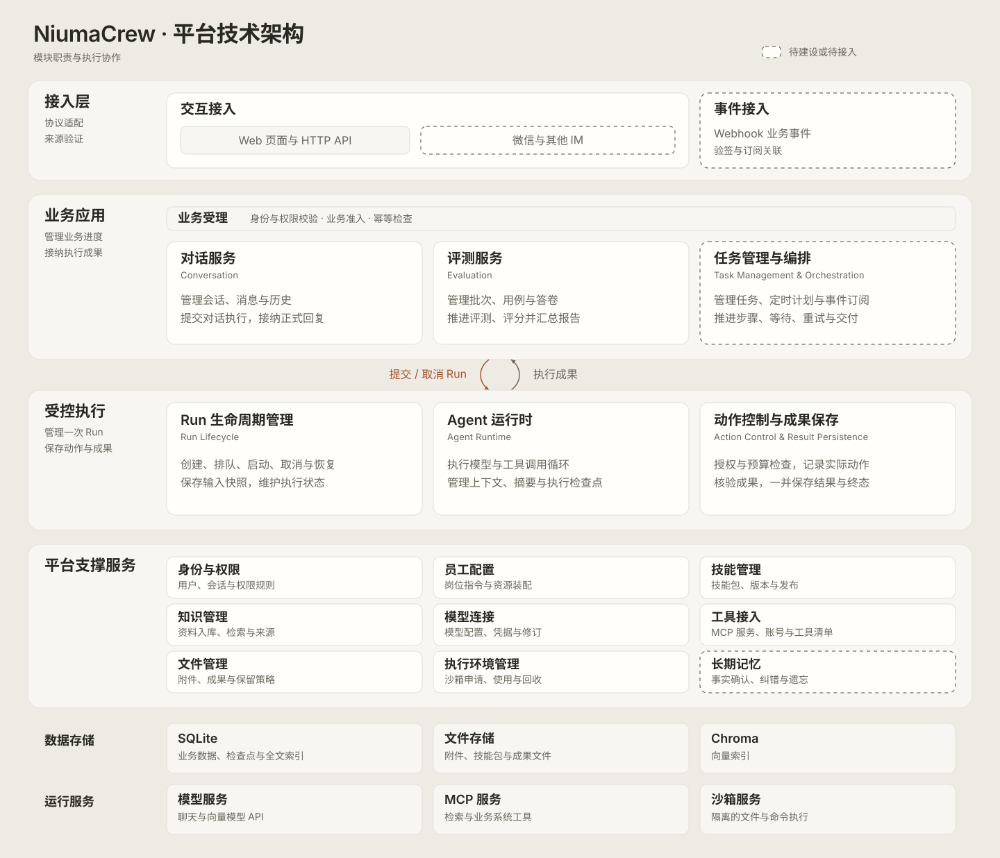
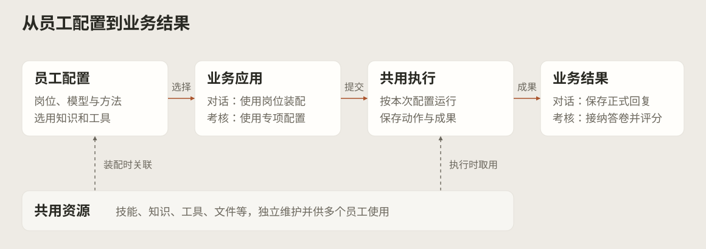

# 系统架构

平台由网页与接口、业务应用、智能体执行和共用资源服务组成。前端提供操作界面，后端按职责划分模块，在同一进程与业务库内协作。

## 模块分工

| 图中分区     | 职责                                           | 主要内容                                               |
| ------------ | ---------------------------------------------- | ------------------------------------------------------ |
| 接入层       | 接收操作、转换请求，返回结果与进度             | 网页与接口                                             |
| 业务应用     | 管理业务记录，使用执行成果完成工作             | 对话与正式回复、考核与评分                             |
| 受控执行     | 驱动模型和工具，管理一次执行的动作与成果       | 执行管理、智能体运行、动作检查与成果保存               |
| 平台支撑服务 | 维护共用配置、资源和访问能力，供业务与执行使用 | 身份、员工、技能、模型连接、工具、知识、文件和执行环境 |

## 运行与存储

开发时前端开发服务独立启动，生产环境将前端构建为静态资源，由后端或网关提供访问。后端接口与后台执行运行在同一个持锁进程中；模型、工具服务和隔离代码环境通过连接接入，可以位于本机或外部环境。

| 存储       | 保存内容                             | 在系统中的作用                                   |
| ---------- | ------------------------------------ | ------------------------------------------------ |
| 业务数据库 | 配置、资源关系、对话、执行与考核记录 | 保存平台业务事实，组织关联查询与事务             |
| 执行存档库 | 框架的消息状态、摘要和执行位置       | 支持续聊及符合条件的执行恢复，使用独立数据库文件 |
| 文件存储   | 上传原件、技能包和成果文件           | 保存实际字节，与业务记录建立关联                 |
| 检索索引   | 全文索引与知识向量                   | 从资料片段派生，用于关键词和语义检索             |

业务数据与执行存档使用 SQLite，向量索引使用 Chroma。文件和索引由所属资源模块管理，资料更新时同步维护相关索引。具体数据保存与备份方式见[运维指南](../guides/backend-operations.md)。

## 技术决策与取舍

| 当前选择                          | 解决的问题                                                                     | 需要承担的代价                                                 |
| --------------------------------- | ------------------------------------------------------------------------------ | -------------------------------------------------------------- |
| 模块化单体，同进程后台执行        | 本地部署直接，接口与后台共用业务服务，跨模块保存可以组合事务                   | 当前按单实例运行；扩展到多实例需要增加任务领取、协调和故障接管 |
| 业务数据集中在 SQLite，采用短事务 | 员工装配、工作受理及动作记录可以在同库核对并保存                               | 需要协调写竞争，模型调用和耗时处理放在写事务外                 |
| 复用官方智能体框架                | 复用模型工具循环、检查点和文件能力，集中适配平台资源                           | 需要维护框架版本与适配接口，并将平台的操作许可接入调用过程     |
| 执行成果与业务处理分开保存        | 对话和考核共用执行能力，各自保存回复或完成评分；后续保存失败时可以复用已有成果 | 需要协调执行完成与业务处理两个阶段的状态和重试                 |

[后端设计](backend.md)展开目录、事务与服务协作，[前端设计](frontend.md)说明页面、数据与交互的组织方式。
