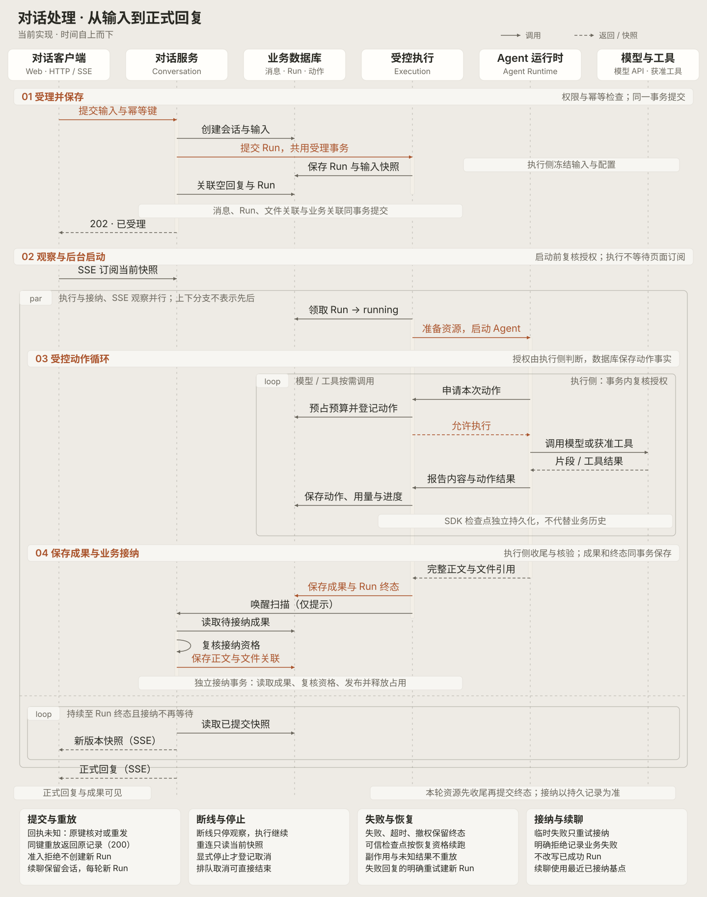

# 对话流程

一次对话将员工装配、模型与工具循环、执行记录和成果保存串在一起。下面以新对话的首次发送为例，说明从提交输入到正式回复的协作。

图中泳道表示职责，不表示独立进程；时间自上而下。后台执行和页面观察并行，后台不等待页面建立订阅。

## 受理与保存

前端为本次提交固定请求标识。对话服务与执行服务共用短事务，保存输入、空回复、执行记录和关联，提交后返回已受理。文件字节由文件服务独立保存，此事务提交的是文件关联。

发送超时但结果未知时，沿用原标识核对或重发；已受理请求返回原记录。显式重试失败回复则是新的一次执行，保留旧记录。

## 后台执行与页面观察

后台从数据库发现排队工作，复核当前授权，准备资源并驱动智能体。模型与工具可以多轮调用；每个实际动作先检查许可、预占预算和登记，再调用上游。固定输入与配置不会冻结权限。

页面通过持续连接读取已提交快照。断线后恢复读取，不重新交办；关闭页面不等于停止。只有显式停止才登记取消，已经发生的外部操作不会自动撤销。

## 保存成果与形成回复

执行层先核验并保存完整成果和执行终态。对话服务再用独立事务复核接纳资格，保存正式正文和文件关联，释放对话占用。临时保存失败只重试后一阶段，避免重复生成。

页面同时读取执行状态与回复保存状态。完成事件也可能对应失败或取消，不能仅凭连接结束判断成功。下一轮保留同一对话，新建执行记录，从最近成功接纳的明确检查点延续。

## 继续查阅

- [智能体执行](执行机制.md)：模型循环、上下文与平台控制的分工。
- [对话规则](../reference/conversations.md)：幂等、历史、停止与重试条件。
- [执行规则](../reference/runtime.md)：动作、预算、取消及恢复资格。
- [前端实现](../../frontend/src/pages/conversations/README.md)与[后端执行实现](../../backend/app/execution/README.md)：内部协调及关键故障路径。
