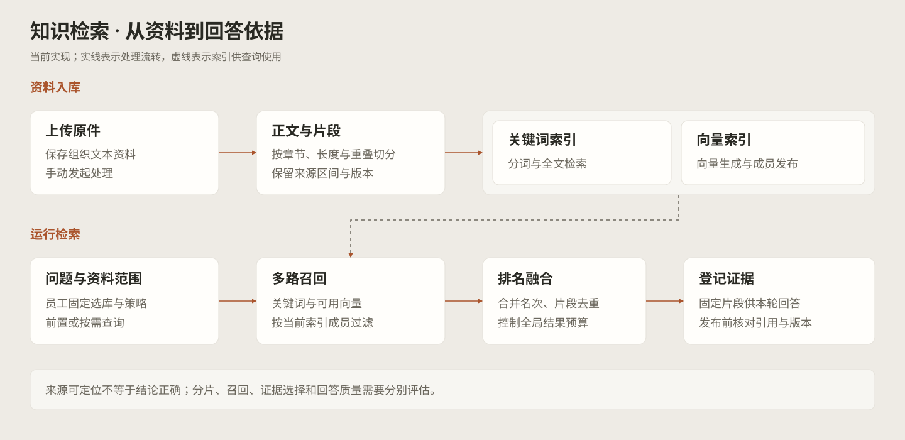

# 知识检索

知识资料需要经过解析、分片和索引，才能成为员工可查询、可核对的回答依据。当前产品支持组织文本资料、关键词与向量混合检索；文件加载实验和产品上传入口分别维护。

## 入库与分片

产品接收有界的 UTF-8 文本和 Markdown。上传只保存原件，手动处理才生成固定正文、片段和关键词索引。原件、正文、片段和索引分别承担保存、来源定位和查询职责。

分片保留章节及原文区间，按长度与重叠规则切分；同父相邻短章节可以受限合并。这样既保留局部上下文，也能回到准确来源。长度、重叠和合并阈值需要通过命中质量与上下文成本比较，不存在适合所有资料的固定最优值。

处理成功才切换新内容，失败保留旧版。重切、删除和连接变化需要处理索引资格与版本，不能让新片段配旧向量。细节见[知识实现](../../backend/app/resources/knowledge/README.md)。

## 关键词与向量召回

关键词路径使用固定中文分词规则建立全文索引，以 BM25 排名，适合精确术语、名称和编号。分词与词典版本改变后，需要处理旧索引。

向量路径将查询和片段转换为向量，由向量存储检索语义相近内容。分词、模型分词器与向量模型承担不同职责；中文词法切词不等于生成向量。模型、编码方式和索引成员需要一致，模型变化后的重建成本也属于选型依据。

当前产品已接入真实向量服务与 Chroma。向量构建通过可查询、可取消的持久任务执行；成功批次按模型空间与文本内容缓存，只编码缺失内容，整代发布前保留旧可用索引。结构接线不证明语义质量，字符散列等实验替身也不能用于证明真实向量效果。

## 混合检索与排名融合

当前采用倒数排名融合，将关键词、向量及多库的候选按名次合并，再选取全局结果。它适合合并不可直接比较的原始分数；融合后的排名不是置信度，也不代表证据一定支持答案。

实现复用框架的 RRF 检索器，按片段标识去重；没有额外的语义精排模型。召回数量、融合参数、重复片段与结果预算应一起评估，见[排名融合实现](../../backend/app/resources/knowledge/retrieval.py)。

## 检索时机与回答依据

员工固定选库、检索策略和结果数量。前置检索在回答前提供资料，按需检索由智能体提出查询并补读；两者共用授权范围和检索核心。向量覆盖可用时混合召回，否则按现行规则采用关键词路径，上游故障不伪装为正常结果。

命中内容登记为本次执行的证据，回答引用才能回到对应片段。补读、历史引用和最终保存都要核对范围与版本。引用格式合法只证明来源可定位，不能证明回答在语义上得到支持；这需要评估。权限和版本规则见[知识规则](../reference/knowledge.md)。

## 质量验证与后续建设

| 方向             | 当前基础                                               | 需要深入的问题                                 |
| ---------------- | ------------------------------------------------------ | ---------------------------------------------- |
| 分片与召回验证   | 已有独立实验、公开资料问题集与引用区间覆盖计算         | 切分方式、召回数量和查询类型怎样影响命中与噪声 |
| 连续对话查询改写 | 建设中，已有[待评审方案](../proposals/前置检索改写.md) | 怎样补齐指代，避免加入无依据的条件             |
| 宽召回与精排     | 建设中                                                 | 哪类查询确有收益，增加多少耗时与费用           |
| 标注与持续评估   | 建设中；已有样例不等于完整标注平台                     | 标准证据、难例、无答案题和数据隔离怎样维护     |

后续研究从同一数据集比较基线开始，再决定是否增加精排或多阶段检索。召回、证据选择和回答生成分别定位失败，具体方法见[能力评估](能力评估.md)。
