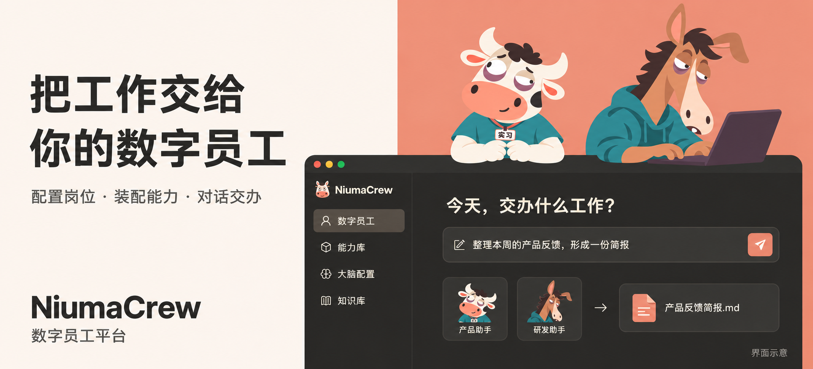

# 平台定位

NiumaCrew 是一个用于交流与学习的数字员工平台。我们希望把个人积累的方法、工具使用经验和知识，整理成团队可以共同使用、持续改进的能力，让同类工作不必由每个人重新摸索。

## 整理工作经验

做过一类工作的人，往往已经知道该查什么资料、用哪些工具、怎样判断结果。但这些经验常常散落在个人的提示词、技能配置和操作习惯里，换一个人就要重新准备。

平台希望把这些准备留下来：整理适用的任务、做事步骤、参考资料和成果要求，让个人走过的路能被其他人接着使用。具体怎样组织和维护，见[组织资产](组织资产.md)。

## 装配最小能力

围绕一类明确的工作，为员工准备刚好够用的方法、知识和工具。比如资料整理员需要整理标准、参考材料和必要的读取操作，就先把这些配好；需要交付文件时，再补上相应能力。

使用者选择合适的员工，提供本次材料和要求。维护者关注这类工作怎样做好，使用者专注于这次希望得到什么结果。装配的思路见[员工设计](员工设计.md)。

## 共同使用并改进

多人使用同一位员工，方法和配置的改进就能服务后续同类工作。一次任务中发现的遗漏、绕路或工具问题，也值得整理下来，成为下一次改进的依据。

这也是平台的学习方式：从具体工作出发，观察模型怎样使用工具和资料，研究结果为什么成功或失败，再用实际任务检验调整。对底层机制感兴趣，可以从[系统架构](../architecture/overview.md)和[对话流程](../architecture/对话流程.md)继续阅读。
