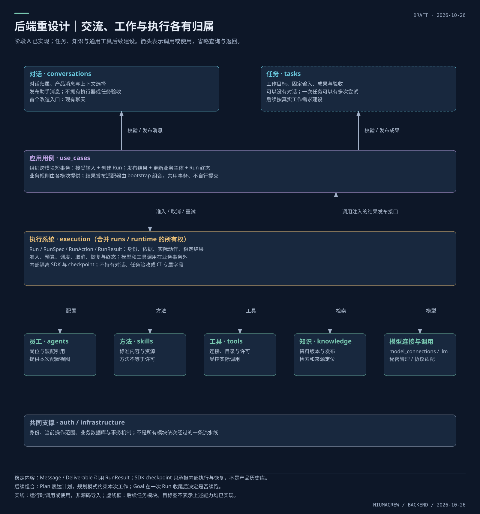

# 后端领域与执行架构重设计

> 后续结构由[平台工作流与执行边界重构方案](../platform-refactor/README.md)接替。本文保留阶段 A、auth 合并和首轮文件归位的实施依据；新方案保留 Conversation/Run，简化回复存储并隔开执行管理与 Agent，仍为未实施草案。

| 项目     | 内容                                                                                                                                                                                                                  |
| -------- | --------------------------------------------------------------------------------------------------------------------------------------------------------------------------------------------------------------------- |
| 设计状态 | 阶段 A 已采纳并实现；B/C 及其他扩展仍为推荐草案                                                                                                                                                                       |
| 实施状态 | 阶段 A 已实现；当前规则已合入架构、术语、运行及数据正文，验证见验收记录                                                                                                                                               |
| 更新日期 | 2026-10-26                                                                                                                                                                                                            |
| 有效前提 | 工程处于 Demo，命名、目录、API 和表结构可以重新设计，不以兼容旧结构为目标                                                                                                                                             |
| 范围     | 领域术语、模块所有权、执行与消息存储、依赖方向、扩展边界及实施顺序                                                                                                                                                    |
| 当前依据 | [后端架构](../../architecture/backend.md)、[现行术语](../../architecture/domain-glossary.md)、[对话](../../reference/conversations.md)、[运行](../../reference/runtime.md)、[数据入口](../../reference/data-model.md) |
| 配套设计 | [执行对象、事务与生命周期](execution.md)                                                                                                                                                                              |

**建议保留 `Conversation` 和 `Run`，重新定义它们的职责；将一级模块 `runs` 与 `runtime` 合为 `execution`；建立独立的产品消息与执行结果存储。** 对话组织交流，任务组织工作与验收，执行系统负责一次尝试如何可靠地完成。正式任务、计划和持续目标按真实功能逐步加入。

## 1. 设计前提与选择

### 已确认的要求与产品假设

用户要求重新审视领域与架构，明确没有历史兼容负担；[标准 Skill/MCP 方案](../skills-and-mcp/README.md)中的标准技能、通用工具接入和 CI 示例化也是已有明确方向。此前建议或表结构本身不构成必须保留的需求。

本方案采用的产品假设是：数字员工有可维护的岗位与能力配置，既能轻量交流，也可以承接需要成果与验收的工作。资料问答和 CI 诊断用于检验这些边界。正式任务的产品需求仍需验证，不将完整项目管理、工作流平台和分布式执行系统设为本轮前置。

### 三种组织方式

| 方式                         | 适用情况                   | 本项目中的代价                               | 判断   |
| ---------------------------- | -------------------------- | -------------------------------------------- | ------ |
| 所有执行依附对话             | 只做聊天产品               | 正式交办、批量评测与后台工作需要制造聊天记录 | 不采用 |
| 所有交流都创建正式任务       | 所有交互都有明确交付与验收 | 一句问答也需要任务状态与成果管理             | 不采用 |
| 对话与任务独立，共用执行系统 | 同时支持交流与正式工作     | 需要明确跨模块提交和结果发布的事务           | 推荐   |

“独立”指生命周期和规则独立，并不要求微服务、独立数据库或消息总线。先采用模块化单体、同一业务数据库与本机执行驱动；这是一项成本选择，可以随实际负载重新评估。

## 2. 术语与对象边界

基础执行术语已落实于[现行术语](../../architecture/domain-glossary.md)；Task、Plan、Goal、成果与验收仍为后续设计定义。

| 名称                     | 建议中文与含义                                       | 生命周期与边界                                             |
| ------------------------ | ---------------------------------------------------- | ---------------------------------------------------------- |
| `Agent`                  | 数字员工：岗位、指令和能力装配的长期定义             | 多次工作复用；SDK 每次创建的实例不另称业务 Agent           |
| `Conversation`           | 对话：人与员工持续交流的容器                         | 拥有归属、消息和上下文选择；不拥有执行器或任务验收         |
| `Message`                | 消息：产品中实际发布的用户或助手交流                 | 不可变内容；SDK 工具结果和系统事件不自动成为产品消息       |
| `Task`                   | 任务：目标、输入、交付与验收构成的正式工作           | 可以没有对话；一次任务可以经历多次执行和修订               |
| `Run`                    | 执行尝试：有独立身份、预算、过程和终态的一次执行     | 不强制依附对话，不等于一次模型请求；重试创建新 Run         |
| `RunAction`              | 执行动作：已经尝试的模型、工具、技能加载、检索或校验 | 记录实际发生或尝试发生的事情；替代含义容易混淆的 `RunStep` |
| `RunResult`              | 执行结果：一次 Run 形成的稳定输出                    | 与 SDK 存档分离；可被消息或任务成果引用                    |
| `Plan` / `PlanStep`      | 计划 / 计划项：准备采用的做法                        | 可以调整或放弃；一个计划项可对应多个实际动作               |
| `Goal`                   | 持续目标控制：继续条件、停止条件、预算和状态         | 决定是否再发起一次 Run；不替代任务目标或成果验收           |
| `Deliverable` / `Review` | 成果 / 验收：任务的交付版本与业务决定                | Run 成功不代表成果被接受；验收绑定具体成果版本             |

`Conversation` 的名字适合交流领域，问题在于改造前它还承担大量执行准入工作。`Run` 的名字适合可追踪的执行尝试，改造前它的形状过度绑定对话输入输出。只替换这两个单词，无法解决这些责任问题。

### 不额外引入重复概念

1. 不增加与 `Run` 同时开始、同时结束的持久 `Turn`。一次用户提问通常触发一个 Run；执行中补充输入以后可以归入同一 Run，二者无需固定一一对应。
2. 不再增加泛化 `Session` 表示对话；现有登录会话已经使用该词，SDK session/thread 只出现在适配器内。
3. `RunSpec` 表示本次执行的冻结依据，用户阅读的工作计划使用 `Plan`。当前 `ExecutionPlan` 实际封装 `execute/authorize` 等执行策略，迁入新模块时建议改名 `ExecutionStrategy`，不能直接将它改名为 RunSpec。
4. `Task` 表示正式工作；异步协程、后台句柄和知识处理作业使用各自的技术名称，避免三个生命周期共用一个 task 状态。

### 六个维度分别表达

| 维度     | 回答的问题               | 示例                                 |
| -------- | ------------------------ | ------------------------------------ |
| 工作归属 | 这次尝试服务哪个业务对象 | 对话、任务、评测样例                 |
| 触发原因 | 为什么现在启动           | 用户提交、重试、目标续跑、定时触发   |
| 工作模式 | 这次期望做什么           | 规划、实施                           |
| 操作许可 | 允许实际做哪些动作       | 只读仓库、读取知识、写入指定资源     |
| 能力依据 | 采用什么方法和配置       | 员工、技能制品、工具目录、模型与规则 |
| 执行状态 | 当前进行到哪里           | 排队、运行、成功、失败、取消         |

不要设计 `mode = chat / task / ci / plan / goal`。其中有业务归属、专业场景、工作模式和触发机制，无法形成互斥分类。CI 应通过方法、输入范围、工具许可与专业校验组合表达。

## 3. 模块所有权与协作



[SVG 原图](diagrams/backend-modules.svg)；可编辑来源为[图生成器的 modules 函数](../../architecture/diagrams/build-backend-views.py)。图中全部是目标责任位置，实线表示调用或使用；不是当前代码导入图，也不表示这些模块已经实现。

### 核心模块

| 模块            | 拥有的数据和规则                                           | 对外提供什么                       | 职责边界                                    |
| --------------- | ---------------------------------------------------------- | ---------------------------------- | ------------------------------------------- |
| `agents`        | 员工身份、岗位、指令、能力装配引用                         | 授权范围内的员工配置与执行配置视图 | 不保存工作进度，不持有 SDK 实例             |
| `conversations` | 对话归属、产品消息、排序、上下文选择                       | 对话输入、历史与结果发布适配       | 不计算全局执行容量，不驱动模型循环          |
| `tasks`         | 任务目标、输入提交、成果与验收                             | 正式工作输入与成果发布适配         | 不制造对话，不复制执行器；有实际需求再建    |
| `execution`     | Run、RunSpec、RunAction、RunResult、预算、准入、取消与恢复 | 统一的执行生命周期与稳定结果读取   | 不拥有对话、任务验收或 CI 业务字段          |
| `skills`        | 可复用方法、标准内容、资源制品及兼容规则                   | 可装配和按需读取的方法视图         | 方法声明不是工具授权，正文不能改变宿主权限  |
| `tools`         | 工具连接、获准目录、员工许可与受控调用                     | 有当前授权检查的动作入口           | MCP 是适配机制；凭证不放进员工或技能正文    |
| `knowledge`     | 资料、文档版本、解析发布、检索与引用定位                   | 已发布资料的受控检索与来源证据     | 导入/索引作业有自己的状态，不伪装成聊天 Run |

`execution` 统一运行记录与运行驱动的所有权，但内部仍区分准入、调度、单次执行、SDK 适配和存取。合并一级目录不是把现有文件拼成一个更大的服务。

### 支撑模块

| 模块                 | 建议责任                                             |
| -------------------- | ---------------------------------------------------- |
| `auth`               | 用户、会话、当前操作主体及权限策略                   |
| `model_connections`  | 模型连接、秘密、修订与当前可用性                     |
| `llm`                | 接收显式配置，适配模型协议、流与用量；不查询业务 ORM |
| `organization_rules` | 组织规则及本次使用的可回查依据                       |
| `infrastructure`     | 数据库、事务、文件及锁等技术机制                     |
| `bootstrap`          | 组合具体实现、注册结果发布适配器、管理进程生命周期   |

### 身份与访问控制归属调整

2026-10-26 已采纳并实现：一级 `authorization` 已合入 `auth`。当前身份、登录会话与固定角色权限属于同一访问控制模块，内部以 `actor.py` 保存操作主体、`permissions.py` 保存纯权限和资源范围策略，`service.py` 继续管理账号与会话。调用方按职责直接导入对应文件，不保留旧包兼容入口。

本次调整只改变代码归属与依赖路径，现有权限集合、401/403/404 语义、资源范围和后台授权复核继续保持。现行职责见 [auth 模块说明](../../../backend/app/auth/README.md)，实际检查和测试见[合并验收](../../records/auth-consolidation.md)，不涉及数据库迁移。

### 文件职责第一轮整理

2026-10-26 已采纳并实现：对话查询、归属检查、上下文选择和响应组装集中到 conversations/queries.py，业务写入集中到 writes.py；ConversationCommands 与 PublishRun 继续协调原有跨模块事务。员工执行配置、技能装配捕获和许可校验、系统提示词组合统一归 agents/execution.py。执行错误定义归 execution/errors.py。

同步清理不准确的命名：对话命令、参数校验、API 请求限流、技能加载、进度保存和执行完成入口。以原有 HTTP、数据库结构、配置快照、授权时机和事务提交顺序为行为基线，不保留旧模块别名。验证使用现有配置、对话、取消/重试、发布回滚、流式与进程恢复测试，并检查静态类型和文档引用。

当前分工见[后端架构](../../architecture/backend.md)，实施与验证见[文件职责整理验收](../../records/backend-file-responsibilities.md)。SDK 消息转换边界、授权策略复用、CI 循环统一和 checkpoint 测试辅助清理保留为后续增量，本轮不调整其行为。

SOP、评测、调度和多代理协作保留独立扩展空间。真实需求出现时确定各自业务主体，不能因为图里可以画一个框就预建空模块。

## 4. 执行、交流和成果如何连接

### 提交与发布由应用用例协调

“发送消息”同时涉及对话和执行；“执行任务”同时涉及任务和执行。由薄的应用用例组织同一业务事务：业务模块检查主体与输入，execution 检查执行容量、幂等和本次依据，参与者共用事务且不自行提交。

结果发布也使用同样方式：execution 形成稳定结果，对话适配器创建助手消息，任务适配器创建成果，最后与 Run 终态一起提交。适配器只做本库内确定性的状态变更；模型、MCP、文件上传等耗时动作放在事务外。

### 消息和 SDK 状态采用不同存储职责

改造前完整消息正文依赖 SDK checkpoint 读取。阶段 A 已让产品消息和正式结果有稳定业务存储：用户消息保存输入内容，助手消息引用不可变 RunResult，任务成果也可以引用同一份输出正文。正文不必复制成两份可独立编辑的数据。

checkpoint 保存 SDK 的模型上下文和恢复位置。产品历史不需要先加载 LangChain 图状态，也不能把某个 SDK `UserMessage` 自动解释成人类输入。checkpoint 不可读时，历史仍可读；执行恢复按明确错误处理。

这会增加产品内容模型和一次显式结果发布，但可以把 SDK 升级、消息展示、成果保存和故障恢复各自维护。具体数据关系、提交顺序和故障窗口见[执行设计](execution.md)。

### CI 归位为能力组合

CI 的价值在于仓库取证和专业报告校验，保留这些规则；其承载方式改为：标准技能描述方法，任务或对话输入提供仓库范围，tools 管连接与员工许可，通用循环执行，受信的专业校验器检查候选结果。

通用 Agent 不再放 `ci_repository`，通用 Run 不再放 `ci_result/ci_feedback`。结构化结果使用有类型和版本的输出契约；CI 反馈属于专业评价。专业校验器可以有代码，但新增专业能力不应要求修改通用主循环。

## 5. 代码组织与依赖约束

以下为拟议方向，只列与本次边界直接相关的节点，不预先创建目录。

```text
backend/app/
├── main.py                        # ASGI 导出入口，已归位到应用根目录
├── api/                           # HTTP、DTO 与 SSE
├── use_cases/                     # 跨模块操作与事务协调
│   ├── conversation_commands.py
│   └── publish_run.py
├── conversations/                 # 对话、产品消息与上下文选择
├── execution/                     # 一次执行尝试的完整所有权
│   ├── models.py                  # 执行持久模型
│   ├── contracts.py               # RunSpec、输入、动作与结果类型
│   ├── admission.py               # 幂等、容量和接受执行
│   ├── service.py                 # 状态变更与生命周期规则
│   ├── queries.py                 # 持久事实的安全读取
│   ├── driver.py                  # 本机扫描、领取与并发看护
│   ├── coordinator.py             # 单次 Run 的准备、执行与收尾
│   └── sdk/                       # Agent 循环、事件映射和 checkpoint
├── agents/                        # 员工定义和装配
├── skills/                        # 方法资产
├── model_connections/             # 模型连接与凭据
├── llm/                           # 模型协议适配
├── auth/                          # 身份与访问控制，内部区分 actor、permissions 和 service
├── infrastructure/                # 技术机制与共享事务
└── bootstrap.py                   # 具体实现装配
```

`tasks`、`tools`、`knowledge` 在相应能力实施时建立；Plan、Goal 先作为 execution 内部的专门职责文件实现，有独立复杂度后再拆子包。文件名表达职责，不要求每张表都有 repository，也不对简单配置 CRUD 机械套四层目录。

### 允许与禁止的依赖

数据库错误识别增量（2026-10-26，已实现）：SQLite 错误码及唯一约束文本匹配统一进入 infrastructure/database/errors.py，仅提供技术判断，不产生业务提示。员工及模型连接服务只将明确的字段唯一冲突转为业务错误；删除保护在调用方写事务中检查实际关联。其余完整性错误原样抛出，HTTP 层只将已识别的数据库繁忙转为可重试响应。当前职责见[数据库模块说明](../../../backend/app/infrastructure/database/README.md#数据库错误与业务错误)，实际结果见[错误边界验收](../../records/database-error-boundaries.md)。

| 调用方                   | 可以依赖                                                   | 应避免的依赖                                    |
| ------------------------ | ---------------------------------------------------------- | ----------------------------------------------- |
| `api`                    | 应用用例、查询与输入输出 DTO                               | 直接驱动 SDK 或写 Run 状态                      |
| `use_cases`              | 业务模块公开操作、execution、共享事务                      | 再复制模块内部的准入或验收规则                  |
| `conversations/tasks`    | 自身模型、执行契约和结果读取接口                           | Runner、SDK 图状态和供应商消息类型              |
| `execution`              | 员工与能力的窄接口、模型适配、权限策略、注入的结果发布接口 | 对话/任务的具体 ORM、CI 专属数据和 HTTP Request |
| `skills/tools/knowledge` | 自身规则、受信技术适配与权限契约                           | 反向控制某个对话或 Run 的终态                   |
| `llm`                    | 显式模型配置、供应商 SDK、受控网络                         | 员工、对话、账号和数据库查询                    |
| `bootstrap`              | 上述具体实现                                               | 业务规则；它只负责装配                          |

execution 调用结果发布接口，具体适配器由应用层注入。这样执行核心不需要为了发布聊天消息而反向导入 Conversation ORM。业务绑定和数据库外键仍真实存在，不能用无约束字符串 ID 假装解耦。

第一阶段已停止通过 `Session.info` 隐式传入 checkpoint 服务。依赖由构造参数或明确上下文提供。输入、结果、动作、错误和发布接口使用可检查的类型，避免宽泛 `dict` 穿越模块。已对执行边界加入 mypy 类型检查和自动化导入约束；后续扩大检查范围；bootstrap 与集中 ORM 元数据注册作为具名例外。

### 第一阶段的代码归位依据

| 当前入口                                                                                                                | 改造前职责或耦合                                              | 目标归属                                                                    |
| ----------------------------------------------------------------------------------------------------------------------- | ------------------------------------------------------------- | --------------------------------------------------------------------------- |
| [对话查询](../../../backend/app/conversations/queries.py)、[命令](../../../backend/app/conversations/service.py)        | 原服务同时承担历史、上下文、权限、容量、幂等、快照与 Run 创建 | 查询和业务写入归 conversations；事务协调归 use_cases；通用准入归 execution  |
| [Run 模型](../../../backend/app/execution/models.py)与 [RunStore](../../../backend/app/execution/store.py)              | 执行记录强关联对话；存取依赖 checkpoint 与运行时错误          | execution 拥有尝试与实际动作；业务关联归入口模块；SDK 状态经显式适配访问    |
| [Runner](../../../backend/app/execution/scheduler.py)与[单次协调](../../../backend/app/execution/coordinator.py)        | 已分开调度和一次执行看护                                      | 保留有效职责分工，统一进入 execution；不重新合成一个大 Runner               |
| [员工执行配置](../../../backend/app/agents/service.py)、[技能加载](../../../backend/app/agent_runtime/skill_loading.py) | 原运行时技能混合配置捕获、当前授权、虚拟资源和 SDK 中间件     | 员工配置、捕获及许可归 agents；共享资产归 skills；虚拟文件和 SDK 适配归 sdk |
| [Run 查询](../../../backend/app/execution/queries.py)                                                                   | 完整历史内容依赖 checkpoint 解码                              | 稳定消息/结果走业务存储；恢复信息留在 SDK 适配器                            |
| [原CI 模块（已退役）](../../reference/ci-diagnosis/README.md)                                                           | 专业取证、工具、循环、报告和反馈集成                          | 方法归 skills，工具归 tools，专业校验保留扩展实现，反馈归专业评价           |

这些归位涉及规则、数据和事务一起调整，不能靠批量移动目录完成。原有代码只提供行为证据，不限定新结构。

## 6. 实施顺序与验收

### A. 先闭合执行与历史

已以现有聊天为真实入口，建立 `execution` 所有权、稳定消息/结果模型，以及提交和发布事务。迁移现有取消、预算、动作、快照与恢复中仍有价值的规则，同时移除隐式 checkpoint 注入。

验收重点是：重复提交只创建一次尝试；失败重试保留原输入和旧尝试；取消与完成竞争有确定结果；checkpoint 缺失不影响已发布历史；结果发布失败不留下“成功但没消息”的半完成状态。

这一步不要求先实现 Task、Goal、通用 MCP 或工作流，也不要求旧 API/表结构保持原样。前后端消费协议随真实内容模型一并调整。

### B. 将能力接入统一执行

按[标准 Skill/MCP 方案](../skills-and-mcp/README.md)建设方法制品、工具许可与统一调用，CI 改用同一循环及专业校验扩展。验收权限收缩、工具目录变化、取消、超时、证据和结构化输出；新增另一个普通方法时不修改通用主循环。

知识管理可按自身闭环推进，不必等待正式任务。导入、解析、索引仍是知识作业，检索才作为 Run 内能力使用。可复用队列、限流与用量机制，但作业业务状态由 knowledge 维护。

### C. 用实际功能增加 Task、Plan 和 Goal

建议按独立任务交付、规划转实施、持续目标的顺序验证，避免同时建设三个新生命周期。

| 增量 | 最小交付                             | 必须证明的边界                                |
| ---- | ------------------------------------ | --------------------------------------------- |
| Task | 任务输入 → Run → 成果 → 验收         | 没有对话也能工作；Run 成功与成果接受独立      |
| Plan | 规划 Run → 固定计划版本 → 实施 Run   | 计划项与实际动作独立；确认计划不自动扩大许可  |
| Goal | 条件与预算 → 多次有界 Run → 明确停止 | 每次 Run 都收尾；自动续跑不重置预算或越过撤权 |

执行中补充、持久等待和后台授权也是单独增量；没有实现时，接口明确返回忙碌或不支持，不能让一条模型文字假装已经暂停或接受补充。

### Demo 数据与验证策略

新结构不承担保持旧 schema/API 的兼容目标。实施时若本机数据需要保留，提供一次明确的数据搬迁；若使用新基线，则显式选择新库并按操作契约保护已有数据。本方案不执行数据库清空。

测试按新行为重组。幂等、原子性、权限、取消、预算和故障可见性应保留并重新验证；绑定旧表名、旧 SDK 序列化或固定消息数量的断言随设计修改。原测试数量不构成领域设计的约束。

阶段 A 已完成实现，生效规则见[当前后端架构](../../architecture/backend.md)、[运行](../../reference/runtime.md)及[数据](../../reference/data-model.md)，实际验证见[第一阶段验收](../../records/execution-refactor.md)。剩余功能不因执行核心可复用就标记已实现。

## 7. 与既有草案及公开实现的关系

[员工工作页](../agent-workspace/README.md)中的轻量交流、独立任务和成果验收仍是候选业务方向；其中维持现有 Runner、消息形状和逐步扩展 Run 的技术约束需要在实施前与本方案统一。[能力模型](../agent-capabilities/README.md)中“保留十一表”的演进假设也不作为本次重设计前提。各草案尚未实施的相互冲突项不同时生效。

公开实现用于核查概念边界，不直接决定本项目命名：

| 公开依据                                                                                                                                                                                                                                                             | 能确认什么                                                                  | 对本方案的启发                                          |
| -------------------------------------------------------------------------------------------------------------------------------------------------------------------------------------------------------------------------------------------------------------------- | --------------------------------------------------------------------------- | ------------------------------------------------------- |
| [Codex app-server 契约](https://learn.chatgpt.com/docs/app-server)与[固定源码的执行循环](https://github.com/openai/codex/blob/970111f6cb62cc02fe36a82ea7d71b37a2889c97/codex-rs/core/src/session/turn.rs)                                                            | Thread 中有 Turn；一次 Turn 可包含多次模型/工具往返和多种 Item              | 对话、一次执行与模型动作需要分开；不必额外复制一层 Turn |
| [Codex 计划处理](https://github.com/openai/codex/blob/970111f6cb62cc02fe36a82ea7d71b37a2889c97/codex-rs/core/src/tools/handlers/plan.rs)与[目标控制](https://github.com/openai/codex/blob/970111f6cb62cc02fe36a82ea7d71b37a2889c97/codex-rs/ext/goal/src/runtime.rs) | 计划清单、规划模式和持续目标有不同实现位置；目标可以启动后续工作轮          | 不把计划、模式、目标和运行状态混成一个对象              |
| [Claude Agent SDK 循环](https://code.claude.com/docs/en/agent-sdk/agent-loop)、[会话](https://code.claude.com/docs/en/agent-sdk/sessions)和[目标](https://code.claude.com/docs/en/goal)                                                                              | 一次 query 有多轮往返与结果边界；session 保存历史；目标在工作轮之外判断继续 | 稳定产品内容、一次尝试和持续控制各有职责                |

研究时点为 2026-10-25。Claude Code 核心由原生程序执行，公开 SDK 与官方披露只能证明其明确展示的边界；不能据此声称看到了全部内核。表中映射是本方案的工程判断。
