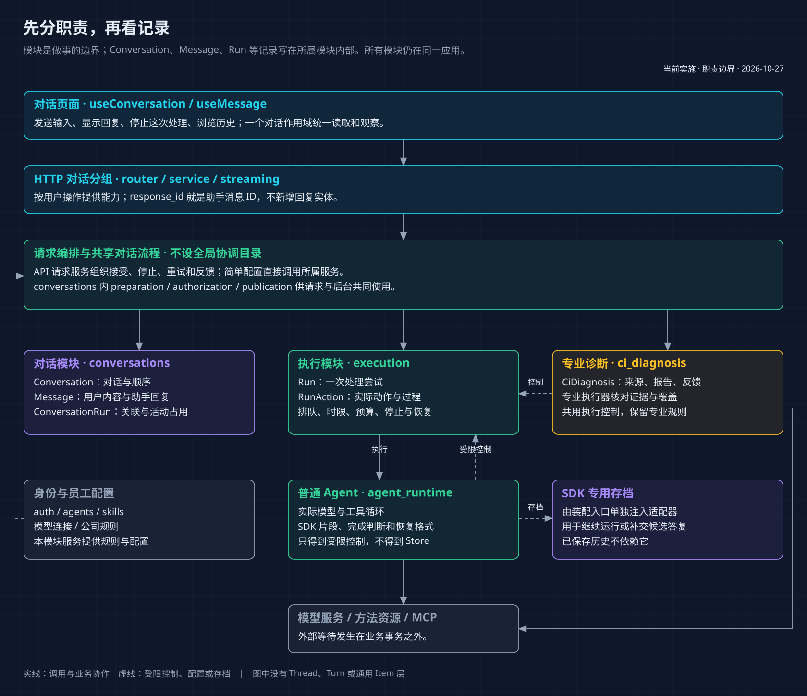

# 平台工作流与执行边界重构方案

配套图示：[四张分层架构图与模块解读](layered-architecture.md)，分别展开全局、前端、后端，以及执行宿主与 Agent 的边界。

| 项目     | 说明                                                                                        |
| -------- | ------------------------------------------------------------------------------------------- |
| 设计状态 | 已采纳；2026-10-27 完成职责复核与当前范围实施                                               |
| 实施状态 | 当前范围已实施；本地库升级至 0005，开发服务已启动，实际检查见实施记录                       |
| 范围     | 当前完整前后端、身份与配置、普通对话、CI 诊断、运行恢复、工程与文档；未来能力只规定接入条件 |
| 设计方法 | 从现有用户行为和必须保存的信息出发，逐项追问抽象是否必要；用具体失败场景检验边界            |
| 阅读方式 | 先读本页建立整体认识，再按需要进入专题；完整结构与逐文件去向放附录                          |

当前行为以[后端架构](../../architecture/backend.md)、[Agent 边界](../../architecture/agent-runtime.md)、[对话契约](../../reference/conversations.md)和[运行契约](../../reference/runtime.md)为准。本目录保留设计取舍与实施顺序，[实施记录](../../records/platform-refactor-implementation.md)说明实际结果和限制；学习从[观测指南](../../learning/observing-runtime.md)开始。

## 1. 推荐结论

**保留 Conversation 和 Run，简化回复的保存方式，隔开 Agent 内部运行与应用执行管理；API 和前端按对话交互组织。**

Conversation 表示持续的对话，Message 表示其中一段需要保存和定位的内容，Run 表示针对输入进行的一次处理尝试。execution 是管理 Run 的后端模块；它不代表另一层业务对象。对话 API 请求服务组织发送、重试和停止，共享准备、授权与发布归 conversations，agent_runtime 负责实际模型与工具循环。

本次最重要的改变有六项：

1. **内容直接归对话。** 用户输入与助手回复都保存在 Message。助手回复在接受请求时就有稳定 ID，正文可以暂空；失败、取消、成功由对应 Run 表达。删除通用 RunResult 中转表。
2. **保留有用约束，删去重复身份。** ConversationRun 继续保证同一对话最多一个活动处理，以及输入、回复属于同一对话；不再维护“回复占位 ID”和“正式消息 ID”两种身份。
3. **请求编排与共享流程按实际归属。** 对话请求服务放 API 分组，准备/授权/发布放 conversations；其他业务服务保留本模块。操作按需持有共同事务，不设全局 use_cases/application。
4. **Agent 通过受限接口协作。** SDK 消息拼接与恢复格式留在 agent_runtime；运行器只能检查继续资格、记录动作、报告普通进度，不能通过 hooks.store 取得整个存储。
5. **前端处理用户操作。** 保留 useConversation 和 useMessage；对外使用 conversations 和 responses 路径，不把 Run、SDK 模型轮或后端目录直接变成页面结构。
6. **文件随实际职责归位。** 不新增 lifecycle，进度缓冲并入 control，当前 SDK 目录压平；配置读取回页面、搜索回导航、编辑清理由编辑器提供，技术层不反向依赖应用配置。

这些选择减少需要同时理解的概念，没有减少取消、重试、恢复、权限和事务保证。

## 2. 用一个问题理解整个系统

用户问：“为什么这次构建失败？”

1. 对话请求服务检查用户、对话与员工配置，一起保存用户消息 M1、空的助手回复 M2、处理 R1，以及它们的关联。
2. 执行模块把 R1 排入队列，取得运行资格后调用 CI 专用执行器。
3. CI 执行器读取获准的构建资料、调用模型、核对证据。执行模块记录运行状态与实际动作，CI 模块保存专业资料。
4. 共享发布流程把最终正文写入 M2、保存诊断报告、结束 R1、释放对话占用，一起提交。
5. 前端只需知道 M2 的正文、状态和可用操作，无须理解 SDK 消息或 RunResult。

如果 R1 失败，M2 仍是这个失败回复区域；点击重试后创建 R2 和 M3，继续处理原问题 M1。问题目录仍只有一个问题，旧失败过程可以继续查看。



[架构 SVG](diagrams/target-boundaries.svg) · [完整流程 SVG](diagrams/request-lifecycle.svg) · [可编辑源](diagrams/build-diagrams.py)。图已同步本次结构；虚线后续能力仍未实现。

## 3. 先看职责，再看文件名

| 需要解决的问题                         | 负责位置                                              |
| -------------------------------------- | ----------------------------------------------------- |
| 谁登录、能否访问                       | auth                                                  |
| 员工如何配置、使用哪些方法与模型       | agents、skills、model_connections、organization_rules |
| 对话中说了什么、如何排序和定位         | conversations                                         |
| 多个模块如何一起完成发送、停止、发布   | API 对话请求服务与 conversations 共享流程             |
| 一次处理如何排队、运行、取消和恢复     | execution                                             |
| 模型与工具如何循环协作                 | agent_runtime                                         |
| 构建证据、诊断报告和反馈如何校验       | ci_diagnosis                                          |
| HTTP 参数、响应、观察连接如何传输      | api                                                   |
| 页面如何加载、发送、显示回复和浏览历史 | 前端 conversations 页面及其内部控制器                 |

文件目录是这些职责的落点，不要求 API、数据库表和 React Hook 与之同名。

## 4. 阅读导航

| 文档                                       | 读完能回答什么                                                   |
| ------------------------------------------ | ---------------------------------------------------------------- |
| [配套分层图](layered-architecture.md)      | 从全局、前端、后端和运行四个视角理解职责，具体数据与接口仍看专题 |
| [服务归属与调用](service-boundaries.md)    | 哪些服务属于 API，哪些流程供后台复用；事务与依赖怎样组织         |
| [全工程职责复核](responsibility-review.md) | 哪些实际依赖需要调整，哪些短文件保留，哪些可选整理不做           |
| [设计取舍与追问](decisions.md)             | 为什么需要这些记录，哪些抽象被删除，替代方案付出什么代价         |
| [内容与处理记录](domain.md)                | Message、Run、关联、动作和 CI 数据如何保存，重试如何关联         |
| [后端模块与依赖](modules.md)               | 所有后端模块分别拥有何种规则，谁允许调用谁                       |
| [Agent 运行边界](runtime.md)               | 如何处理 SDK、进度、动作、授权、恢复和专业执行器                 |
| [面向用户操作的 API](api.md)               | 页面如何发送、查询、停止、重试和观察，错误及幂等如何约定         |
| [前端组织](frontend.md)                    | 页面、Hook、控制器、状态和订阅为什么这样分工                     |
| [完整流程](flows.md)                       | 正常流程与取消、撤权、崩溃、持久化失败等情况怎样收束             |
| [实施与验收](migration.md)                 | 先改什么、怎样保留数据、如何验证、怎样回退                       |
| [后续能力接入](extensions.md)              | 计划、目标、正式任务、工具、知识和评测何时值得增加               |
| [完整目标树](target-tree.md)               | 每个目录和文件的职责与设计原因，包括全部目标文档                 |
| [逐文件去向](file-map.md)                  | 重写前清单中的文件分别保留、移动、拆分或移除到哪里               |

## 5. 本次重构保持的行为

- 相同请求键的重发不会重复工作；提交结果未知时先核对，不换新键猜测。
- 首条消息与对话、助手回复、Run 和关联一起保存；不留下半套记录。
- 模型与工具调用发生在业务事务外；动作开始记录与预算确认成功后才发出调用。
- 停止与完成按同一写入顺序决定结果；迟到成功不能越过已接受的停止。
- 回复正文、CI 报告、执行终态和活动占用一起提交；失败一起回滚。
- 页面离开和观察断线不取消后台工作；重连只读取。
- 历史和后续对话读取业务记录，SDK 存档只用于运行恢复。
- 保留配置修订、游客字段限制、凭证隔离、草稿、历史定位、主题和静态交付。

## 6. 实施顺序与当前范围

| 阶段 | 完成什么                                     | 为什么先后如此                                   |
| ---- | -------------------------------------------- | ------------------------------------------------ |
| P0   | 固定语义、接口草图和验收场景                 | 先统一行为含义，避免改名代替设计                 |
| P1   | 隔开 Agent、统一状态与授权，整理配置和导航   | 先隔开不稳定 SDK，暂不同时改存储和外部协议       |
| P2   | 简化 Message/关联，迁移 RunResult 和 CI 数据 | 内部边界清楚后，再进行有数据校验的正式迁移       |
| P3   | 对话 API 与前端读取结构切换                  | 后端提供页面需要的数据，前端不再解释模型内部规则 |
| P4   | 删除限期旧入口，完成文档、测试和工程检查     | 让最终结构只有一种正常使用方式                   |

不预建 Task、Goal、通用工具网关或引擎注册中心。当前继续采用模块化单体、SQLite、同步 SQLAlchemy、单执行宿主和进程锁。后续功能的业务细节由对应专题维护，本方案只规定接入边界。

## 7. 本报告目录

```text
platform-refactor/              # 本次推荐方案；和现行实现明确分开
├── README.md                   # 结论、例子和导航；先建立整体认识
├── service-boundaries.md       # 请求与共享流程的明确归属；记录采用和撤回的设计
├── responsibility-review.md    # 全工程职责与引用证据；解释本轮拆合和保留
├── decisions.md                # 问题、证据和取舍；说明每个抽象为何存在
├── domain.md                   # 内容与处理数据；把关系讲清楚再决定存储
├── modules.md                  # 后端职责与依赖；避免 execution 承担全部协调
├── runtime.md                  # Agent 受限协议；隔开 SDK 与应用存储
├── api.md                      # 用户操作契约；URL 不镜像后端目录
├── frontend.md                 # 页面和交互组织；Hook 不镜像后端实体
├── flows.md                    # 正常及异常流程；解释谁修改什么、何时提交
├── migration.md                # 实施、迁移和验收；每阶段可独立检查
├── extensions.md               # 未来能力接入条件；不预设空模块和文件
├── target-tree.md              # 全工程与全量文档树；逐节点中文注释
├── file-map.md                 # 当前文件的完整去向；可以检查覆盖
├── inventory.json              # 本轮复核前文件基线；使完整性可核对
├── build-target-tree.py         # 树与映射生成器；从同一清单生成附录
└── diagrams/                   # 图与可编辑源；每份图需核对适用方案
    ├── build-diagrams.py        # 新版两张目标图生成源；随正文同步维护
    ├── target-boundaries.svg    # 职责和依赖；帮助区分模块与记录
    └── request-lifecycle.svg    # 一次发送的全流程；区分事务与外部等待
```

此处是报告主文件导航。全部实际图源、并行新增的分层图及其适用说明，均完整列在[目标树](target-tree.md)，图示解释职责，具体存储与接口取舍由对应专题明确。旧版 Thread/Turn 强制改名、ThreadItem 核心化及全栈同名要求已撤回；不将此前助手建议当作用户需求。

重新设计的研究见[此前记录](../../records/platform-refactor-redesign.md)，全工程职责复核与本轮实际检查见[本轮记录](../../records/directory-responsibility-review.md)。服务归属的后续统一修订见[本轮记录](../../records/api-service-boundaries.md)。现行行为仍以[当前对话契约](../../reference/conversations.md)和[当前执行契约](../../reference/runtime.md)为准。

## 8. 生成与维护

修改文件去向时先更新生成器中的移动、拆分和新增清单，再生成附录；不要手改生成树。两张新版图同样从可编辑源生成。inventory 已刷新为本轮职责复核前的 567 文件快照，生成器核对所有移动、拆分与删除来源确在基线内；以后不随正文格式化改变，新增文件单列。

```bash
uv run --project backend python docs/proposals/platform-refactor/build-target-tree.py
uv run --project backend python docs/proposals/platform-refactor/diagrams/build-diagrams.py
frontend/node_modules/.bin/prettier --write docs/proposals/platform-refactor/target-tree.md docs/proposals/platform-refactor/file-map.md
make check-docs
```
