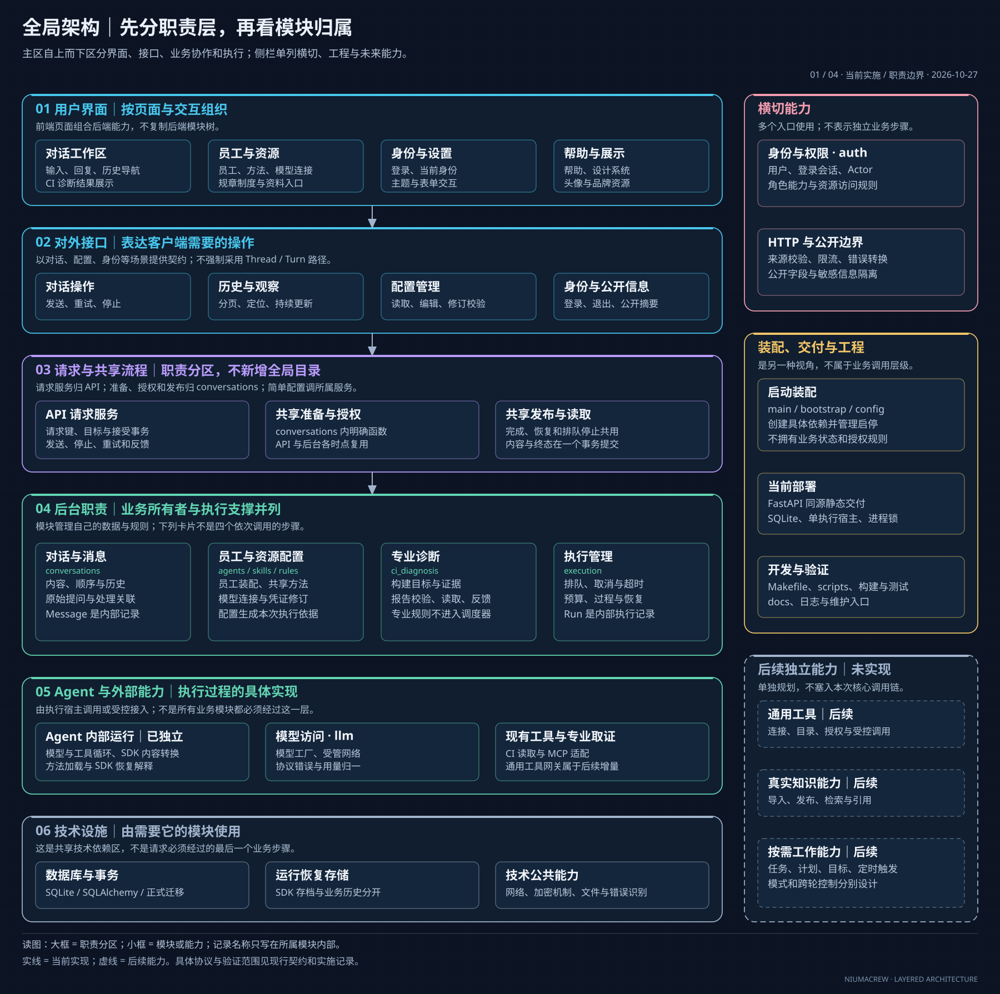
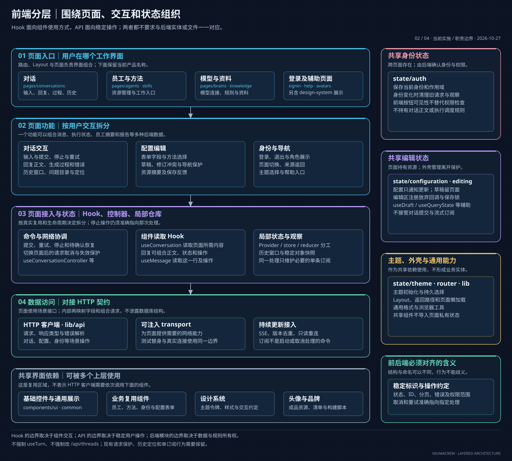
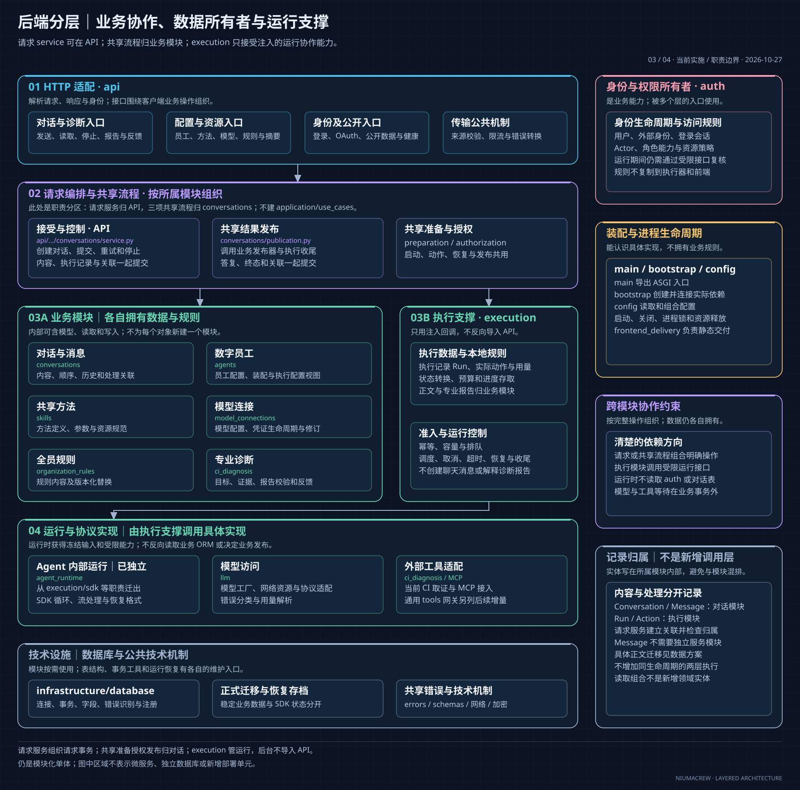
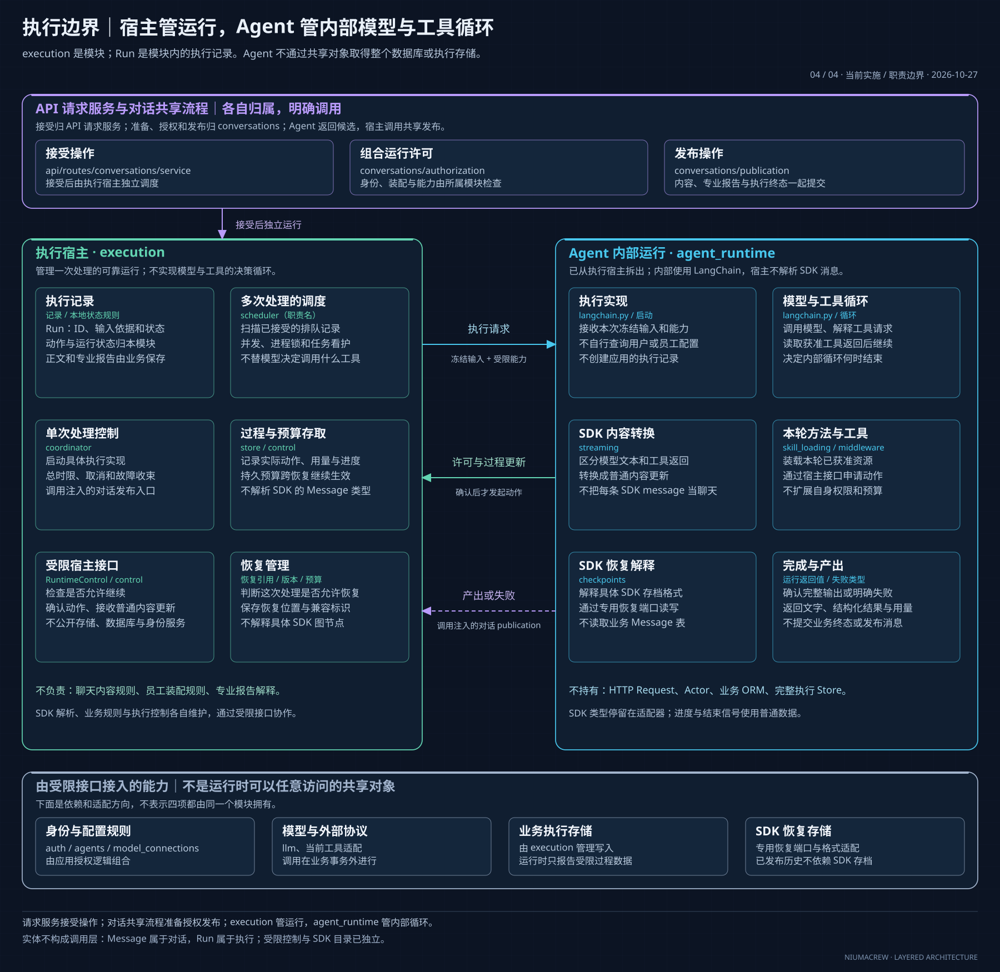

# 分层架构图：模块、边界与协作

2026-10-27 实施同步。本组图按职责分区、嵌套和并列展开当前工程；虚线仅表示后续未实现能力。实际检查见[实施记录](../../records/platform-refactor-implementation.md)。不要求前端、API、后端采用相同的模块名或对象划分。

本页提供四张配套的分层图。[总方案](README.md)、[数据建议](domain.md)与本页分别说明具体改造和职责分区；[完整目标树](target-tree.md)及[文件去向](file-map.md)维护文件级方案。图中不再将 Thread/Turn 路由和 Hook 拆分作为前提。

## 如何读图

| 图面元素       | 表达的内容                                                 | 不代表什么                                   |
| -------------- | ---------------------------------------------------------- | -------------------------------------------- |
| 大分区         | 一组相同观察维度的职责，例如页面、请求与共享流程、执行支撑 | 一个必须新建的目录、服务或部署单元           |
| 分区中的小卡片 | 模块或该模块内部的一项职责                                 | 一个必需拆出的文件或独立服务                 |
| 侧栏           | 身份、装配、共享状态、部署、未来能力等另一观察维度         | 请求依次经过的业务步骤                       |
| 箭头           | 关键跨层调用或明确的运行交互方向                           | 全量导入关系；同层卡片也不意味着彼此直接调用 |
| 虚线框         | 建议独立的边界或尚未实施的能力                             | 已经存在的模块                               |
| 框内的记录名   | 数据归属，例如 Message 归对话、Run 归执行                  | 与模块并列的新架构层                         |

图中沿用 `Conversation`、`Run` 等现有名称，方便对照源码。正文存储、回复身份、HTTP 路径与 Hook 的具体改造以对应专题草案为准，不通过画图另行定案。实线表示工程已有相关职责，**不表示当前依赖已经符合目标边界**。

## 1. 全局总览

主区区分用户界面、对外接口、请求与共享流程、后台模块、Agent 与外部能力、技术设施。只在关键位置连线；底部共享依赖和右侧工程能力不画成必经流程。



[打开完整 SVG](diagrams/layered-01-overview.svg)。

这里的两个重要归属是：对话请求服务在 API，准备、授权和发布归 conversations；执行支撑管理处理如何运行。对话内容、员工配置、专业诊断规则仍由各自模块维护。

## 2. 前端分层

页面按用户工作界面组织；页面功能按输入、回复、历史和编辑等交互组织；Hook、控制器和状态仓库为这些交互提供接入；网络客户端对接稳定的 HTTP 操作。共享身份、编辑和主题状态放在侧栏。



[打开完整 SVG](diagrams/layered-02-frontend.svg)。

| 当前能力或目录                                      | 在图中的位置           | 设计依据                                                               |
| --------------------------------------------------- | ---------------------- | ---------------------------------------------------------------------- |
| main、router、Layout                                | 页面入口及共享外壳     | 管启动、导航、身份边界与页面组合                                       |
| pages/conversations                                 | 对话页面与交互功能     | 组合输入、回复、过程、历史和诊断结果                                   |
| pages/agents、skills、brains、knowledge             | 资源及配置页面         | 分别满足员工、方法、模型和资料管理；知识页仍不等于已实现检索系统       |
| pages/signin、help、avatars、design-system          | 身份及辅助页面         | 保留真实入口，不因后端术语变化改页面分类                               |
| 对话控制器、Provider、store、reducer、Hooks         | 页面接入与状态         | 按生命周期与更新频率划分；不按后端每个实体各建一份状态                 |
| lib/api、transport、SSE 接入                        | 数据访问               | 处理请求契约和观察；组件不操作 ORM 或 SDK 对象                         |
| state/auth、configuration、editing、theme           | 共享状态侧栏           | 身份、编辑、主题各自管理；configuration 仅通知写入变化，资源读取归页面 |
| components、hooks、lib、设计系统、头像品牌及 public | 共享界面依赖与通用能力 | 按实际复用提供控件、展示、辅助逻辑和成品资源                           |

回复组件可以一起取得正文、执行状态、过程和按钮能力。本方案保留公开 `useConversation`、`useMessage`，订阅属于内部实现；不新增并列的 `useReply` 或 `useTurn`。

API 依据稳定的用户操作设计，也不按每个 React 组件各建一个接口。发送、历史、停止等接口可以组合多个后端模块，停止和重试仍须准确指定目标处理。

## 3. 后端职责与模块

HTTP 适配、请求与共享流程和模块所有权分别画成分区。业务模块与执行支撑并列：业务模块维护各自规则，执行支撑维护运行过程；请求或共享流程持有相应事务，不另建全局协调目录。



[打开完整 SVG](diagrams/layered-03-backend.svg)。

| 后端模块                   | 归属与职责                                                                | 主要协作边界                                                 |
| -------------------------- | ------------------------------------------------------------------------- | ------------------------------------------------------------ |
| api                        | HTTP、参数与响应、依赖注入、来源保护、限流、错误和静态交付                | 调用请求服务或所属服务，不直接推动 Agent 内部循环            |
| API 请求服务与对话共享流程 | 请求事务归 api/routes/conversations/service；准备授权发布归 conversations | 两者按操作持有事务，后台不导入 API                           |
| conversations              | 对话、轻量消息、顺序、历史、上下文选择与执行关联                          | 不负责全局执行队列；Message 不需要独立领域模块               |
| agents                     | 员工配置、装配及本次执行配置视图                                          | 组合共享资源，不承担登录身份和执行状态                       |
| skills                     | 共享方法、参数和资源规范                                                  | 方法声明与员工授权有各自所有者                               |
| organization_rules         | 全员规则与版本化替换                                                      | 提供规则正文和版本，跨模块提示词组合归运行共享准备流程       |
| model_connections          | 模型配置、凭证生命周期、引用和修订                                        | 向运行准备提供连接能力，不决定模型与工具循环                 |
| ci_diagnosis               | 专业目标、证据、报告校验、读取和反馈                                      | 现有专用循环和 MCP 逐步整理，不提前宣称通用工具已完成        |
| auth                       | 用户、登录会话、Actor、角色能力与资源访问规则                             | 多个入口使用同一规则；运行期间通过受限接口复核               |
| execution                  | Run、实际动作与用量；准入、调度、状态、预算、过程、取消和恢复             | 不创建聊天消息、不解释专业报告，不复制配置与身份规则         |
| 建议的 agent_runtime       | SDK 实现、内部模型工具循环、内容转换、方法加载与恢复格式解释              | 从现有 execution/sdk 等职责拆出；不持有业务 ORM 或完整 Store |
| llm                        | 模型工厂、受管网络、协议适配、错误与用量                                  | 不直接查询员工、用户或对话业务数据                           |
| infrastructure/database    | 连接、事务、字段、技术错误识别与模型注册                                  | 注册属于装配入口；业务不从注册文件反向取得 ORM               |
| main、bootstrap、config    | 应用入口、具体依赖装配、进程启停与配置                                    | 能连接具体实现，但不成为业务规则所有者                       |
| errors、schemas 等公共定义 | 已有应用错误与真正共享的传输基础类型                                      | 不收纳各模块的全部错误、输入输出或状态                       |

`Message` 和 `Run` 在各自模块内部出现。两者之间的关联由请求服务建立并验证，不能据此画出“Message → Turn → execution”的架构层级。当前代码仍通过 RunResult 保存稳定输出；将正文归回对话、专业报告归回 CI 的改造见[数据建议](domain.md)，图面不额外决定迁移细节。

## 4. 执行宿主与 Agent 内部运行

左边展开一次处理的运行管理，右边展开 Agent 内部如何调用模型和工具。上方请求与共享流程负责业务接受、授权组合及发布；下方说明受限能力的来源。



[打开完整 SVG](diagrams/layered-04-execution.svg)。

| 交互               | 方向与内容                                      | 边界要求                                                       |
| ------------------ | ----------------------------------------------- | -------------------------------------------------------------- |
| 开始处理           | 宿主向运行时提供冻结输入和本轮受限能力          | 运行时不回查当前对话或员工配置库                               |
| 执行动作与报告进度 | 运行时调用宿主的许可、预算、动作及内容接口      | 接口不暴露完整 store、database 或 auth；SDK 数据在适配器内转换 |
| 结束处理           | 运行时返回产出或明确失败，宿主调用共享发布流程  | 业务产出与执行终态按既有原子要求提交；运行时不直接发布消息     |
| 恢复               | 宿主管恢复资格、位置和预算；适配器解释 SDK 状态 | 专用恢复端口不扩大成业务数据访问入口；已发布历史不依赖存档     |

当前尚存的混合包括协调器直接参与身份和配置组合、进度解析 SDK 类型、Agent 沿 hooks.store 访问存储。图中表达的是这些职责分离后的目标，不是仅移动文件或更改类名。

## 5. 一次提问如何穿过这些分区

| 顺序 | 负责位置            | 实际动作                                                   |
| ---- | ------------------- | ---------------------------------------------------------- |
| 1    | 对话页面与控制器    | 固定输入和提交标识，通过场景 API 发送；处理未知提交状态    |
| 2    | HTTP 与请求服务     | 验证请求、身份、归属和配置；保存内容、处理记录及关联       |
| 3    | execution           | 接受后独立排队和启动，负责并发、超时、取消及持久预算       |
| 4    | Agent 运行实现      | 在受限能力范围内调用模型和工具，更新过程并返回产出         |
| 5    | 共享发布与所属模块  | 保存助手答复或专业成果，结束执行并释放活动关联；一起提交   |
| 6    | HTTP 读取与持续观察 | 返回已提交的公开内容和状态；前端更新回复区域，断线只读重连 |

配置编辑等操作可以直接经过 API 和所属服务，不经过 Agent。图中的纵向位置不构成所有请求必须完整走完的管线。

## 维护与检查

四张 SVG 与[可编辑生成源](diagrams/build-layered-diagrams.py)相邻，使用内嵌样式和系统中文字体，无远程字体或图片依赖。生成器检查文字估计宽度及卡片高度；生成后仍需渲染检查实际换行、箭头和边界。

```bash
backend/.venv/bin/python docs/proposals/platform-refactor/diagrams/build-layered-diagrams.py
make check-docs
```

本次没有变更业务代码、接口、数据库或部署。详细命名和存储方案仍需评审，不通过画图提前采纳。

本轮全工程职责复核后，配置列表与详情归页面，导航只持摘要，configuration 仅保留更新通知；Agent 实现直接放 agent_runtime，不再嵌套适配器子目录。四图已同步这些职责，细节及证据见[全工程复核](responsibility-review.md)。

本轮进一步明确了服务归属：图中“请求与共享流程”是观察分区，不是全局目录。只有对话请求编排放 API 分组，其他业务服务保留原模块，准备授权发布供后台直接使用，详见[服务边界](service-boundaries.md)。
