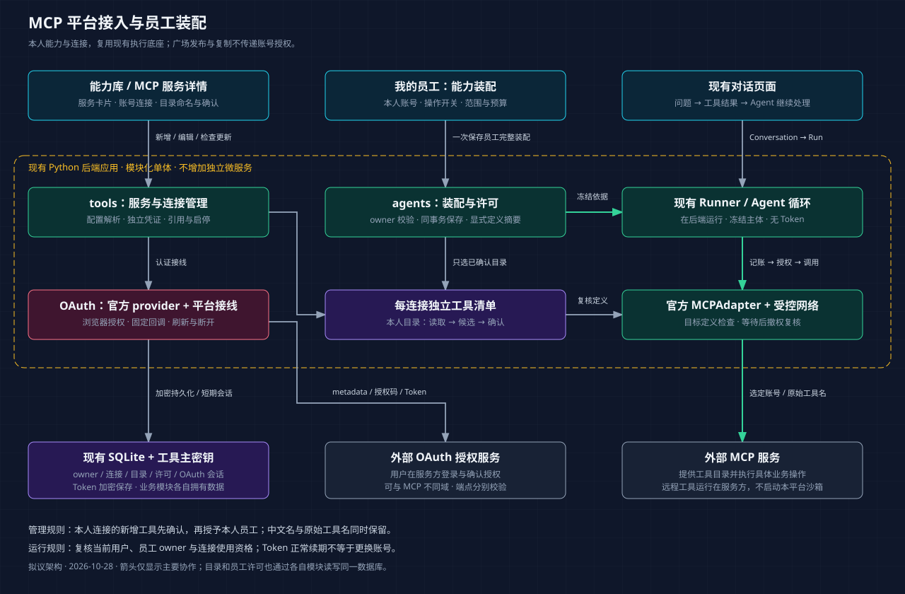

# MCP 平台接入与能力装配实施方案

> 状态：旧探索方案，已被 [Token 实施增量](mcp-token-implementation.md) 取代。当前不实施 OAuth、私人员工/广场、独立发布或复制员工；生效规则见 [MCP 当前契约](../../reference/mcp.md)。以下保留历史取舍，不能作为当前实施依据。

| 项目         | 内容                                                                                                                                                                                                                                                                |
| ------------ | ------------------------------------------------------------------------------------------------------------------------------------------------------------------------------------------------------------------------------------------------------------------- |
| 设计状态     | 待实施方案；依据最新交互演示、用户确认的目录规则和现有代码整理                                                                                                                                                                                                      |
| 实施状态     | 本次仅完成代码核对与方案；下述业务增量尚未实现，演示仍使用模拟数据                                                                                                                                                                                                  |
| 更新日期     | 2026-10-28                                                                                                                                                                                                                                                          |
| 当前基线     | 数据库迁移 `0006`，Run 快照 v3；本地安装 LangChain 1.4.7、FastMCP 4.1.4、MCP SDK 2.3.0                                                                                                                                                                              |
| 本轮范围     | 我的员工/员工广场、发布与复制；远程 HTTP MCP、配置导入与 OAuth；个人模型/工具授权；能力库、原子装配、运行主体与迁移                                                                                                                                                 |
| 保留         | 现有认证会话、Skill 单文件内容/参数及编辑能力、管理员本人 CI、原生文件与沙箱；成员自有权限和资源归属为本轮增量                                                                                                                                                      |
| 不纳入       | stdio/本地进程、旧 SSE、任意后端代码插件、标准 Skill 包改造、插件市场、多租户、独立 MCP 微服务                                                                                                                                                                      |
| 当前实现依据 | [基础工具契约](../../reference/agent-tools.md)、[tools 模块](../../../backend/app/tools/README.md)、[员工模块](../../../backend/app/agents/README.md)                                                                                                               |
| 演示依据     | 开发路由 `/demo/capabilities`；[演示页面](../../../frontend/src/pages/design-system/CapabilityDemoPage.tsx)、[目录管理](../../../frontend/src/pages/design-system/McpCatalogManager.tsx)、[规则验证](../../../frontend/src/pages/design-system/demoCatalog.test.ts) |

本方案是本轮 MCP 与前端整合的实施依据。与[原统一技能库方案](unified-capability-library.md)有三处调整：先交付 MCP，不把标准 Skill 包和按需工具加载作为前置；能力库按 MCP **服务**展示卡片，其内部工具不铺平成一级卡片；OAuth 从后续项进入本轮。原方案的其他后续内容不因此视为已经采纳或实施。

用户已确认“我的员工＋员工广场、主动发布版本、复制后个人授权”。具体产品流程、发布白名单、用户范围、数据与跨端改动以 [私人员工、员工广场与个人授权设计](private-agents-and-gallery.md)为准；本页维护 MCP 协议、连接、目录和 OAuth 接线。此前“新连接默认平台共享”“只按员工限制账号”“所有管理/执行仅管理员可用”的设想已撤回。两份方案共同构成本轮实施依据，均尚未实现。

## 1. 结论与交付目标

建议保留 Python 模块化单体：扩展现有 `tools` 接入与调用层，在 `agents` 统一保存装配，在前端用“能力库”整合技能与 MCP 入口。复用官方客户端处理协议、工具转换和 OAuth，平台负责持久凭证、浏览器授权接线、目录确认、员工许可和运行边界。

完成后已登录用户可以在本人空间：

1. 在能力库接入一个 MCP 服务，填写地址或导入现成配置。
2. 自动探测认证信息，按需填 Key，或跳转服务方完成 OAuth 授权；也可以先保存尚未连接的接入项。
3. 按账号读取工具目录，设置展示名称，确认这版目录。
4. 在员工能力装配里选择服务、账号、允许的操作及支持的范围限制，与员工其他设置一起保存。
5. 发起真实对话，由原 Agent 循环调用已获准工具；遇到目录变化、撤权、凭证失效有明确结果。
6. 回到能力库检查本人连接的远端更新，审阅新增、改变和移除；新操作不会自动授权给员工。
7. 发布一份不含账号/凭证的员工配置版本到广场；其他用户复制后生成独立私人员工，使用自己的模型/MCP 授权。

“添加服务”“账号已连接”“目录已确认”“员工已获准”“本次能调用”分别判断。它们不能用一个“已启用”状态代替。

## 2. 当前系统已有能力与缺口

以下为本次直接读取代码确认的事实，不代表已经部署或通过真实服务联调。

| 位置                    | 当前实现                                                                    | 本轮增量                                                          |
| ----------------------- | --------------------------------------------------------------------------- | ----------------------------------------------------------------- |
| `tools/models.py`       | `ToolConnection` 同时保存服务地址、认证、密文、候选/批准目录与三类修订      | 增加服务分组、连接范围、展示元数据及 OAuth 状态；保留已有连接身份 |
| `tools/service.py`      | none/bearer/header，密钥加密、发现、批准、受控调用                          | 认证探测、OAuth、目录差异、展示名称、用途/引用查询；拆出独立职责  |
| `tools/adapters/mcp.py` | 官方 `MCPAdapter`、原始 descriptor 摘要；调用前重新读取目录，仅比较目标工具 | 继续复用；接入受控 OAuth Auth，保留目标复核，分类认证错误         |
| `tools/network.py`      | 域名白名单、DNS 固定、拒绝跨目标、限制响应和压缩                            | 让 MCP 与 OAuth 多个明确端点分别受控，不放宽为任意外网代理        |
| `agents/tool_grants.py` | 每员工×连接保存工具名/摘要、scope；接受 Run 时冻结，调用前复核              | 装配 DTO 带预期摘要与连接依据；明确重新授权；并入员工保存事务     |
| `agents/service.py`     | 员工与 Skill 装配同事务；工具许可另存                                       | 员工、Skill、MCP 许可一次保存，任一错误整体回滚                   |
| `/tools`                | 连接创建、Key 轮换、发现、批准；通过 `?agent=` 另存员工许可                 | 管理功能搬入能力库的二级页面；员工许可归员工页面                  |
| `/skills`               | 当前 Skill 列表/编辑、CI 专用安装入口                                       | 展示 Skill 与 MCP 服务；原 Skill 编辑继续复用                     |
| `/agents/:id`           | 能力装配主要为 Skill，工具跳转 `/tools?agent=`                              | 在本页完成 MCP 服务、账号和工具选择，不再跳到另一套许可编辑器     |
| 演示页                  | 模拟账号、别名、候选差异、目录确认和许可失效                                | 作为交互与场景依据；正式页调用真实 API，不能直接引用演示数据      |

### 2.1 必须修正的两个现有边界

**保存许可不能顺便升级工具定义。** 现有 `GrantInput.tools` 只收工具名，后端从当前批准目录补摘要。旧工具定义改变后，如果前端再次提交相同名称，可能悄悄变成新许可。本轮改为提交用户实际看见并选择的 `descriptor_hash`，后端只确认这份依据，不能替换成最新版。

**展示修改不能等同于账号变化。** 现有连接更新对普通 `changes` 也递增 `config_revision`，连接改名可能阻断旧 Run。本轮把展示修订和执行依据分开；OAuth 正常刷新只改变 Token 存储版本，不能每次都触发凭证身份修订。

### 2.2 用户范围必须先落实

当前 Agent/Skill/模型连接没有 owner，公开员工端点仍从全库投影，member/guest 仅浏览；Token 创建者字段也不是使用者授权。本轮要先增加自有资源范围、发布快照与模型/工具连接所有权，再开放 member 创建和运行。现状证据与完整模块清单见[个人员工方案](private-agents-and-gallery.md#2-当前系统核对与实际影响)。

## 3. 对象与职责

| 对象                          | 管什么                                                           | 不管什么                                        |
| ----------------------------- | ---------------------------------------------------------------- | ----------------------------------------------- |
| 能力库                        | 本人 Skill/MCP 定义与可用平台定义的联合读取、筛选和入口          | 不公开他人私有内容/连接，不新增万能能力表       |
| MCP 接入项 `McpIntegration`   | 一项服务的名称、说明、无秘密连接样例、展示和启停                 | 不拥有统一权威工具 schema，不代表某个账号已登录 |
| 账号连接 `ToolConnection`     | 实际 URL/凭证、owner、可选本人员工限制、明确共享受众与该连接目录 | 员工共享或复制不自动共享个人账号                |
| 目录候选                      | 一次远端读取的原始工具定义、摘要、连接依据、有效期和差异         | 不立即发布到装配列表                            |
| 已确认目录                    | 平台认可的该连接工具快照                                         | 不能冻结远端实现，也不授予员工权限              |
| 工具展示信息                  | 原始工具名对应的可选展示名和补充说明                             | 不改调用名、schema、指纹或 OAuth scope          |
| 员工工具许可 `AgentToolGrant` | 具体连接、工具名/摘要、范围、预算和员工补充说明                  | 不保存 Token，不修改共享目录                    |
| OAuth 授权会话                | 一次浏览器授权的发起者、连接、state 依据、有效期与结果           | 不是平台用户登录会话，不是 Agent Run            |

关系为：一项可访问的 MCP 定义可对应多份账号连接；每份连接有自己的候选/已确认目录。员工只能引用其 owner 有权使用的连接与已确认工具。个人连接可供本人多个员工复用；不同用户即使 URL/工具名相同，也不能互借目录、凭证或许可。“每账号独立目录”准确指每个连接独立保存已确认工具清单，不是一用户或员工一个磁盘目录。

首版同一员工对同一 MCP 服务选择一份账号连接，工具开关属于该连接；需要另一身份时显式切换，切换后清空待选工具并重新确认。将来确有同员工多账号需求，可放开为多个明确的装配实例，底层连接与许可身份无需重建。



图中框表示模块职责。后端框均在当前应用内，不是每个框部署一个服务，也不是每个员工启动一个进程。我的员工/广场和发布复制的整体关系见[用户与发布架构图](diagram/private-agents-and-gallery.svg)。

## 4. 首版支持矩阵与通用接入边界

| 维度           | 本轮支持                                                         | 明确边界                                                                            |
| -------------- | ---------------------------------------------------------------- | ----------------------------------------------------------------------------------- |
| 传输           | 远程 Streamable HTTP                                             | 不自动退回旧 SSE，不启动 stdio 进程                                                 |
| 无认证         | `none`                                                           | 当前操作匿名成功不代表所有工具都无需认证                                            |
| 静态凭证       | Bearer、自定义认证头；受控的头字段映射                           | Cookie、Host、代理认证等禁止；URL 中不放秘密；不读服务器全局环境变量替用户取 Key    |
| OAuth          | Authorization Code + PKCE S256，发现、登录、刷新、重新授权、断开 | 不提供任意 grant_type 执行器；不是所有 OAuth 扩展都承诺支持                         |
| 客户端识别     | 预注册 Client ID；部署了公开客户端元数据时使用 CIMD；兼容 DCR    | Client Secret 按需提供；DCR 为旧服务兼容，不作为平台私有注册协议                    |
| 工具内容       | MCP 工具发现、参数定义及受控调用                                 | 远端返回的提示、注解、描述都不能直接授予平台权限                                    |
| 资源与提示     | 原样保留工具定义所需原始元数据                                   | 本轮不新增独立 Resources/Prompts 浏览器；遇到工具依赖未支持的客户端能力时报告不兼容 |
| MCP 客户端能力 | 现有工具调用所需握手                                             | 不自动开放 sampling、elicitation、任意 roots 等反向能力；需要时单独定义授权和 UI    |

通用化的目标是：**在平台已实现的传输、认证和网络范围内，新服务通过配置接入**。新增厂商一般不需要新业务适配器；新的传输、交互能力或特殊权限语义才可能需要开发。

## 5. 前端信息架构与列表添加方式

### 5.1 一级入口与卡片粒度

保留 `/skills` 路径，菜单和页标题统一为“能力库”，移除平级“工具连接”菜单；连接仍有正式二级页，不删除后端 tools 模块。页面上方保留搜索、类型筛选、分页和“新增能力”。

1. Skill 卡片：使用现有 `SkillCard`、查看/编辑行为及使用人数；类型标签为“Skill”。
2. MCP 卡片：每个接入项一张卡，类型标签为“远程 MCP”；显示服务名称、说明、已确认操作数、可用连接数和阻碍原因。
3. 卡片内的操作数是各可见连接已确认目录的远端名并集，仅用于摘要；账号目录有差异时明确标注，不能拿并集做授权目录。
4. 点 MCP 卡片进入服务详情，再选账号看工具；几十个工具不会铺满一级列表。
5. 原生工作区继续保留现有配置能力，入口在能力库“平台内置工具”分区；本轮不重写沙箱或要求用户重新配置已有原生许可。

联合列表由后端在本人/可用平台资源范围内筛选、排序、分页后返回 `total`；账号数量、引用人数也不能跨用户统计。不能前端分别取 Skill/MCP 各一页再混排。列表 GET 不访问远端、不创建连接、不自动回填数据。

“新增能力”菜单本轮提供“创建 Skill”和“接入 MCP”；现有 Skill 编辑器不变。标准 Skill 包导入及插件包仍按后续方案，不放一个不可使用的安装按钮。

### 5.2 MCP 详情

| 分页     | 展示与操作                                                                        |
| -------- | --------------------------------------------------------------------------------- |
| 服务信息 | 显示名、说明、配置样例、启停、引用员工；样例不含秘密                              |
| 账号连接 | 列表、范围、认证方式、连接状态；新建/编辑/登录/断开/停用；不显示 Token            |
| 工具目录 | 选账号；已确认/待确认目录；原始名称/描述/schema；展示名编辑；检查更新、确认和丢弃 |

不要把三个分页做成不同的保存副本。详情是入口，实际连接编辑器和目录编辑器分别只有一套，员工页引导跳转也使用同一套。

### 5.3 新增 MCP 引导

1. **提供接入信息。** 选择手动填写或导入配置；填写服务名、说明和 URL。预设只减少输入，不表示官方已验证服务可用。
2. **检查配置并探测认证。** 配置预览不连接；点击“检测连接”才发起受控请求，分别展示网络、协议、认证检测结果。自动识别与连接所有者手动指定认证并存，不静默覆盖用户填写。
3. **建立个人连接。** 无认证也保存为本人的匿名连接；静态认证填秘密字段；OAuth 显示“连接账号”，必要时展开 Client ID/Secret、申请范围等高级设置。owner 由 Actor 填入，可再限制某个本人员工。平台共享连接另由管理员明确建立并配置可使用受众，个人授权不会随发布/复制转共享。
4. **读取工具目录。** 认证完成后读取候选，不调用具体业务工具；可填写展示名称和补充说明。
5. **确认并完成。** 本人明确确认该连接目录，返回服务详情或本人员工装配。确认目录不自动装配员工，也不给其他用户访问此账号。

每个资源有自己的提交边界：服务信息保存后可以先结束，标为“未配置连接”；连接保存后可以稍后授权，标为“待连接”；取消引导不删除已成功保存的资源。OAuth 和远端发现不能包进员工数据库事务，界面必须说明哪些已经保存。

### 5.4 配置导入

继续采用 FastMCP `MCPConfig` 接受的 `mcpServers` 结构，不创造另一套 MCP JSON 标准：

```json
{
  "mcpServers": {
    "research": {
      "transport": "http",
      "url": "https://mcp.example.com/mcp",
      "headers": {}
    }
  }
}
```

1. 粘贴 JSON 或上传 JSON 文件，先做大小/结构检查，再用官方模型解析，随后进行平台支持字段检查。
2. 展示服务选择、地址、传输、认证方式、缺少的字段和不支持原因。多个服务可逐项选择，一项产生一个明确接入项/连接；不自动聚合成共享账号。
3. `command`、`args`、`env`、旧 SSE、未支持的变换和变量引用在创建任何客户端前拒绝。官方模型能解析不等于平台允许执行。
4. 认证头值默认按秘密处理。预览只展示字段名/已提供状态；用户明确保存后加密，导出移除秘密值。原始导入文本和拆出的秘密只在当前表单内存，不能进入草稿、URL、日志或浏览器持久存储；提交成功或退出立即清除。
5. OAuth 无法从普通工具参数推导配置。规范元数据足够时自动发现；不够时依服务文档填写高级项。配置导入不伪造“已经登录”。
6. 有相同地址时提示已有接入项，允许选择归组或明确新建；不按 URL 自动合并账号、凭证和权限。

`tools/list.inputSchema` 描述一次工具调用需要什么参数，不是账号设置或员工安装表单。高级字段由支持的接入类型定义，不能靠大模型猜出来。

## 6. OAuth 自动探测、授权与 SDK 使用

### 6.1 探测流程

1. 先校验地址、部署网络策略、请求上限，再用受控客户端尝试协议初始化/目录读取。
2. 收到 `401` 时按标准解析 `WWW-Authenticate`；有 `resource_metadata` 优先读取其目标，否则依规范尝试带 MCP 路径和根路径的 protected resource metadata。
3. 从 `authorization_servers` 获取授权服务器，读取 OAuth/OIDC metadata，验证 issuer 与所选服务器一致；读取授权/Token 端点、PKCE、客户端识别方式和可选 scopes。
4. 判断“服务声明支持”和“平台当前兼容”两个结果；单独的 401/Bearer、普通网页登录跳转、HTML 登录页均不足以认定可完成 OAuth。
5. 返回可解释的状态：`oauth_available`、`oauth_configuration_required`、`anonymous_accessible`、`auth_undetermined`、`incompatible` 或 `probe_failed`。匿名成功不声称对方不支持 OAuth；后续受限操作仍可能要求授权。
6. 超时/网络拒绝与未发现规范分开。未发现时允许连接所有者手动配置受支持的 OAuth 参数或选静态认证，不直接标成“不支持”；网络策略仍由部署者管理。

探测只检查，不弹窗登录、不注册客户端、不授予 scope。真正发起 OAuth 是明确的“连接账号”操作。探测结果有检查时间、来源和非秘密摘要，不因为列表刷新反复探测。

### 6.2 采用官方协议实现，但替换桌面默认交互

本机源码检查确认：`mcp.client.auth.OAuthClientProvider` 提供 `TokenStorage`、`redirect_handler`、`callback_handler` 等扩展点；FastMCP `OAuth` 便捷类默认会打开浏览器并启动本地临时回调服务。后者适合桌面脚本，不能原样放到云端后端，让服务器替使用者打开浏览器。

实施采用官方 OAuth provider/可扩展适配层，平台补三件事：

1. 数据库加密的 Token/客户端信息存储，按连接和 issuer 隔离。
2. 将授权 URL 返回给当前浏览器，使用现有后端固定回调路径，而不是在服务器上起随机端口回调。
3. 生命周期管理有限数量的授权等待任务，将浏览器 callback 交回原官方流程，并把结果持久化。

本轮先实现 provider 最小垂直验证（先使用隔离替身与测试身份）：发现 → 发出授权 URL → 固定回调 → 换 Token → 真实协议目录读取 → 刷新。不得为了绕过 SDK 接口限制，读取/改写其私有 `context` 或复制整份 OAuth 状态机；若公开扩展点有缺口，应明确局部适配或受控依赖变更，并补兼容测试。

还确认了一个依赖差异：当前 MCP SDK/FastMCP 的 OAuth Auth 基于 `httpx2` 2.13.1；项目受控 MCP client factory 使用 `httpx` 0.28.1，两者 `Auth` 类型不同。本轮需要将 MCP 专属传输/网络包装对齐 SDK 所需客户端及类型，并声明直接依赖、更新锁文件。其他业务 HTTP 调用不连带重写。不能只给现有 client 填一个 `auth="oauth"` 就宣称接入完成。

### 6.3 浏览器授权的完整路径

1. 已登录的连接所有者点击“连接账号”；后端核对 `tools:update`、owner/使用范围与当前配置，创建短期授权会话。个人连接为本人，平台共享连接只有明确资源管理者可授权，普通使用者不能替换团队身份。
2. 单次授权任务交给应用 lifespan 管理；不持有 HTTP Request/数据库 Session 等待用户。SDK 生成 PKCE 和授权参数，通过 redirect handler 提供授权 URL；发起接口返回 `202` 和会话状态入口。
3. 页面保存非秘密草稿后跳转授权方；用户登录并同意权限。Token 不经过前端业务代码。
4. 服务方回到 `GET /api/tool-connections/oauth/callback`。后端先验证 state、有效期、发起用户/平台会话、连接配置依据和 callback 唯一消费状态，再让官方流程验证 issuer、交换授权码。
5. 回调中的授权码仅短暂保留在内存并交还等待任务；不进入数据库、Run 或普通日志。成功后加密保存 Token 与客户端资料，更新授权依据，立即 `303` 到受控站内连接页面；页面重新读取状态。
6. SDK 流程未准备好、用户拒绝、会话过期、平台退出登录、连接被修改或已被另一会话连接时，不允许迟到回调覆盖最新账号。
7. 首版不做授权流程跨重启恢复：PKCE 和等待状态属于进程内任务，应用重启将未完成会话标为过期，用户重新点击连接。已经完成的 Token/客户端信息持久保存，重启不要求全部账号重连。

授权会话保存 state 的摘要、发起用户/平台会话 ID、连接 ID/owner、issuer、请求 scope、预期配置/身份修订、到期和终态；不保存明文 Token。SDK 内存持有 PKCE verifier，终态/取消/超时立即释放。默认会话有效期 10 分钟、每连接最多一个进行中的授权，全局等待上限 8；这些为可配置的首版建议值。

回调允许服务方跨站 GET，但仅该路径以 state/PKCE/平台会话校验承接；不豁免其他写 API 的 Origin/JSON 检查。回调响应 `no-store`、禁止 Referrer 泄漏；应用及反向代理日志不记录 callback 查询串。若第三方只支持未实现的 response mode，则提示不兼容，不整体放宽 CSRF。

### 6.4 Token 刷新与断开

| 事件                                                   | 处理                                                                                               |
| ------------------------------------------------------ | -------------------------------------------------------------------------------------------------- |
| Token 即将过期且有 refresh token                       | 按连接互斥刷新；成功原子替换 Token，保留账号身份修订和工具许可                                     |
| 服务未签发 refresh token                               | 记录到期；过期要求重新授权，不能保证永远自动续期                                                   |
| 并发请求同时触发刷新                                   | 同连接 single-flight；数据库 Token 版本 CAS 防止旧返回覆盖已旋转的 refresh token                   |
| 刷新中连接被断开/更换                                  | 保存前核对授权代次；旧刷新结果丢弃，不得复活已断开的连接                                           |
| scope 缩减、issuer/resource 改变、交互式重连或更换账号 | 作为身份/权限依据变化，递增身份修订，旧运行停止使用；目录待重新验证                                |
| 正常刷新返回不同 scope 集合                            | 按授权依据变化处理，不能当成无影响续期                                                             |
| `invalid_grant` / 远端撤销                             | 标记需要重新授权，停止使用，不回退其他账号或匿名请求                                               |
| 断开连接                                               | 先本地失效并清除 Token，递增身份修订；发现可用 revocation 端点时再尝试远端撤销，失败不恢复本地使用 |

交互式重连无法通用证明还是同一个业务账号，因此保守要求重新验证目录和许可。OAuth 没有统一的“业务账号昵称/仓库清单”接口；无可靠 profile 来源时使用连接所有者填写的连接名，不声称已自动识别某个账号。

运行中的 Agent 不负责弹出登录授权。需要交互时返回 `tool_auth_required` 或 `tool_scope_insufficient`，页面给管理入口。只有协议明确的认证拒绝、且能确认未执行工具时，才允许受限刷新重试；超时/断线/未知结果不重放有副作用的工具。

## 7. 网络与秘密边界

现有 `PinnedTransport` 只允许固定 MCP origin。OAuth 还需要访问 metadata、issuer、Token、客户端注册/撤销等端点，不能直接关闭这个限制。

1. 将工具网络校验提取为明确目标的工厂，MCP 请求仍固定到所选连接；OAuth 每个端点单独解析、校验 DNS、固定目标和限制响应。
2. 保留部署者域名白名单与显式私网许可；MCP 域名和 OAuth 授权域名分别可配置。自动发现一个新域名不等于自动获准访问，界面提示部署者补充策略。
3. 对发现链深度、端点数、总超时、文档大小和重定向次数设上限；默认拒绝服务端 HTTP 重定向。公开 OAuth HTTPS 端点与显式本地开发回调分开处理。
4. 不把 MCP Bearer、用户 Cookie、任意请求头转发给 metadata 或另一个 issuer；Token 端点只接受相应 OAuth 客户端认证。issuer 变化后禁止复用原注册凭证。
5. 认证头、Client Secret、access/refresh token、PKCE、授权码不进入展示 DTO、Skill、员工补充说明、模型上下文、Run 快照、动作或错误正文。
6. 继续用现有工具主密钥；新增结构化秘密序列化和版本，不在迁移里解密，不因密钥丢失生成替代密钥。OAuth 多字段必须有完整脱敏集合，不能沿用只替换单个字符串的结果裁剪。

平台不从用户提交的 URL 推导任意内网访问权限。开源默认保持轻量配置，不为 OAuth 引入单独密钥服务或通用出口代理。

## 8. 目录、名称与更新规则

### 8.1 保存位置与展示

目录继续存于所选 `ToolConnection` 的 `discovery_candidate` 和 `approved_catalog`，不新建每工具定义表。候选包括原始工具定义、摘要、配置/身份修订、抓取时间和过期时间；继续使用 10 分钟候选有效期，过期重新读取。

工具展示信息放独立 `tool_annotations` JSON，以原始工具名为键，包含 `display_name`、`note`。它属于这份账号目录，可编辑的只有展示信息，不允许修改服务返回的原始 name/description/schema。

有展示名时显示 `搜索网页（tavily_search）`，没有时只显示原名。原始描述与补充说明分开展示；不默认翻译，不用中文名调用。展示修订独立管理，不参与 descriptor hash、员工许可或运行撤权。不同账号分别保留自己的展示信息，可显式复制文字，不复制许可。

### 8.2 更新影响

| 远端变化                   | 能力库                            | 员工装配与运行                                   |
| -------------------------- | --------------------------------- | ------------------------------------------------ |
| 新增工具                   | 候选标“新增”，连接所有者命名/确认 | 确认后进入可选列表，默认关闭；旧工具未变继续可用 |
| 原始定义改变               | 展示 schema/描述/元数据差异       | 旧摘要许可失效；必须对新定义明确重新授权         |
| 原始工具改名               | 按“移除旧项＋新增新项”处理        | 保留旧许可历史并标无效；不猜同义、不迁移授权     |
| 删除工具                   | 候选标“移除”                      | 远端不可调用；确认后不再提供新授权，旧历史仍保留 |
| 只改中文名/补充说明        | 保存展示元数据                    | 不改变调用或许可                                 |
| 同名工具实现改变但定义不变 | 标准目录可能无法识别              | 快照不保证服务实现未变化；供应商仍负责其接口行为 |

默认更新入口只有能力库，个人目录由本人管理，平台共享目录由资源管理者处理。运行时可检测目标变化并保存待审候选，但不代替有权用户确认、不修改展示名、不将新增项放入员工可选目录。可在后续加后台“检查更新”，其结果仍只是候选。

确认目录用候选 hash、目录/配置/身份预期修订做并发检查；多人同时确认或候选被新读取替换时返回冲突，不按最新候选偷偷保存。丢弃候选不修改已确认目录。

候选确认为相同内容时按无变化处理，不无意义递增目录版本。批准目录是当前认可快照，历史 Run 已冻结当时定义；本轮不新建无限目录版本库。需要恢复旧服务版本必须由服务方提供或固定部署，不能靠回滚本地快照让远端旧接口重现。

## 9. 员工装配交互与保存

### 9.1 页面流程

1. 在“我的员工”的现有“能力装配（可选）”里点“添加能力”，从本人/可用平台联合列表选择 Skill 或 MCP 服务；广场副本先按能力需求列出待配置事项。
2. 选择 MCP 后打开配置面板：**账号连接 → 可用操作 → 员工使用设置**。同一服务复用这套面板，不给每个厂商写一套页面。
3. 账号选项只显示本人的个人连接和当前用户明确获准的共享连接，标明认证方式、目录状态和使用限制。本人可选某员工专用，但这不能代替 owner 校验。没有账号时跳到同一个连接编辑器；返回后仍须保存员工装配。
4. 操作开关只显示该连接已确认目录；未确认目录只能去能力库处理。原有失效许可单列，允许移除或审阅新定义后重新开启，不能无提示勾中新版。
5. 用户配置调用预算、已有平台支持的参数限制及可选“员工补充说明”；保存后才生效。
6. 账号切换清空工具草稿并提示重新选择，不自动复制另一账号开关或范围。
7. 新员工可先选已有本人连接或明确获准的共享连接，与创建一起保存；如要限制专门员工，先取得本人员工 ID。广场复制不带原连接、Key 或许可，添加者完成自己的授权后再保存装配。

### 9.2 哪些信息通用，哪些不能自动猜

| 内容                                         | 实现方式                                                 | 实际含义                                         |
| -------------------------------------------- | -------------------------------------------------------- | ------------------------------------------------ |
| 账号登录/Token                               | 连接编辑器与 OAuth                                       | 确定请求使用哪个身份                             |
| 工具开关                                     | 已确认目录生成                                           | 后端真正检查的工具许可                           |
| 单项调用次数                                 | 现有 `max_calls` 控件                                    | 平台运行预算，不冒充服务方计费上限               |
| `maximum/maxItems/maxLength/enum` 等参数限制 | 沿用支持的规则，普通控件＋高级 JSON                      | 调用前后端校验；必须与具体工具 schema 可对应     |
| 员工补充说明                                 | 通用可选文本                                             | 作为模型上下文，不是权限，不放秘密               |
| 默认仓库/工作重点等厂商业务信息              | 可写补充说明；确有强约束时用已支持参数规则或受限上游身份 | 不从 `tools/list` 推导一套“所有服务通用仓库权限” |

例如，同一个仓库查询工具确实有 `repository` 参数时，可对该工具配置 `enum`；如果部分操作使用仓库 ID、URL 或服务端默认仓库，平台不能宣称只填一个仓库字符串就约束所有操作。通用面板不等于自动理解任意供应商权限。

Skill 仍使用现有 `configuration_schema`/员工 `parameters`，不凭空生成“审查重点”等专用字段。本轮不要求所有 Skill 补额外字段，也不为接 MCP 修改标准 Skill 协议。

### 9.3 原子保存与许可依据

员工写请求新增可选 `tool_grants`。每个连接引用携带预期配置/身份修订，每项工具携带 `{name, descriptor_hash}`，另带范围、预算和可选 `context_note`。批准时的连接配置/身份修订也必须保存到 grant，不能只检查请求后丢弃，否则下次 Run 会从连接读取新身份，旧许可便会自动借给新账号。后台在同一短事务完成员工修改、Skill 参数校验与 MCP 许可保存。

1. 核对 Actor/员工 owner、员工预期修订、接入项可见/启用、Skill 可用范围、连接 owner 或共享受众、目录依据、实际工具 hash、参数规则和次数上限。
2. 新增/重新授权的 hash 必须与当前批准工具匹配；不接受“只传名字，后台换成最新”。
3. 未修改的旧许可按原 hash 保留；失效项可保留为不可用历史，不能因修改员工姓名或补充说明自动升级。读取 DTO 返回每项 `valid` 与原因；激活新许可必须明确提交当前定义。
4. PATCH 省略 `tool_grants` 保持原配置，显式空数组解除全部；GET 失败不能转换成空列表再保存。
5. 统一递增一次员工修订；旧 `PUT tool-grants` 入口调用同一个事务 helper。兼容期旧格式仅允许保留原有依据未变的许可或解除许可；新增工具、切换账号、升级定义必须提交新版预期依据，不能在服务端补成最新 hash。返回明确冲突提示，不能以兼容旧客户端为由绕过确认。
6. 连接/OAuth/目录确认独立保存；取消员工编辑不回滚这些已完成资源，页面显示“账号已保存，尚未装配”。

前端保存锁、脏表单、身份隔离、冲突保留草稿、返回路径继续沿用现有机制。秘密不参与任何草稿持久化。

## 10. 数据与修订设计

以下表名/字段为拟议增量，实施时用正式 Alembic 迁移；不用 `create_all` 代替升级。

| 对象                                     | 新增或调整                                                                                                                               | 原因与约束                                                                  |
| ---------------------------------------- | ---------------------------------------------------------------------------------------------------------------------------------------- | --------------------------------------------------------------------------- |
| 新 `mcp_integrations`                    | 服务定义、personal/platform 范围、owner、无秘密样例与公开预设                                                                            | 一服务多连接；本人定义不因被员工引用而自动公开                              |
| `tool_connections`                       | integration_id、scope_kind=personal/platform/system、owner_user_id、restricted_agent_id、usage_policy、秘密版本、展示修订/注解与认证状态 | 取代旧 platform/agent/system 单轴；新个人连接默认仅本人，员工限制为额外条件 |
| `tool_connections` OAuth 配置            | 非秘密 issuer/resource、客户端模式、公开 Client ID、申请/已获 scope、metadata 摘要与更新时间                                             | 与秘密分开；仅连接所有者/有权管理者读取，不进公开列表                       |
| `tool_connections.encrypted_credentials` | 版本化秘密载荷，容纳具名认证头或 OAuth Token/客户端密钥                                                                                  | 复用现有工具密钥；旧字符串仍可读取；Token 不另存普通 JSON                   |
| `tool_connections` Token 元信息          | `token_version`、过期时间、授权代次                                                                                                      | 正常刷新 CAS，与授权身份变化分开                                            |
| 新 `mcp_oauth_sessions`                  | 连接/owner、发起用户/会话、state hash、issuer、依据、到期与终态                                                                          | 私人授权只由本人发起/消费；SDK PKCE 和授权码不落普通记录                    |
| `agent_tool_grants`                      | 保留工具 JSON 的 name/hash；新增获准时的连接配置/身份修订及 `context_note`，明确输入依据和无效原因投影                                   | 防止下次 Run 自动借用已更换的账号；不为每个工具建一张授权表                 |
| Run 快照                                 | 冻结接入启停依据、连接范围/身份代次、员工补充说明、可选展示名称                                                                          | 不冻结秘密或 Token 版本；真实语义变化使用 v4，保留旧 v2/v3 读取             |

本页 MCP 增量新增服务分组和短期 OAuth 会话两张表；[个人员工方案](private-agents-and-gallery.md#9-数据增量与约束)另定义发布项/发布版本及员工、Skill、模型连接的所有权字段。目录、展示信息、Token 仍以连接为聚合，不新增工具定义表、万能配置表或独立 Token 微服务。

### 10.1 修订规则

| 修订/版本             | 何时变化                                               | 是否影响已有许可/运行                                 |
| --------------------- | ------------------------------------------------------ | ----------------------------------------------------- |
| 服务/连接展示修订     | 名称、说明、工具展示名                                 | 不影响执行依据；历史显示冻结值                        |
| 配置修订              | URL、认证方式、会影响调用的配置或连接使用范围          | 旧 Run 不继续使用；待重新验证，不暗中换目标           |
| 凭证身份修订/授权代次 | 手动换 Key、交互重连、scope/issuer/resource 改变、断开 | 旧授权依据失效；显式重新验证连接/目录，员工确认后生效 |
| Token 存储版本        | 同一授权下的正常 Token/refresh token 旋转              | 不改变已确认目录与员工许可，只用于并发替换            |
| 目录修订              | 确认不同目录                                           | 未变工具的许可保留；变化项仍按自身 hash 失效          |
| 员工/许可修订         | 用户保存了装配变化                                     | 当前授权 guard 生效；不保证撤回已发出的上游请求       |

原有凭证身份修订含义需要继续保留，不可为了避免刷新失效而干脆不检查账号变化。身份状态与 Token 有效期状态也不能混为一项。

## 11. 后端模块拆分与依赖

不引入新技术栈、Redis 或独立服务。新增文件只对应实际独立职责；普通 CRUD 留在现有 service，避免每表一套 repository。员工归属、发布/复制、Skill 与模型的个人范围文件改动见[跨模块补充清单](private-agents-and-gallery.md#11-需要新增和修改的模块)，与下面 MCP 文件一起实施。

### 11.1 拟议新增文件

以下节点均为计划，尚未创建业务实现。

```text
backend/app/
├── tools/
│   ├── integrations.py       # 服务分组、启停、引用保护与展示投影
│   ├── configuration.py      # MCPConfig 解析、支持检查、秘密拆分、静态预设
│   ├── catalogs.py           # 候选/确认、差异和展示名称；复用现有目录结构
│   └── oauth/
│       ├── models.py        # 短期授权会话 ORM
│       ├── schemas.py       # 探测、发起和状态 DTO
│       ├── discovery.py     # 标准认证发现与兼容性结果
│       ├── service.py       # 发起、回调、取消、断开和状态变更
│       ├── provider.py      # 官方 OAuth provider 与 Web 回调接线
│       └── storage.py       # TokenStorage、加密映射、刷新互斥/CAS
└── api/
    ├── queries/
    │   └── capabilities.py  # Skill/MCP 联合读取、分页、权限裁剪
    └── routes/
        ├── capabilities.py  # 联合目录 HTTP 入口
        └── mcp_oauth.py     # 探测、授权会话、固定回调、断开
```

`oauth/models.py` 仅拥有会话；连接及其秘密仍归 `tools/models.py`。`provider.py` 不访问员工或 Run，`storage.py` 不启动浏览器。现有 GitHub 平台登录与本轮 OAuth 业务不同，不直接拿 `auth/github.py` 的固定提供商实现接任意 MCP。

### 11.2 修改现有文件

| 当前路径（均相对仓库根）                                                                | 改动                                                                   |
| --------------------------------------------------------------------------------------- | ---------------------------------------------------------------------- |
| `backend/app/tools/models.py`、`schemas.py`                                             | 服务分组/连接范围、认证枚举、修订与安全 DTO；增加明确字段白名单        |
| `backend/app/tools/service.py`                                                          | 保留连接管理/执行协调；调用新配置、目录和 OAuth 服务；删除重复目录逻辑 |
| `backend/app/tools/config.py`、`backend/app/config.py`                                  | OAuth 回调基址、网络目标、探测/授权限额；显式解析，不散落读环境        |
| `backend/app/tools/network.py`                                                          | SDK 所需 HTTP 类型、每目标固定网络工厂、OAuth 多端点上限与隔离         |
| `backend/app/tools/adapters/mcp.py`                                                     | OAuth provider 注入、工具目录复核、认证失败分类；不让 SDK 自动越界登录 |
| `backend/app/tools/contracts.py`、`policy.py`                                           | 类型化身份依据/展示字段；复用现有可强制范围，禁止把说明当权限          |
| `backend/app/agents/schemas.py`、`service.py`、`tool_grants.py`                         | 原子装配、预期 hash、连接范围、旧接口兼容 helper；单次员工修订         |
| `backend/app/conversations/preparation.py`、`authorization.py`                          | 冻结新增依据并逐次复核，保留发布前授权检查                             |
| `backend/app/agent_runtime/tool_calls.py` 及工具装配处                                  | 继续通过 RuntimeControl，补员工说明与受控错误；不接触 Token/ORM        |
| `backend/app/execution/contracts.py` 及快照校验/读取处                                  | 新快照语义、v2/v3 兼容；不改变外部工具不可自动重放的边界               |
| `backend/app/api/routes/tools.py`、`agents.py`、`public.py`、`configuration_summary.py` | 新 DTO、服务分组/连接操作、员工保存、公开列表/数量与全局搜索           |
| `backend/app/api/router.py`、`security.py`、`bootstrap.py`                              | 注册路由、固定 callback 例外与日志裁剪、注入服务/授权任务生命周期      |
| `backend/app/infrastructure/database/models.py`、`backend/migrations/versions/`         | 注册新模型；新增正式迁移和回填；修订 CHECK、FK、唯一索引               |
| `backend/pyproject.toml`、`backend/uv.lock`                                             | 明确 MCP 专属 HTTP 依赖；仅必要时调整 SDK 版本，不顺便全量升级         |

`tools` 不拥有员工许可；`agents` 不解析 OAuth；`execution` 不认识供应商名称或账号秘密。`bootstrap` 组合这些服务，外部调用不在数据库写事务中执行。

## 12. 前端文件与整合方式

路由页继续按当前业务模块组织。数字员工页增加“我的员工/员工广场”，发布详情使用独立 DTO；具体组件/路由见[个人员工前端清单](private-agents-and-gallery.md#11-需要新增和修改的模块)。OAuth 页面不是第二套身份 Provider；服务端为连接状态的唯一事实来源。

### 12.1 拟议新增文件

```text
frontend/src/
├── pages/
│   ├── skills/
│   │   ├── useCapabilityDirectory.ts  # 联合能力目录，替换当前列表读取部分
│   │   ├── McpIntegrationPage.tsx     # 服务信息、连接和目录入口
│   │   └── McpImportDialog.tsx        # JSON 导入预览；秘密不入草稿
│   └── tools/
│       ├── ToolConnectionPage.tsx     # 唯一账号编辑与 OAuth 连接页面
│       ├── useToolConnection.ts       # 详情、保存、状态读取和冲突
│       ├── McpCatalogEditor.tsx       # 目录差异、展示名、确认/丢弃
│       └── OAuthConnectionPanel.tsx   # 探测、登录/重连、到期/失败状态
├── components/
│   └── capabilities/
│       ├── CapabilityCollection.tsx   # 共享选择/展示组合，复用 Skill 卡片
│       └── McpAssignmentConfiguration.tsx # 员工的账号/开关/范围配置
└── lib/
    ├── models/
    │   └── capability.ts             # 跨页面的带类型读取模型，不依赖页面
    └── api/
        ├── capabilities.ts           # 联合列表和服务分组 DTO/API
        └── mcpOAuth.ts               # 探测、授权会话、状态、断开 API
```

组件只在实际需要跨能力库和员工页面时共享；只服务连接页的 Hook/规则留在 `pages/tools`。真实组件与演示共享展示接口时从业务层导出，正式代码不得导入 `pages/design-system`。

### 12.2 修改与退出旧实现

| 文件/范围                                                                       | 处理                                                                               |
| ------------------------------------------------------------------------------- | ---------------------------------------------------------------------------------- |
| `pages/skills/SkillsPage.tsx`                                                   | 一级页标题/列表改为能力库；创建菜单、MCP 卡片/详情路由；保留 SkillEditorPage       |
| `pages/skills/useSkillDirectory.ts`                                             | 原 Skill 详情/编辑继续可用；联合列表由新 Hook 负责，不重复维护两份目录             |
| `pages/tools/ToolsPage.tsx`                                                     | 退出一屏混合连接/员工许可的旧管理方式，保留兼容跳转；不维护两套表单                |
| `pages/agents/AgentConfiguration.tsx`、`useAgentEditor.ts`、`lib/api/agents.ts` | 接入 MCP 装配草稿/读取/整体保存；替换 `/tools?agent=` 跳转                         |
| `lib/api/tools.ts`                                                              | 补全 descriptor/连接/候选/许可类型，移除 `unknown` 写请求，保持 DTO 与表单模型分离 |
| `Layout.tsx`、`router.tsx`、`lib/navigation.ts`                                 | 单一级入口、二级面包屑、旧深链兼容、安全返回白名单                                 |
| 导航摘要、全局搜索、员工资源数、帮助页                                          | Skill 与工具计数分别保留；统一入口显示能力总量，不能把旧 `skills` 计数偷偷改义     |
| `pages/design-system/` 演示与 fixtures                                          | 正式组件提取后复用展示；模拟端口仍明确隔离，不将假 Token/成功提示带入正式页        |
| `frontend/vite.config.ts` 与后端静态交付                                        | 新 API/callback 代理、深链 GET/HEAD/刷新；开发回调不绕过同源约束                   |

### 12.3 路由建议

| 路由                                                                        | 页面                                                             |
| --------------------------------------------------------------------------- | ---------------------------------------------------------------- |
| `/skills`                                                                   | 能力库，类型/状态/搜索/分页可恢复                                |
| `/skills/new`、`/skills/:id`                                                | 原 Skill 创建/编辑，语义不变                                     |
| `/skills/mcp/new`、`/skills/mcp/:id`                                        | 接入 MCP 引导/服务详情                                           |
| `/skills/connections`、`/skills/connections/new`、`/skills/connections/:id` | 唯一连接管理；允许受控 `integration`、`agent`、`returnTo` 上下文 |
| `/agents/:id?tab=capabilities`                                              | 员工能力装配；保留非秘密草稿后跳转/返回                          |
| `/tools`、`/tools?agent=:id`                                                | 分别兼容重定向连接列表/员工装配                                  |

静态段 `mcp`/`connections` 明确注册，不能误入旧 Skill ID 路由。OAuth callback 为后端 API，不将 code/Token 转发进 React 路由。GitHub 登录安全返回规则目前也有独立白名单，新增深链时一起核对，不能只改前端。

## 13. API 增量

接口为拟议契约；保留现有错误分类和分页习惯，不在此复制完整 OpenAPI。登录用户可在本人范围调用相应能力；平台管理写入另需管理权限。列表、单条、引用、探测/目录、OAuth 和运行均检查 owner 或明确共享受众，猜 ID 不能绕过。发布/复制接口见[个人员工 API](private-agents-and-gallery.md#10-api-与跨端契约)。

| API                                                               | 用途与关键规则                                                                        |
| ----------------------------------------------------------------- | ------------------------------------------------------------------------------------- |
| `GET /api/capabilities`                                           | 本人和可用平台定义联合列表/状态；不返回他人私有内容或秘密，不远程探测                 |
| `GET /api/public/capabilities`                                    | 仅明确公开的平台定义展示，不含任何个人目录/连接/内部地址；不能据此读取私人 Skill 正文 |
| `POST/PATCH /api/mcp-integrations` 及单条路径                     | 服务定义与预期修订；连接存在时删除保护，停用阻止新装配/调用                           |
| `POST /api/mcp-config/preview`                                    | 配置解析和支持检查；不保存、不连接、不原样回显秘密                                    |
| `GET/POST/PATCH /api/tool-connections` 及单条路径                 | 扩展现有连接；支持范围、OAuth 配置、秘密写入和状态读取                                |
| `GET /api/tool-connections/:id/usage`                             | owner 读取本人引用；共享管理者读取其管理范围影响，不向使用者公开其他用户私有员工      |
| `POST /api/tool-connections/:id/auth/probe`                       | 真实认证探测，限频；不主动登录或注册客户端                                            |
| `POST /api/tool-connections/:id/oauth/sessions`                   | 明确发起登录，核对预期修订/幂等键；返回 202，URL 准备完成后读取                       |
| `GET/DELETE /api/tool-connections/:id/oauth/sessions/:session_id` | 读取/取消本次授权，须匹配发起用户、平台会话、连接及当前 owner                         |
| `GET /api/tool-connections/oauth/callback`                        | 唯一固定回调，校验 state/issuer/PKCE/平台会话，立即跳转站内                           |
| `POST /api/tool-connections/:id/oauth/disconnect`                 | 本地立即撤销、清除秘密、可选远端撤销；重复断开幂等                                    |
| 现有 `POST .../:id/discover`、`.../:id/approve`                   | 继续分离发现/确认；新增明确差异与预期凭证身份依据                                     |
| `DELETE .../:id/discovery-candidate`                              | 丢弃指定候选，核对 hash，不误删别人刚读的新候选                                       |
| `PATCH .../:id/tool-annotations`                                  | 仅展示信息、预期展示修订；不改原始定义                                                |
| 原员工 POST/PATCH 与 GET                                          | 新增原子 `tool_grants` 与可用性投影；省略/清空语义明确                                |
| 原 `PUT agents/:id/tool-grants`                                   | 兼容入口，复用同事务规则；旧格式不能静默重新授权                                      |

“检测 URL 尚未保存”的引导可先保存接入项/待配置连接，再调用按 ID 探测；不另建一个匿名任意 URL 请求接口。配置预览多次调用没有副作用；发现产生新候选，确认依 hash 幂等，不重复升级同一目录。创建与 OAuth 发起采用短期幂等键/唯一进行中会话约束，重复点击不生成多份账号/授权任务。

主要稳定失败码：`mcp_transport_unsupported`、`mcp_config_unsupported`、`tool_endpoint_denied`、`oauth_configuration_required`、`oauth_incompatible`、`oauth_session_expired`、`tool_auth_required`、`tool_scope_insufficient`、`tool_candidate_expired`、`tool_definition_changed`、`tool_access_revoked`、`tool_upstream_failed`。是否可重试由实际阶段决定，不能所有错误都解释为“请重新登录”。

## 14. 一次真实 Agent 调用的路径

1. 用户在本人私人员工的 Conversation 提交问题；后端核对 Actor、员工、对话与 Run owner 一致，以及个人/共享模型和工具的使用资格。广场只能查看/复制，不能直接借作者员工执行。Agent/模型循环仍在后端。
2. 准备阶段取得本人员工已保存的 Skill、工具许可、账号 owner/受众、已确认 descriptor 和补充说明；仅冻结非秘密主体与授权依据。必需能力未配置则提示准备事项，不自动选择作者或管理员账号。
3. 仅将有效获准工具提供给模型；同名远端工具继续使用当前连接隔离的稳定暴露名，中文展示名不参与路由。
4. 模型请求工具时，RuntimeControl 在原子事务中复核身份/员工/连接/接入项/预算，保存动作后才允许外部访问。
5. 工具服务在事务外读取当前可用凭证；OAuth 必要时受限刷新。普通续期不改变本 Run 身份，交互重连则停止旧绑定。
6. 通过受控客户端重新读取当前目录，比较**目标工具**的原始 name/hash；无关新增不阻断旧目标，目标变化保存候选并拒绝调用。
7. 网络等待后再次 guard，确认没有撤权/取消，再发出业务调用。数据只送往选定账号和获准目标；没有匿名或另一个账号回退。
8. 返回内容先按多秘密字段裁剪、大小限制并持久化动作，再交给 Agent 继续循环；最终发布沿用现有授权复核。
9. 超时/断线的外部副作用可能未知；记录明确阶段，不假装未发生、不自动重放。取消/停用阻止后续动作，无法保证远端已接受请求被撤回。

HTTP MCP 在服务方运行工具，不启动本平台沙箱。本地脚本/stdio 的隔离机制属于后续接入方式，不因本轮支持 OAuth 混入宿主进程执行。

## 15. 状态、错误与可观察结果

状态按来源组合，不新增一个包办全部生命周期的大枚举。

| 层次     | 典型状态/提示                                         | 用户去哪里处理             |
| -------- | ----------------------------------------------------- | -------------------------- |
| 服务     | 启用/停用、无连接                                     | 能力库服务信息             |
| 认证发现 | 未检测/检测到 OAuth/缺应用配置/未确定/不兼容/网络失败 | 连接页面                   |
| 账号认证 | 待配置/授权中/已连接/需要重连/已断开                  | 连接页面                   |
| 目录     | 未读取/待确认/已确认/发现变化/候选过期                | 能力库工具目录             |
| 员工许可 | 未选择/已授权/定义失效/账号不可用/范围不符            | 员工能力装配               |
| 运行     | 已拒绝/已开始/成功/明确失败/结果未知/已取消           | 现有 RunActions 与对话错误 |

日志最小记录 request/connection/integration/session/run/action 的非秘密 ID、操作阶段、耗时、结果类别；只记录实际需要的关联 ID，不宣称当前已有统一追踪系统。至少统计探测/授权成功失败、刷新失败、目录变更、调用耗时/失败和候选冲突。起步复用应用日志与受控管理状态，不以部署 Prometheus 为前置。

## 16. 迁移、兼容与回滚

1. 实施前重新核对迁移 head；暂停接单，等待或按既有规则终止活动 Run，备份业务库、文件及工具/模型主密钥。不用本次读取的 `0006` 永远假定升级时仍是 head。
2. 新增服务分组/授权会话和连接字段。旧 MCP 连接各建一个接入项，不按相同 URL 合并；保留连接 ID、Key 密文、候选/已确认目录及 descriptor hash。
3. 旧 MCP/模型连接按明确的遗留资源接收者映射为个人资源，不能默认平台共享；确属组织用途需另行配置受众。旧原生连接为 system。创建者只能作为映射候选，归属冲突必须审阅；完整旧员工/对话迁移见[个人员工迁移](private-agents-and-gallery.md#12-迁移与历史兼容)。
4. 原 `encrypted_credentials` 标记旧格式并保留，运行按原认证类型解读；新结构化写入显式转换。Alembic 不读取密钥、不更换密文、不安装依赖。
5. 旧许可 name/hash 原样保留，补空 `context_note`，并以迁移时对应连接的配置/身份修订建立初始绑定；以后变化不得自动回填该依据。已有失效工具继续无效，不能迁移成最新定义。旧静态凭证当前有效的连接不因为新增 OAuth 字段强制重新登录。
6. v4 快照体现接入状态/范围/身份语义；保留 v2/v3 校验和历史显示，旧外部工具不自动恢复/重放。标准 Skill 包以后实施时再次依据实际语义安排版本，不预占一套尚未实现字段。
7. `/tools` 与原 Skill/员工路径维持受控重定向；导航、搜索、数量、帮助和新旧 API 保持兼容。新 UI与后端迁移同包发布，不混跑旧服务写新库。
8. 新库已产生写入后回滚恢复配套库/文件/密钥备份，不直接启动旧二进制读新结构。迁移失败保持原库可恢复；测试包含真实升级和外键检查，不只新建空表。

服务/连接删除先看本人范围引用与活动 Run；有引用时先停用或解除装配，不级联删除员工许可/历史。删除员工处理其 restricted_agent 关系和进行中的授权，但不能删除本人其他员工共用的连接；发布项下架与已复制实例的生命周期按个人员工方案分别处理。停用连接立即阻止新动作，OAuth Task 终止不得写回过期账号。

## 17. 实施顺序与每阶段交付

下面保留 MCP 技术工作包 M0–M4，整体依赖/发布顺序统一采用[个人员工方案 P0–P5](private-agents-and-gallery.md#13-与-mcp-原计划合并后的实施顺序)：先落实 owner 和权限，再开放 member 运行，再交付发布/复制及双 Tab。不要把旧 M 阶段当作可跳过用户隔离的独立上线计划。

| 阶段                  | 交付                                                                                | 为什么先做                                                 | 完成依据                                                 |
| --------------------- | ----------------------------------------------------------------------------------- | ---------------------------------------------------------- | -------------------------------------------------------- |
| M0 基线与协议验证     | 官方 MCPConfig；固定 Web callback 的 OAuth 最小链路；HTTP 类型兼容；新对象/修订契约 | 先验证最难的 SDK/网络接线，避免做完 UI 才发现 OAuth 跑不通 | 协议替身完成授权、目录读取与刷新；不启动后端桌面浏览器   |
| M1 数据与静态认证闭环 | 服务分组/迁移、配置导入、连接范围、目录差异/别名、原子许可与真实 Bearer 调用        | 当前已有基础，先让统一模型可工作                           | 空库/旧库迁移；两员工独立许可；变化定义不得自动升级      |
| M2 OAuth 正式化       | 探测、加密存储、授权会话/固定回调、刷新互斥、断开、网络策略、认证错误               | 用 M0 已验证的 SDK 接线补齐平台生命周期                    | 取消、超时、重启、账号切换、Token 旋转、scope 不足全覆盖 |
| M3 正式前端整合       | 能力库、新增引导/JSON、服务详情/目录、唯一账号编辑器、员工统一保存、导航兼容        | 基于稳定 API 将演示变成真实业务                            | 从接入到员工真实调用完整浏览器流程，旧入口可达           |
| M4 收口与发布         | 文档/帮助、旧库演练、公开权限、真实上游联调、性能/限制验证                          | 协议替身不证明真实供应商可用                               | 静态/测试/构建/文档检查；实际记录真实与未覆盖范围        |

M1/M2 可以同步建设相应页面，但 member 写入/执行前必须完成个人资源授权底座，最终按 P4/P5 验收完整双用户流程。任何真实外部账号缺失都单列未验，不能用模拟成功冒充上线可用。后续部署只需维护本应用及已有数据库/数据目录，不要求另起 MCP 管理服务。

## 18. 验收矩阵

| 类别       | 必须覆盖的场景                                                                                                          |
| ---------- | ----------------------------------------------------------------------------------------------------------------------- |
| 配置导入   | 单/多服务、重复地址、语法错误、未知字段、stdio/SSE/环境变量拒绝；秘密不进响应/日志/草稿；保存前不连接                   |
| OAuth 发现 | 正确挑战、标准路径回退、不同域 issuer、issuer 不匹配、元数据缺失/过大/超时、401 非 OAuth、匿名+受限操作                 |
| 客户端识别 | 预注册有/无 Secret、CIMD、旧 DCR 兼容、回调不允许/PKCE 不兼容、缺应用配置可解释                                         |
| Web 授权   | 发起鉴权、跨用户 state、过期/重复 callback、拒绝、取消、途中退出/修改连接、重启过期、多次点击、等待上限                 |
| Token      | 同账号并发刷新、refresh token 旋转、断开与刷新竞争、scope 变化、无 refresh token、`invalid_grant`、存储失败不继续请求   |
| 网络       | DNS 到私网/链路本地、发现跨域、认证头泄漏、重定向、超大/压缩响应、注册端点诱导；部署者许可不能被服务 metadata 扩大      |
| 目录       | 账号 A/B 不同目录、候选过期/竞争、无变化确认、改名/删除/定义变化、仅展示修改、丢弃候选、新增不自动授权                  |
| 员工保存   | 不同账号/工具/范围、专用连接越权、显式 hash、保存姓名不升级旧许可、整体回滚、旧 API 不绕过、读取失败不能清空            |
| 运行       | 接入/连接/员工撤权、等待后 guard、目录变化仅阻断目标、Token 刷新不使旧 Run 失效、交互换账号使旧绑定失效、未知结果不重放 |
| 前端       | 导入→连接→确认→装配→真实调用→更新→重新授权；两员工互不影响；身份切换/返回/草稿/弹窗/键盘/长原名                         |
| 公开权限   | 成员/游客白名单；端点/账号/内部 schema/引用/候选不泄漏；路由猜 ID 拒绝                                                  |
| 迁移       | 空库、旧 Key/原生/员工许可、历史 v2/v3、外键/CHECK/ID/hash 保留、主密钥缺失、备份恢复                                   |
| 交付       | 日夜、320/390/桌面/短屏；新旧深链/刷新/GET/HEAD；列表分页一致、无列表远程探测和 N+1                                     |

后端新增定向测试建议 `test_mcp_configuration.py`、`test_mcp_catalogs.py`、`test_mcp_oauth.py`、`test_mcp_oauth_network.py`、`test_agent_capability_assembly.py` 与迁移测试；协议替身要穿过官方客户端，而非仅 mock 最外层 service。前端按新组件就近编写状态/许可/整体保存测试；浏览器验证真实流程。受影响检查通过后按项目要求执行 `make check`，结果写入实施记录。

## 19. 主要设计取舍

1. **统一入口，保留所有者。** 用户不用在技能库/工具连接之间寻找；内部仍由 skills/tools/agents 管理各自数据，避免万能表和万能插件执行器。
2. **服务卡片与账号目录分离。** 列表数量可控，同一服务不因员工账号多而重复；实际可调用操作仍由账号决定。
3. **目录确认与员工授权分离。** 连接本人或共享资源管理者先检查更新、命名和确认，再为自己的员工选操作；更新不会静默扩权。
4. **官方协议加平台生命周期。** 复用 MCPConfig、MCPAdapter 和 OAuth provider，减少协议代码；平台必须实现 Web 回调、凭证存储、网络和授权边界，不能把 SDK 默认设置当成云平台方案。
5. **账号持久保存，归属与员工限制分开。** 本人多个员工可复用个人连接；广场只分享配置，复制者重新绑定账号。Key 不塞进 Skill、发布版本或员工参数。
6. **先在单体中划清接口。** 当前共享 SQLite/单 Runner 无需新微服务；将来拆 worker 或跨机器共享时保留连接/许可身份和调用契约，按实际负载再拆部署。
7. **只扩本轮需要的能力。** MCP 协议仍复用现有底座；为私有副本补 Skill/模型归属与单文件复制，但不提前引入标准多文件包、CI 重构或新沙箱。后续插件包复用这些受控方式。

## 20. 待实施前核实项与默认选择

以下均有默认路线，不要求先做语言/框架选型才能开始。

| 项目               | 默认路线                                                          | 何时影响实施                                                              |
| ------------------ | ----------------------------------------------------------------- | ------------------------------------------------------------------------- |
| OAuth 外部回调地址 | 配置独立公开基址；本地允许显式 localhost 回调，线上 HTTPS固定路径 | 某服务不允许本地 callback 时，用该服务许可的开发环境域名；不改 Agent 接口 |
| OAuth 客户端身份   | 优先已有预注册配置；有可信公开元数据 URL 时用 CIMD；DCR 仅兼容    | 只有需要公网上可访问的客户端文档/固定应用注册时才需部署者配置             |
| 真实测试服务       | 先用协议替身覆盖；选一个现有 Key 服务和一个兼容 OAuth 服务联调    | 需要真实授权时由账号本人在平台页面完成，不通过聊天索要 Token              |
| 依赖兼容           | 锁定现有 SDK并对齐 MCP 专属 HTTP 类型                             | M0 发现公开扩展点不足才调整依赖并重新验证，不预先全量升级                 |
| Skill/本地 MCP     | 保留现有 Skill，stdio 后续单独设计隔离启动                        | 不阻塞这次远程 MCP 与前端整合                                             |

## 21. 依据、文档维护与本次交付边界

工程依据为本次读取的当前源码、已安装 SDK 签名/实现、现行契约及交互演示。外部规范于 2026-10-28 核对：

- [MCP HTTP 授权](https://modelcontextprotocol.io/specification/2026-07-28/basic/authorization)与[授权发现](https://modelcontextprotocol.io/specification/2026-07-28/basic/authorization/authorization-server-discovery)：挑战、protected resource metadata、issuer 和端点发现。
- [MCP 客户端注册](https://modelcontextprotocol.io/specification/2026-07-28/basic/authorization/client-registration)：预注册、CIMD 和保留兼容的 DCR。
- [FastMCP OAuth](https://gofastmcp.com/clients/auth/oauth)：便捷类的浏览器/本地回调、认证与存储扩展；平台 Web 交互仍需接线。
- [LangChain MCP 连接](https://docs.langchain.com/oss/python/langchain/mcp/connections)：MCPAdapter、连接管理与官方配置；实际以锁定版本验证。

个人空间、发布白名单和角色/资源范围由[个人员工方案](private-agents-and-gallery.md)详细维护，本页不重复展开。

实施后将生效规则合入[基础工具契约](../../reference/agent-tools.md)、[接入指南](../../guides/agent-tools.md)、[员工配置契约](../../reference/agent-configuration/api.md)、模块 README、当前架构与领域术语；实际验收进入 records。更新相关索引和旧方案剩余范围，不将整份方案复制到现行正文。

本次没有修改业务 API、数据库、真实账号或生产前端，也没有发起 OAuth 登录/真实工具调用。完成的是：现状核对、目标决策、模块/文件设计、跨端流程、数据与迁移、分期和验收依据。
