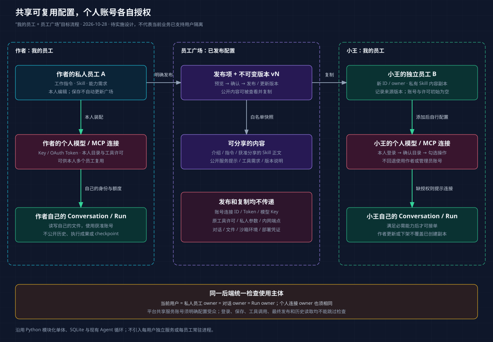

# 私人员工、员工广场与个人授权设计

> 状态：旧探索方案，已被 [Token 实施增量](mcp-token-implementation.md) 取代。当前不实施 OAuth、私人员工/广场、独立发布或复制员工；生效规则见 [MCP 当前契约](../../reference/mcp.md)。以下保留历史取舍，不能作为当前实施依据。

| 项目     | 内容                                                                                                                                            |
| -------- | ----------------------------------------------------------------------------------------------------------------------------------------------- |
| 设计状态 | 用户已确认产品方向；以下为待实施的完整增量设计                                                                                                  |
| 实施状态 | 尚未实现；本次只更新方案与架构图，不修改业务代码、权限或用户数据                                                                                |
| 更新日期 | 2026-10-28                                                                                                                                      |
| 关系     | 补充并修正 [MCP 平台接入方案](mcp-platform-integration.md)的用户归属、连接范围、发布/复制与执行主体；协议、OAuth 网络与目录复核继续由原方案维护 |
| 范围     | 我的员工、员工广场、版本发布、复制员工、私有 Skill 副本、个人模型/MCP 连接、用户范围校验、迁移及验收                                            |
| 当前基线 | `Agent`/`Skill`/模型连接无用户所有权；member/guest 只读；工具连接创建者仅审计；对话/文件/Run 已有用户关联                                       |

## 1. 核心决定与产品入口

数字员工默认属于创建它的用户，保存在“我的员工”。用户明确发布一份可分享配置版本后，其他人才能在“员工广场”看到该版本；广场展示的是发布版本，不是作者正在编辑的私人员工。

用户从广场点击“添加到我的员工”，系统根据选定发布版本创建独立员工及必要的私有 Skill 副本。新员工属于添加者，默认没有模型连接、MCP 凭证或有效工具许可；添加者配置自己的账号、确认自己的工具目录并授权后，才能运行相关能力。

首版不提供直接调用他人私人员工、多人共同编辑同一员工、自动同步作者修改、组织/团队工作区、付费市场或关注点赞系统。平台共享服务账号保留明确的配置模式，但个人授权默认私有；不能以“来自广场”作为借用作者账号的依据。

| Tab      | 数据与默认入口                               | 主要操作                                                   |
| -------- | -------------------------------------------- | ---------------------------------------------------------- |
| 我的员工 | 当前登录用户拥有的员工；登录后默认进入       | 新建、编辑、配置账号、对话、停用、发布、更新发布、删除保护 |
| 员工广场 | 平台内已发布、未下架的版本摘要；游客默认进入 | 搜索、查看公开配置/能力需求、添加到我的员工；游客须先登录  |

“别人只能看到共享出来的员工”指普通产品访问。管理能力分为下架公开内容、停用用户/共享资源等明确操作，不把当前 `resources:all` 自动解释为可以借用任意个人 MCP/模型凭证执行任务。



## 2. 当前系统核对与实际影响

| 当前入口                                                             | 本次确认的实现                                                        | 必须改变                                                                          |
| -------------------------------------------------------------------- | --------------------------------------------------------------------- | --------------------------------------------------------------------------------- |
| [员工 ORM](../../../backend/app/agents/models.py)                    | 员工无 owner，名称全局唯一，收藏/启停在员工本身                       | 增加用户归属，名称按 owner 唯一；收藏/启停作用于本人的私有实例                    |
| [员工服务](../../../backend/app/agents/service.py)                   | 服务只按员工 ID 读取，管理权限主要在路由                              | 服务显式接收 Actor/受信用户范围；列表、单条、引用和运行都检查归属                 |
| [公开接口](../../../backend/app/api/routes/public.py)                | 对全部员工做字段白名单投影，没有主动发布条件                          | 广场只查询已发布版本；不能继续投影所有 `Agent`                                    |
| [权限映射](../../../backend/app/auth/permissions.py)                 | admin 可编辑/运行，member/guest 仅公开浏览；资源访问有 admin 全量回退 | 给 member 自有资源操作能力；不把角色能力当作所有权，个人连接不经全量回退使用      |
| [前端员工页](../../../frontend/src/pages/agents/AgentsPage.tsx)      | 根据 `agents:read` 判断是否为管理员，决定整套 UI                      | 改为具体操作能力和资源允许动作；member 也能操作自己的员工                         |
| [模型连接](../../../backend/app/model_connections/models.py)         | 共享模型连接，无 owner，引用员工全量返回                              | 个人模型连接、明确共享受众、读取/测试/引用/运行授权均隔离                         |
| [Skill](../../../backend/app/skills/models.py)                       | 共享内容、无 owner；员工只存 ID 和参数                                | 增加 personal/platform 范围以承载独立副本；本轮仍为当前单文件内容，不扩标准包协议 |
| [运行准备](../../../backend/app/conversations/preparation.py)        | `prepare` 只按 agent_id 捕获模型/工具                                 | 从受信 Actor 确定本轮用户，检查员工、对话、连接和输入资源一致                     |
| [运行授权](../../../backend/app/conversations/authorization.py)      | 会话/角色/修订复核；个人连接所有权尚未实现                            | 每次受控动作和最终发布再次核对本轮主体和连接使用资格                              |
| [对话查询](../../../backend/app/conversations/queries.py)            | 有 owner，但管理员有 resources:all 路径                               | 我的对话/SSE/消息/文件/重试的普通产品入口不跨用户；维护权限不自动代操作           |
| [摘要接口](../../../backend/app/api/routes/configuration_summary.py) | 全库员工与收藏计数                                                    | 按当前用户统计我的员工/收藏；广场总数独立，公开计数不泄漏私有数量                 |

这是用户范围能力的实质扩展，不是只在前端做可见性过滤。数据库仍是共享 SQLite，后端仍是模块化单体，不需要“一用户一数据库”或“一员工一服务”。

## 3. 领域对象与关系

| 名称                               | 含义与所有者                                            | 关键边界                                                       |
| ---------------------------------- | ------------------------------------------------------- | -------------------------------------------------------------- |
| 私人员工 `Agent`                   | 属于某用户的可编辑、可执行配置；归 agents               | 员工本身始终私有，发布不把它改成全员可执行对象                 |
| 广场发布项 `AgentPublication`      | 作者管理的一条公开展示入口；归 agents/publications      | 保存启停/当前公开版本，不包含凭证或私有员工实时详情            |
| 发布版本 `AgentPublicationVersion` | 一次明确发布的不可变配置白名单及内容摘要                | 版本发布后不原地编辑；后续发布产生新版本                       |
| 员工副本                           | 依据某发布版本创建的新 `Agent`，记录来源版本            | 有自己的 ID、owner、修订及装配，运行不依赖作者账号或源员工存活 |
| 能力需求                           | 员工需要哪些 Skill、MCP 工具或内置工具的说明/可迁移配置 | 不是可执行许可，不持有连接 ID/Token；允许尚未配置就保存员工    |
| 有效装配                           | 私人员工实际绑定的 Skill、模型连接和工具许可            | 与需求分开，必须完成当前用户授权和目录检查                     |
| 个人连接                           | 当前用户自己的模型或 MCP 身份                           | 多个本人员工可复用；他人不能因复制/管理角色而借用              |
| 平台共享连接                       | 管理员明确配置用于共享的服务身份                        | 有明确可使用受众；个人连接不在发布时自动升级为共享             |

关系为：用户拥有私人员工；私人员工可对应一个广场发布项；发布项有多个不可变版本；任意已登录用户可从当前可用版本创建自己的副本。副本可以再编辑和发布，保留来源标识，不构造一个会自动执行跨作者权限的继承链。

`AgentPublication` 不归 conversations，避免与现有“发布助手最终回复”混淆：前者是员工配置分享，后者仍由 `conversations/publication.py` 原子提交消息和成果。

## 4. 我的员工与广场的页面交互

### 4.1 我的员工

1. 登录用户进入 `/agents?tab=mine`，后端只返回 `owner_user_id == Actor.user_id` 的员工；前端不提交 owner 作为授权来源。
2. 复用现有 `AgentCard` 和编辑器，卡片增加“待配置模型”“待连接 MCP”“已发布 vN”“有未发布修改”等真实状态；发布状态与员工启停分别显示。
3. 当前头像、岗位、指令、示例任务、交付要求和 Skill/MCP 装配入口继续使用。可选能力未装配不阻止纯文本工作；复制出的必需能力缺失时显示明确准备事项。
4. 收藏仍放 `Agent.is_favorite`，因为一个私有实例只属于一个用户；不额外新增收藏表。首版广场不提供收藏功能。
5. “发布到广场”进入唯一发布预览。已发布员工显示“更新发布”“下架”，不把源员工的每次保存都当成更新发布。

### 4.2 员工广场

1. `/agents?tab=gallery` 显示发布版本的卡片，展示公开名称、作者显示名、说明、分类、能力需求及版本。无原员工 ID、账号、调用权限或“直接对话”按钮。
2. 详情通过独立 `/agents/gallery/:publication_id` 读取发布 DTO；已发布工作指令/可分享 Skill 正文可以被查看和复制，发布前必须说明这一点。
3. 主操作“添加到我的员工”复制当前选定版本；游客先登录后回到同一发布项，并重新核对状态。新建副本完成后进入本人编辑页的“准备使用”区域。
4. 搜索/分类/分页按 Tab 分别保存在 URL；切 Tab 后清理不适用筛选，不把“我的可对话状态”套在广场作者员工上。加载失败、未发布内容和空列表分别展示。
5. 作者可见“管理发布”入口；其他人只有查看/复制入口。管理员下架属于管理动作，不意味着普通编辑器能打开作者私有员工。

### 4.3 发布预览

预览页面按实际白名单展示将公开的文本、Skill 正文和能力需求，让作者勾选可分享内容，填写版本说明，再提交发布。至少列出“不会复制账号/凭证/对话/文件”和“别人将能查看并复制发布内容”。

发布前要求员工草稿已保存；请求带源员工/Skill 预期修订及预览摘要。预览后源配置改变则返回冲突并重新预览，不发布用户未看过的新指令。普通配置错误使用现有错误 UI，不再创建重复的“快速发布”表单。

## 5. 发布内容白名单与依赖封装

发布使用独立 DTO 从源数据组装，不能把 `AgentRead.model_dump()` 删除几个字段后直接当发布包；新字段缺省不公开。

| 数据                                                                       | 发布/复制规则                                                                              |
| -------------------------------------------------------------------------- | ------------------------------------------------------------------------------------------ |
| 名称、头像、岗位、分类、说明、示例任务、交付要求                           | 可分享；头像只用当前可复用内置资源 ID                                                      |
| 员工工作指令                                                               | 作者预览后明确发布的正文快照；不包含系统全局规章或实时对话上下文                           |
| Skill 正文、说明、参数 schema                                              | 允许分享的当前单文件内容以不可变快照纳入；复制时创建添加者私有 Skill，不引用作者可变 Skill |
| 员工 Skill 参数、MCP 补充说明、默认仓库/路径                               | 默认不发布，首版全部重置并要求添加者填写；不把个人业务上下文当通用配置                     |
| MCP 服务/工具需求                                                          | 可选的公开服务标识、公开配置样例、原始工具名及必要性；仅为需求，不授予访问                 |
| 私有 MCP URL、内部服务名、完整账号目录/schema/默认参数                     | 不自动导出；首版私有端点转为“需自行配置服务”的需求占位，不借内部 ID 解析作者连接           |
| 模型供应商/模型建议                                                        | 可作为非强制建议；`model_connection_id` 和凭证不发布，添加者自己选择支持的模型             |
| 账号、OAuth scopes 实际授予、Token、Client Secret、连接引用、grant ID/hash | 全部排除，不能作为副本的有效装配                                                           |
| Conversation、Message、Run、checkpoint、上传/来源/成果文件                 | 全部排除；示例只分享作者明确填写的普通说明文字                                             |
| 沙箱配置/资源 ID、宿主路径、CI 部署 Token、平台维护配置                    | 全部排除；可保留“需要代码执行”的需求，添加者独立授权内置工具                               |

发布 Skill 必须拥有该 Skill 或具备平台标记的可分享资格。平台内容新增明确 `shareable` 标记，旧内容默认不可导出正文；私有 Skill 可由本人显式分享。未获资格的依赖必须在发布预览中移除，或阻止发布并说明，不能默认把“能运行”当成“能公开全文”。

用户手写的提示词也可能含秘密。敏感值检测可辅助阻断已知连接秘密/明显密钥，但无法证明自然语言没有隐私；明确预览和按字段选择是发布职责，不能用“做了扫描”代替分享确认。发布动作不触发任何模型、MCP 或脚本执行。

### 5.1 为什么需要私有 Skill 副本

如果复制员工后仍引用原作者 Skill ID，作者修改或删除 Skill 就会改变别人的员工。当前 SDK 运行从 Skill ID 捕获正文，因此本轮最小依赖增量是给现有 Skill 加 personal/platform 范围，并把发布版中获准的单文件 Skill 内容物化为添加者私有记录。

这不引入 ZIP、资源编辑或私有 Skill 包协议。每次添加员工内部去重相同 Skill 快照，生成本次独立 Skill ID；不同副本不暗中合用可变 Skill。导入后用户可在自己的能力库看到和编辑这些内容，来源标识只供追溯。

### 5.2 能力需求与真实授权

员工新增 `capability_requirements` JSON，包含稳定的本地需求 key、能力类别、是否必需、公开服务提示、所需原始工具名等。它是平台员工配置的内部结构，不是新的 MCP 或 Skill 标准。

复制时重建需求 key 与本地 Skill 的映射。MCP/native 需求初始为待配置，不创建指向作者连接的 `AgentToolGrant`，也不保存一份空连接“假许可”。用户选择自己的连接并明确勾选工具后，grant 可引用对应 requirement key；没有需求记录的手工装配仍允许存在。

准备状态由实际绑定计算，不持久化另一个容易失真的 `ready=true`。必需需求缺失阻止发起新 Run，并提供连接/配置入口；可选需求缺失仅提示，其工具不提供给模型。工具目录不同的账号由用户审阅差异，不要求它具有作者相同的 schema/hash。

## 6. 发布、更新、下架与复制的完整流程

### 6.1 作者发布与更新

1. 作者保存自己的员工；服务检查 owner、可分享依赖、非秘密白名单与支持范围，生成受限大小的发布预览/摘要。
2. 作者明确确认分享内容。服务以源员工及 Skill 预期修订在同一短事务重新组装白名单，核对预览摘要、拥有权及发布项修订。
3. 首次创建 `AgentPublication` 和版本 1；更新时新增版本 N+1，原版本内容不变，并原子切换当前公开版本。
4. 私有员工继续可编辑/运行；普通保存不修改已发布版本。发布项记录来源修订/内容摘要，派生“有未发布修改”，不依赖修改时间猜测。
5. 作者下架改变发布项状态，广场列表/详情和新复制都不可访问；本人仍可在管理页查看版本与重新发布。别人已创建的独立副本不变。

首版普通用户只读取/复制当前公开版本。若看完 v1 后作者已更新到 v2，复制请求按原 version_id/hash 返回变化冲突，要求查看新版本，不能自动复制用户未审阅的最新内容。旧版本供作者管理和已复制实例溯源，不作为绕过下架的公开历史入口。公开查询与复制还直接检查作者账号有效，不能依赖延迟下架任务才阻止停用账号继续传播内容。

预览摘要不是权限凭据。服务必须重新组装、重做 owner/依赖检查，不能信任浏览器上传的“已脱敏 payload”。后端限制正文、Skill 数量、需求数和总大小，避免把复制接口当文件存储通道。

### 6.2 添加者复制与配置

1. 添加者登录后请求复制具体 `publication_id + version_id`，带 `client_request_id`；服务核对该版本当前可复制、发布项没有下架、内容 schema 支持且大小合法。
2. 同一事务创建新的 owner=当前用户的员工、私有 Skill 副本、Skill 关系、能力需求和来源版本关联；模型/MCP 连接为空，工具许可为空。任何依赖写入失败全部回滚。
3. 副本名称在该用户范围内冲突时生成“名称（副本 2）”等可见名字，数据库唯一约束兜底；不同用户可以拥有同名员工。业务编号默认清空，不复制作者的唯一编号。
4. 重复点击或网络重试在副本存在期间按 owner/client_request_id 与请求摘要返回同一副本；键用于不同发布版本时返回冲突。删除副本后不承诺永久保留此幂等记录，客户端新操作生成新 key。
5. 返回 `201/200` 和准备事项。用户先选择自己的模型，再按需求配置 MCP/内置工具，保存本人装配，准备状态重新计算。
6. 用户可自由改指令、参数、Skill 或删除可选需求。作者后续更新仅显示“来源有新版本”的可选提示，首版不自动合并或覆盖用户修改；需要时显式再添加一份副本。

并发发布/下架/复制在发布项写锁和版本核对下线性化：复制先成功提交则副本保留；下架先提交则后续复制失败。不能读取时可见、长事务外组装后就绕过最后状态检查。

### 6.3 删除源员工与来源生命周期

删除自己的员工继续遵守现有对话/活动 Run 引用保护；有历史时先停用。若允许删除一个没有历史的源员工，先下架其发布项，发布项的 `source_agent_id` 置空，不删除已经公开的版本和别人副本所引用的来源记录。

新列表不展示被下架版本，已安装用户仍保留自己已经获得的配置与来源版本号；不因为来源下架重新开放读取作者其他版本或私有资源。发布版本的审计保留与合规清理是平台维护动作，不能跨用户级联删除副本。副本再发布时保留可公开的直接来源署名，不递归抓取源账号数据。

## 7. 个人 MCP 与模型授权流程

### 7.1 所有权和员工范围是两条轴

`owner_user_id` 回答“谁拥有这份账号授权”；`restricted_agent_id` 回答“是否只给本人某位员工使用”。后者不能替代前者。

| 连接模式 | 可选择/使用范围                                | 首版默认                                    |
| -------- | ---------------------------------------------- | ------------------------------------------- |
| personal | 本人所有员工；可再限制某个本人员工             | 所有新 OAuth、Key、个人模型连接的默认模式   |
| platform | 管理员明确创建的组织服务身份；只允许已配置受众 | 无默认受众；不因平台注册/复制员工自动允许   |
| system   | 平台维护的原生工作区能力；无外部个人凭证       | 依本人实例的工具许可运行，仍使用每 Run 隔离 |

`platform` 的 `usage_policy` 首版使用明确用户 ID 白名单；由管理员在共享资源管理入口配置，不引入组织角色/分组引擎。模型和 MCP 连接可复用同一纯权限规则，但各自拥有密文与修订。共享连接默认空受众；共享/扩大受众前展示受众、操作和消耗影响；个人连接首版不提供一键转共享，应另建明确服务账号连接。

对 personal 连接，所有普通 API 的读取、测试、授权、目录读取、批准、轮换、断开、引用查询和运行都必须 owner 匹配。成员即使获得 `tools:update` 也只更新自己的连接；管理员普通产品流程同样不能使用别人的个人授权。

### 7.2 使用自己的 MCP

1. 添加者在本人副本点“配置文档 MCP”，选择“我的连接”或新建个人连接。
2. 服务端使用已认证 Actor 填 owner；拒绝客户端伪造 owner、他人的 restricted_agent_id、连接 ID 或 OAuth session ID。
3. 无认证服务也保存为本人连接，目录/配置不会跨用户复用；平台无凭证服务定义可以公开复用。
4. OAuth 由连接本人在浏览器授权；发起、callback、TokenStorage 全部绑定连接 owner、issuer 和发起平台会话。已有原方案 PKCE、state、网络限制、刷新/CAS 保持。
5. 目录读取与确认回到能力库里该个人连接的管理页；本人编辑展示名称，其他用户看不到候选或内部定义。
6. 在本人副本勾选已确认操作，提交明确 name/hash 与连接身份依据，后端保存到本人员工 grant。
7. 新 Run 只能使用已保存的这份连接；本人无连接或授权失效就提示配置，不借用作者、管理员、其他员工或匿名身份。

同一用户多个员工可以复用个人连接与已确认目录，各自有工具开关/范围/预算；不同用户即使服务 URL、外部账号名或 Token 内容碰巧相同，也保留独立连接和授权会话，不能据此合并。

### 7.3 模型账号同样需要隔离

只隔离 MCP 而保留全局模型 Key，会让普通成员仍可能使用作者/管理员的模型额度。因此模型连接也加入 personal/platform 所有权和受众，列表、选择、测试、引用和 `resolve/assert_current` 同样校验本轮用户。

复制员工只带建议模型，不复制实际模型连接 ID。本人已有模型可直接选择；明确获准的共享模型可选用；无可用模型显示“待配置模型”，不按默认 ID 偷偷接入全局 Key。当前受限供应商预设和加密方式继续复用，不在本轮扩大任意 Base URL。

### 7.4 现有 CI 专用入口

当前 CI 链路使用部署级凭证，不能因为给 member 开放 runs:create 就默认让它运行。旧管理员自身 CI 功能按现状保留；member 的 CI 需求在具有受支持的个人/明确共享身份前标为未就绪。

首版发布预览不纳入部署级 CI 专用绑定；若作者保留这一依赖则提示先移除或按未支持依赖处理，不发布“开箱可用”的假副本。CI 迁移通用连接仍是[独立后续方案](ci-connection-migration.md)，此次不顺便重写专业报告或取证循环。

## 8. 权限矩阵与运行主体

### 8.1 角色能力与资源范围

| 操作                                     | 已登录用户（member/admin 的本人空间） | guest                      |
| ---------------------------------------- | ------------------------------------- | -------------------------- |
| 我的员工 CRUD、收藏、启停                | 仅本人资源                            | 不可用                     |
| 创建/修改个人 Skill、模型、MCP 连接      | 仅本人资源；平台预设只读              | 不可用                     |
| 广场列表/公开详情                        | 只读已发布版本                        | 保留当前游客会话下公开浏览 |
| 复制员工                                 | 创建到本人名下，不可指定别的 owner    | 登录后再复制               |
| 发布/更新/下架                           | 仅自己的发布项；平台可另行下架        | 不可用                     |
| 对话、文件、SSE、重试、取消              | 本人会话/员工/运行，连接须有使用资格  | 不可用                     |
| 平台预设、网络白名单、共享受众、全局规章 | 管理员专用配置入口                    | 不可用                     |

现有 `agents:*`、`tools:*`、`model_connections:*` 等能力可授予 member，但每个入口增加资源谓词；另补发布/复制和管理平台资源的明确能力，不简单给 member 整套 `ADMIN_PERMISSIONS`。纯 `auth.permissions` 接收 Actor/所有权/受众等事实，查询所属模块负责在 SQL 中过滤并在单条写入时复核。

普通“我的”列表、摘要、全局搜索、收藏、连接引用、分页总数始终使用同一用户范围。维护访问如确有需要必须使用独立管理入口；`resources:all` 不能直接绕过个人连接 owner。外部不可见 ID 返回统一不存在，避免靠错误区别枚举别人的私有对象。

### 8.2 一次 Run 的主体链

首版不支持代他人操作。接受请求时强制：

```text
Actor.user_id
  = 私人员工 owner_user_id
  = Conversation.owner_user_id
  = Run.owner_user_id
  = Run.initiated_by_user_id
```

个人模型/MCP 连接还必须 owner 相同；platform 连接则核对当前用户在受众中。相等关系由后端检查，客户端不能提交“代表作者执行”的用户 ID。

运行准备冻结主体 ID、连接 owner/范围/身份依据和当时使用资格；SDK 仍只接收受控运行数据。每次模型/工具请求、网络等待后的 guard 与最终发布重新复核会话有效、主体链、资源所有权和共享受众。不要仅在员工保存时检查 owner。

重试属于本用户，重新走相同校验，不切换到对话原作者或管理员身份。重新登录后按当前会话的同一用户走既有恢复规则；外部请求仍不可自动重放。用户停用、个人授权撤销或共享受众移除，阻止后续动作和成功发布，不保证撤回已发出的上游操作。

文件服务已有 owner 需继续沿链传递，公开发布不能绕过 MessageFile/Run 的下载权限。广场浏览和复制不产生 Run、不初始化沙箱、不执行源 Skill 脚本。

## 9. 数据增量与约束

只新增发布项和不可变版本两张业务表，扩展现有员工/Skill/连接。目录、许可及文件不另建一套存储。

| 对象                            | 拟议变化                                                                                         | 约束与原因                                                                                             |
| ------------------------------- | ------------------------------------------------------------------------------------------------ | ------------------------------------------------------------------------------------------------------ |
| `agents`                        | 非空 owner FK；可空 source_publication_version_id；capability_requirements；copy_request_id/hash | 名称改为 `(owner_user_id,name)` 唯一；编号按 owner 约束且复制清空；owner 不可由普通 PATCH 更换         |
| 新 `agent_publications`         | author_user_id、可空 source_agent_id、状态、当前版本、修订、时间                                 | 一源员工一条入口；来源删除 SET NULL；作者与源 owner 一致；发布/下架核对预期修订                        |
| 新 `agent_publication_versions` | publication_id、递增 version、schema_version、白名单 payload、hash、source revision、创建时间    | `(publication_id,version)` 唯一；不可变；current_version 必须属于同一发布项；总大小限制                |
| `skills`                        | scope_kind=personal/platform、owner_user_id、shareable、可选来源版本标识                         | personal 必须 owner；platform 只由管理员写；普通运行允许可用公共库引用，导出正文另看 shareable         |
| `agent_skills`                  | 保留当前装配/参数结构                                                                            | 写入时 Skill 必须本人或可用平台内容；复制生成新私有 Skill，参数重置                                    |
| `mcp_integrations`              | 增加 personal/platform 定义范围、owner                                                           | 本人接入配置可私有，管理员可维护公开服务预设；共享定义不含账号/目录                                    |
| `tool_connections`              | scope_kind=personal/platform/system、owner_user_id、restricted_agent_id、usage_policy            | 取代前版 platform/agent/system 单轴；个人 owner 非空；restricted_agent 必须同 owner；system 无个人凭证 |
| `model_connections`             | personal/platform 范围、owner_user_id、usage_policy                                              | 个人 Key/引用隔离；服务预设仍是平台数据；名称按范围/owner 唯一                                         |
| `agent_tool_grants`             | 保留 name/hash、身份修订、范围；可选 requirement_key                                             | 员工 owner 有权使用连接；不在复制时写作者 grant；保存与调用都检查                                      |
| `mcp_oauth_sessions`            | 发起用户/会话、连接 owner、issuer 及原方案状态字段                                               | 本人发起和接收 callback；共享 OAuth 仅资源管理者可发起，使用者不能替换团队身份                         |
| Run 快照                        | 主体/资源 owner、共享使用依据、可选来源发布版本                                                  | 无秘密；与原 MCP 新语义一起设计 v4，保留旧版本读取                                                     |

owner FK 使用 RESTRICT，用户首版停用、不级联删除其员工/发布/凭证与历史。personal/platform/system 组合用 CHECK 与分范围索引兜底；owner 可空的唯一约束不能直接依赖 SQLite 对 NULL 的默认行为。

来源版本引用保留是追溯，不在每次运行中向作者检查授权。副本运行依据是添加者已拥有的内容/连接/许可；来源下架不等于移除添加者的账号或删其对话。

## 10. API 与跨端契约

| API                                            | 目标行为                                                                                  |
| ---------------------------------------------- | ----------------------------------------------------------------------------------------- |
| 原 `GET/POST/PATCH/DELETE /api/agents` 及单条  | 本人列表/CRUD，Actor 决定 owner；公开 DTO 与个人详情严格分离                              |
| `GET /api/agent-publications`、`/:id`          | 已发布版本列表/详情；带版本号/hash；未发布或下架对普通浏览不可见                          |
| `POST /api/agents/:id/publication-preview`     | 本人源员工的白名单预览/依赖校验；不保存、不执行                                           |
| `POST /api/agents/:id/publications`            | 携带预期源/Skill/发布项修订与预览 hash；首次发布或新增版本                                |
| `GET /api/agents/:id/publication`              | 作者查看自己的发布状态/版本列表，不混入公共列表接口                                       |
| `POST /api/agent-publications/:id/unpublish`   | 作者下架；重复下架按匹配依据幂等，不删除副本                                              |
| `POST /api/agent-publications/:id/copies`      | 当前可复制版本 + request_id，创建本人副本，201/200；不收 owner 或连接 ID                  |
| 原 `/api/public/agents` 及单条                 | 旧展示入口改为明确兼容广场数据，不再读取任意私有员工；不能把 publication ID 冒充 agent ID |
| 原 Skill/模型/工具 API                         | 列表/单条/引用/授权/测试全部带受信用户范围；平台写入口要求管理能力                        |
| 原 configuration-summary / navigation / search | 我的数据按 owner，广场总数单独字段；分页 total 与查询相同                                 |
| 原对话/文件/Run API                            | 主体链检查，取消/SSE/下载同范围；无代用户执行接口                                         |

旧公开员工单条链接不能因存在同 ID 的私有员工就返回内容。迁移后有显式发布映射才可重定向到广场详情，否则提示内容未发布/不可见。旧 `PublicAgent` 响应的 agent ID 语义不可静默改成 publication ID，应给旧端点明确的废弃/重定向说明，并让正式新页只使用 Publication DTO。

新增错误：`agent_not_owned` 对外映射不可见、`publication_not_available`、`publication_preview_changed`、`publication_dependency_not_shareable`、`copy_request_conflict`、`personal_connection_denied`、`shared_connection_not_allowed`、`agent_setup_required`。错误不暴露其他用户的 ID、姓名、端点或账号信息。

## 11. 需要新增和修改的模块

### 11.1 新增文件（拟议）

```text
backend/app/
├── agents/
│   ├── access.py              # 本人员工查找、查询范围与归属不变式
│   ├── publications/
│   │   ├── models.py         # 发布项和不可变版本
│   │   ├── schemas.py        # 公开版本、预览、发布和复制 DTO
│   │   ├── payloads.py       # 白名单组装、依赖快照和 hash
│   │   ├── service.py        # 发布/下架/读取，短事务和修订
│   │   └── copying.py        # 原子物化员工/私有 Skill/需求，幂等
│   └── setup.py              # 需求与实际绑定的就绪查询，不执行工具
└── api/routes/
    └── agent_publications.py # 广场、发布预览、发布/下架/复制 HTTP
```

模型/工具/Skill 的资源范围 helper 留在各所有者模块；纯所有权/受众判定可复用 `auth.permissions`，不预建通用 ORM 权限框架。原 MCP 方案的 OAuth/configuration/catalogs 等新增文件继续需要，不重复列为两套实现。

```text
frontend/src/
├── pages/agents/
│   ├── AgentGallery.tsx             # 广场列表，共用卡片视觉
│   ├── AgentPublicationPage.tsx     # 公开版本详情/添加操作
│   ├── AgentPublicationEditor.tsx   # 唯一发布预览/更新/下架
│   ├── AgentSetupChecklist.tsx      # 复制后模型/MCP/参数待配置
│   └── useAgentPublications.ts      # 广场与发布操作，身份隔离
└── lib/api/
    └── agentPublications.ts         # 独立 Publication DTO 与接口
```

### 11.2 现有模块改动清单

| 位置                                                                                                 | 改动                                                                            |
| ---------------------------------------------------------------------------------------------------- | ------------------------------------------------------------------------------- |
| `agents/models.py`、`schemas.py`、`service.py`、`tool_grants.py`                                     | owner、局部唯一、来源/需求、原子复制和装配入口；禁止跨用户连接/Skill            |
| `skills/models.py`、`schemas.py`、`service.py`                                                       | personal/platform、可分享正文、私有副本及引用统计隔离；原标准内容字段复用       |
| `model_connections/models.py`、`schemas.py`、`service.py`                                            | 个人/共享范围、受众、引用裁剪、运行 resolve 的主体校验                          |
| MCP 原方案 `tools`、`oauth`、`catalogs`                                                              | 默认个人连接；服务定义范围；OAuth owner 绑定；本人目录管理；共享受众复核        |
| `auth/permissions.py`、相关 dependencies                                                             | member 具备自有资源操作，guest 保持只读；显式平台管理能力；个人资源不经全局回退 |
| `api/routes/agents.py`、`skills.py`、`model_connections.py`、`tools.py`                              | 所有路由传可信 Actor；管理角色判断不代替所有权；批量/单条均检查                 |
| `api/routes/public.py`、`configuration_summary.py`、前端导航接口                                     | 公开员工只来自发布，计数/搜索/收藏不能泄漏私有记录                              |
| `conversations/preparation.py`、`authorization.py`、`queries.py`、`writes.py` 与请求服务             | 主体链、本人员工接单、当前连接使用资格、SSE/重试/发布复核                       |
| `execution/contracts.py`、快照读取/恢复、当前 guard                                                  | 冻结身份依据；历史读取与旧凭证拒绝分支；不改 SDK/宿主依赖方向                   |
| `files/service.py`、文件引用/下载、沙箱输入准备                                                      | 继续复核本轮 owner；发布/复制不传播文件授权；无跨用户缓存工作副本               |
| `ci_diagnosis` 准备/授权入口                                                                         | member 禁止隐式使用部署 Token；原管理员链路保留                                 |
| `infrastructure/database/models.py`、正式 migrations                                                 | 新表/字段/复合唯一/FK；旧库归属映射与版本校验                                   |
| `pages/agents/AgentsPage.tsx`、`useAgentDirectory.ts`、`useAgentEditor.ts`、`AgentConfiguration.tsx` | 双 Tab、我的数据、来源与发布状态、准备清单；去除 agents:read=admin 判断         |
| `pages/skills/`、原方案能力库组件                                                                    | 本人 Skill/接入项 + 可用平台定义；Skill 副本编辑；公开内容不展示私有引用数      |
| `pages/brains/BrainsPage.tsx` 与相关连接编辑                                                         | member 能配本人模型；平台共享管理另有权限，不再管理员才能打开整个页             |
| `pages/tools/`、OAuth/目录面板、员工装配                                                             | 我的连接/获准共享连接；区分 owner 与 restricted_agent；个人 Token 不分享        |
| `Layout.tsx`、`router.tsx`、`lib/navigation.ts`                                                      | Tab 深链、广场详情/发布页、收藏仅本人、模型设置入口按能力；安全返回白名单       |
| `components/navigation/*`、`lib/api/navigation.ts`、搜索                                             | 我的数量/收藏与公开广场分域；身份切换清空旧缓存                                 |
| `lib/models/agent.ts`、`lib/api/agents.ts`、`skills.ts`、`tools.ts`、`modelConnections.ts`           | Owner 与允许动作/需求/来源 DTO，Publication 与 Agent 不混型                     |
| 帮助、设计样板/演示 fixtures、Vite API 白名单、后端静态交付                                          | 新路径与真实权限，演示不冒充已实现；日夜/窄屏与深链验证                         |

新增界面复用现有 AgentCard、Tabs、PageHeading、SkillCard、连接编辑器、主题及编辑保护，不新建一套“个人平台”外壳。无需新 npm 状态库、独立发布服务或新的认证体系。

## 12. 迁移与历史兼容

1. 维护窗口暂停接单并清理活动执行，备份库/文件/主密钥；先输出员工、模型、工具、Skill、对话 owner 与引用审计。
2. 旧 Agent/模型/Skill 没有可靠 owner，不能随意推给第一个管理员或根据最后使用者推断。迁移必须提供明确的遗留资源接收用户映射；单管理员部署可由维护命令明确选择该管理员。
3. 旧工具连接 `created_by_user_id` 只能作为映射候选，不自动作为最终所有者，因为它此前是共享配置。引用跨多个用户时先报冲突，维护者明确拆成个人记录或配置平台共享受众，迁移不得自动共享秘密。
4. 旧员工归接收用户的私有空间，默认**全部不发布**。原公开展示不能继续从 Agent 全库读取；需要公开的预置员工由其接收者审阅并正式发布，游客广场暂空属于真实迁移结果。
5. 旧 Skill/模型/工具按映射归个人；确属平台维护的 Skill/无秘密预设单独声明 platform。共享密钥默认没有新增受众；不因给 member 开放功能就自动消费旧 Key。
6. 旧对话/Run owner 保留。若旧员工同时被不同用户拥有的对话引用，维护窗口按对话 owner 创建对应私有员工/必要内容副本并重绑 Conversation 的当前员工；历史 Run.agent_id、快照/消息不改写。缺少明确凭证映射的副本为待配置，不拷走其他人的账号。
7. 上述历史跨用户映射需有可复核报告；旧 v2/v3 Run 只读展示保持，跨新归属边界的旧 checkpoint 不自动恢复或复用秘密。原员工 ID 未变的重试按当前本人授权重新准入；因迁移重绑到新员工的旧 Run 不继续使用原 retry_of 链，提示以当前员工重新提交问题，不能改写历史 Run.agent_id 迎合约束。特殊 CI 不重放。
8. 原名称/编号唯一索引改为 owner 内唯一，更新冲突识别与测试。头像/原文/原 ID 尽可能保留；冲突副本使用显式新 ID 和来源映射，不伪造旧归属。
9. SQLite 迁移通过正式 Alembic 执行；发布表、当前版本同属关系、模型注册、FK/CHECK/唯一索引要在空库与真实旧库验证。与 MCP 增量按实施时 head 排序，不能机械抢占固定迁移号。
10. 前后端/迁移同包发布；回滚恢复配套库、文件、密钥和归属报告。不得让旧版全量公开接口与新版私有数据混跑。

用户删除/停用在首版沿用停用与会话撤销管理，不开放级联硬删除全部个人资源。本人副本的账号引用/发布来源/历史删除保护分别处理，不因作者账号停用删除别人已经取得的副本；停用作者应下架其公开入口并阻止新复制。

## 13. 与 MCP 原计划合并后的实施顺序

| 阶段              | 完整交付                                                        | 关键验收                                                       |
| ----------------- | --------------------------------------------------------------- | -------------------------------------------------------------- |
| P0 契约与原型验证 | 对象/白名单/连接两轴；保留原 M0 的官方 OAuth Web 接线验证       | 两个真实平台用户的范围测试；SDK 固定 callback 最小链路         |
| P1 私有资源底座   | 员工/Skill/模型/工具 owner、member 自有权限、原子装配、迁移报告 | 跨用户猜 ID/引用/计数/Run 全拒绝；成员只消费本人或明确共享资源 |
| P2 MCP 与个人授权 | 原 M1/M2 的导入、目录、OAuth/刷新/断开接到用户范围              | A/B 同服务各自授权、目录与 revoke 不串号                       |
| P3 发布与复制     | 不可变发布版本、白名单预览、独立员工/Skill/需求副本             | 不带账号；作者修改/下架不覆盖副本；并发复制/下架与回滚         |
| P4 正式前端闭环   | 我的员工/广场、能力库、个人连接、复制后准备清单及新导航         | 创建→发布→另一用户复制→个人授权→真实对话全流程                 |
| P5 发布验收       | 真实升级/恢复、旧历史、权限/浏览器、文档收口                    | 静态检查、测试、构建、文档；协议替身与真实上游证据分开         |

个人资源授权必须先于开放 member 写入/运行；不得先把管理员能力给所有人，再等待后续补 owner。发布和复制也不依赖标准 Skill 多文件包或插件市场。

## 14. 验收矩阵

| 类别         | 必须证明                                                                                                     |
| ------------ | ------------------------------------------------------------------------------------------------------------ |
| 员工归属     | A/B 各自 CRUD/收藏/启停；同名可创建；直接访问他人 ID/列表 total/搜索/导航不泄漏                              |
| 公开边界     | 未发布员工不出广场；只能读发布快照；旧 public 端点不能回退私有 Agent；下架/作者停用即停止新访问/复制         |
| 发布白名单   | 原指令/分享 Skill 正文经确认；Token/连接引用/参数/内网 URL/文件/对话/CI 环境秘密排除；未知新字段默认不公开   |
| 版本生命周期 | 修改私有员工不改广场；更新产生新版本；source 删除/下架不删除副本；版本属于正确发布项                         |
| 复制原子性   | 员工+Skill+需求全部成功或回滚；新 owner/ID；清空模型/grant/参数/收藏/编号；双击幂等及冲突                    |
| 依赖独立     | 作者 Skill 修改/删除不改变 B 副本；不可分享内容阻止发布；未配置能力有真实原因，无假授权                      |
| 个人授权     | A/B OAuth/Key/模型列表、callback、TokenStorage、目录、别名、刷新、usage 互不串号；admin 不借 member 私人账号 |
| 共享账号     | 明确受众才可选/用；复制不能扩大受众；移除使用者后在后续动作/发布 guard 拒绝                                  |
| 运行主体     | 本人 Agent/Conversation/Run/连接/文件一致；绕过前端、SSE、重试、取消、下载、缓存/checkpoint 都不跨用户       |
| 现有功能     | 管理员本人 CI 保留，member 不偷用部署 Token；原文件/沙箱/模型预算/取消/未知结果不重放                        |
| 迁移         | 明确接收者、跨用户旧对话映射、旧库主密钥/hash/ID、旧 checkpoint 拒绝恢复、FK/模型差异、备份恢复              |
| 前端         | 两用户实际登录切换、两 Tab 深链/分页/返回、待配→就绪→对话、发布预览/冲突、日夜/320/390/桌面/键盘             |

新增定向测试建议 `test_agent_ownership.py`、`test_agent_publications.py`、`test_agent_copying.py`、`test_personal_connections.py`、`test_run_principal.py` 与迁移测试；前端按新组件就近测试。最终按项目风险矩阵执行 `make check`，真实 OAuth/模型调用另记账号、网络和实际结果，不能用预置演示数据代替。

## 15. 本次更新边界与维护

这是已确认方向对应的待实施设计，不代表成员已获得新权限、已有员工已私有化或 Token 已迁移。现行文档继续描述当前实现；实现后再回写员工/身份/模型/工具/对话契约、领域术语与模块 README，实际验证归 records。

与本设计冲突的旧设想撤回：管理员独占所有创建/执行、员工全库公开展示、新连接默认平台共享、仅按员工 ID 限制账号、复制沿用作者 Skill/连接、发布后原地同步源配置。MCP 协议、目录差异、显式 name/hash、受控网络、OAuth 刷新和单体架构继续沿用原方案。
