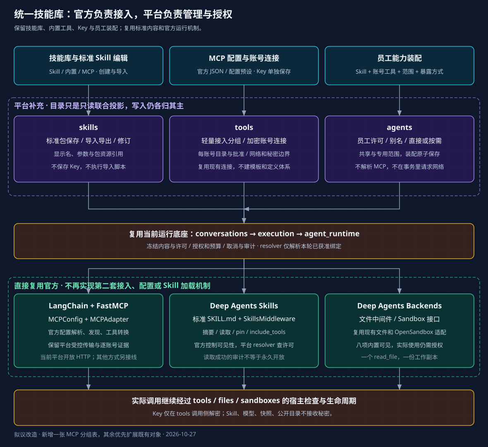

# 技能库统一展示与连接装配改造方案

> 状态：Token MCP 与联合能力库部分已实现，当前规则见 [MCP 契约](../../reference/mcp.md)。标准 Skill 包及插件包等仍为后续增量；旧方案不能替代最新员工账号边界。

| 项目     | 内容                                                                                                                        |
| -------- | --------------------------------------------------------------------------------------------------------------------------- |
| 设计状态 | 已按官方接入方案复审；目标行为待实施，取代本页此前的自定义模板与四表设计                                                    |
| 实施状态 | 业务改造待实施；新增基于当前前端组件的开发演示页，不接业务 API、数据库或真实凭证                                            |
| 更新日期 | 2026-10-28                                                                                                                  |
| 当前基线 | 迁移 `0006`、Run 快照 v3；`langchain[mcp]==1.4.7`、`fastmcp==4.1.4`、`deepagents==0.7.30`                                   |
| 保留需求 | 技能库整合、内置工具展示、MCP 配置辅助、共享/员工专用 Key、员工装配、运行与历史兼容                                         |
| 当前契约 | [基础工具](../../reference/agent-tools.md)、[数据模型](../../reference/data-model.md)、[原有边界](foundation-boundaries.md) |

结论：菜单和装配体验由平台整合；MCP 使用 LangChain 的 `MCPAdapter` 和 FastMCP 的 `MCPConfig`，Skill 使用标准 Agent Skills 目录和 Deep Agents 的 `SkillsMiddleware`。平台补充账号保存、员工授权、公开展示及审计，不另外定义 MCP 配置协议、Skill 包格式或按需加载机制。

本页早期的“公用”仅指管理员维护的平台内复用。用户随后已确认私人员工与员工广场：成员可管理和运行本人资源，个人连接默认私有，广场发布不共享授权。当前目标以[私人员工、员工广场与个人授权设计](private-agents-and-gallery.md)为准；本页下文保留的“成员只读/无个人凭证空间”等旧范围不再作为本轮实施依据。游客仍只读，团队工作区/多租户体系不在首版范围。

本轮 MCP 实施范围已由 [MCP 平台接入与能力装配方案](mcp-platform-integration.md)细化并调整：优先远程 MCP 与正式前端整合，OAuth 纳入本轮；一级列表按 MCP 服务展示，内部工具在账号目录和员工装配中选择。下文将 MCP 工具铺平为一级卡片、OAuth 延后及标准 Skill 包作为同轮前置的部分不再作为本轮依据；标准 Skill 包和按需工具加载仍保留为后续方案。新方案尚未实施。

## 1. review 入口与交互演示

先看[官方与平台分工](#2-官方已提供什么平台补什么)，再看[页面流程](#4-页面与使用流程)、[模块边界](#10-后端模块边界)、[数据增量](#11-数据增量)、[完整影响清单](#16-完整影响清单)。



对话内交互演示同步更新，可操作：统一目录、标准 `SKILL.md` 预览及关联工具、官方 MCP JSON 配置预设、共享/员工专用账号、目录发现与批准、员工整体保存、读取 Skill 前后工具可见性、凭证轮换。全部使用模拟数据，不访问服务，不接受真实 Key，不执行程序。浏览器中的 JSON 检查只演示交互；正式后端使用官方模型校验。

本轮实际检查及未覆盖范围见[设计复审记录](../../records/unified-capability-library-design.md)。

### 1.1 基于当前工程的交互增量

开发演示入口 `/demo/capabilities` 仅在 Vite 开发环境注册。复用当前品牌、主题、标题、员工卡片、技能卡片和 Base UI 适配控件；员工示例来自现有设计样板，技能、连接、目录和许可使用当前类型组织模拟数据。该入口没有业务请求、真实凭据输入或程序执行，保存只影响当前演示页面内存。

员工页保留“基本信息／工作指令／能力装配”和员工预览；拟议改动是将分散的技能选择、GitHub CI 入口和工具许可整理成同一装配列表。能力库合并展示 Skill、远程 MCP 和内置工作区，保留类型标签。当前 CI 专用通道仍按现有只读工具和员工 `ci_repository` 演示，不伪装成任意 GitHub 工具均已通用接入。

技能的现有 `configuration_schema`／装配 JSON 与拟新增的“员工补充说明”分别展示、分别保存。空参数规范仍只允许 `{}`；不从技能正文猜测“审查重点”等表单字段，也不将补充说明塞入当前后端不接受的参数对象。MCP 保留保存连接、发现候选、批准目录和员工许可四个独立动作。该演示用于审阅页面和交互，不代表标准 Skill 包、多文件执行、账号可见范围或聚合保存事务已实现。

### 1.2 目录快照、名称与更新的演示规则

目录读取、展示名称维护和更新确认集中到能力库的“管理连接与目录”；员工装配只选择连接及其已确认操作。装配页可进入同一管理入口，准备账号与目录后返回，不在装配面板中更新目录。工具目录按账号连接分别保存；中文展示名称和补充说明独立于原始描述与定义，有别名时始终显示“别名（原始工具名）”。

演示分别维护模拟远端目录、待确认目录、已确认快照，以及员工授权时的工具指纹。检查更新不覆盖快照；确认更新后，新增工具默认不授权，未变化操作保留许可，定义改变或移除使对应旧许可失效。原名改变按删除与新增处理，不依据中文名自动迁移。只改展示名称不改变指纹或授权。丢弃候选继续使用原快照，不能据此保证已删除的远端操作可用。

页面提供新增、定义变化、改名、删除及恢复初始远端五种独立模拟场景，并提供使用已保存员工许可的模拟调用检查。调用只核对所选工具的员工授权、已确认定义和远端定义；无关新增不阻断原操作，目标删除／改名／定义变化则停止该次模拟调用，不自动发布新目录或切换账号。此状态与校验仅存在于开发演示，不改动正式后端目录或运行流程。

## 2. 官方已提供什么，平台补什么

| 能力           | 官方实现与直接复用点                                                                    | 本工程现状                                        | 平台需要补充                                                       |
| -------------- | --------------------------------------------------------------------------------------- | ------------------------------------------------- | ------------------------------------------------------------------ |
| MCP 接入       | `langchain.mcp.MCPAdapter`：发现并转为 LangChain 工具；FastMCP 处理客户端和传输         | 已使用 Adapter、受控传输和工具转换                | 配置导入入口、管理界面；保留网络限制、授权、预算和结果记账         |
| MCP JSON       | FastMCP `MCPConfig`，顶层 `mcpServers`；支持多个服务和不同传输                          | 现有表单只暴露 HTTP 单连接                        | 用官方模型解析，再检查平台当前支持的方式；多个服务分别创建账号连接 |
| MCP 认证       | 官方客户端支持请求头、Bearer、OAuth 等接入能力                                          | 平台目前开放 none/bearer/header                   | Key 加密、范围、轮换、引用影响；OAuth 的页面与令牌生命周期以后补   |
| Skill 格式     | Agent Skills：目录、带 YAML frontmatter 的 `SKILL.md`、可选资源文件                     | 数据库指引目前被投影成单个 `SKILL.md`             | 标准包导入/导出、文件编辑、版本保存；保留旧 Skill ID 和参数        |
| Skill 加载     | Deep Agents `SkillsMiddleware(backend, sources)`，摘要发现、读取正文、pin、按上下文选择 | 已接官方中间件                                    | 多文件只读后端投影、员工范围和内容修订；审计对接                   |
| Skill 关联工具 | `metadata.include_tools` 字符串；`SkillsMiddleware(tools=resolver)`                     | 锁定版本已支持，但项目未传 resolver               | 将别名解析为本员工获准的真实工具，提示缺失连接/许可                |
| 内置文件/执行  | Deep Agents 文件中间件、Backend/Sandbox 接口                                            | 文件及 OpenSandbox 适配已接线，真实沙箱待环境验收 | 八项工具的标签、就绪状态、范围选择和装配入口                       |
| 技能库与员工   | 框架提供运行组件，不提供本项目的技能库、账号库和员工业务                                | 已有 skills/agents/tools 三个所有者               | 联合目录、公开投影、原子装配、并发和迁移                           |

`langchain.mcp` 在官方文档中仍标为 beta。以本项目锁定版本为验收对象，不因文档出现新接口就直接升级或替换现有适配器。

### 2.1 此次撤回与调整

| 初版设计                                                                               | 复审后的决定                                                      | 原因                                                       |
| -------------------------------------------------------------------------------------- | ----------------------------------------------------------------- | ---------------------------------------------------------- |
| 自定义模板字段 schema、映射表达式、发布/退役/撤销体系                                  | 撤回；改为官方配置的静态预设和普通字段表单                        | 当前需求用 URL、认证字段和官方 JSON 足够表达               |
| `mcp_templates`、`tool_sources`、`tool_definitions`、`agent_tool_grant_tools` 四张新表 | 撤回；只新增轻量 `mcp_integrations` 分组，扩展现有连接/许可/Skill | 不复制账号目录，也不为菜单整合重建工具注册系统             |
| 平台自己维护 Skill 关联工具的激活状态                                                  | 不采用；由官方中间件管理读取与可见性                              | 平台只解析获准工具和记录审计，不维护第二个可见性状态机     |
| 标准 Skill 包导入延后                                                                  | 纳入本轮目标增量                                                  | 使新增 Skill 可直接复用官方格式，避免继续绑定私有正文格式  |
| 为来源/模板版本强制增加 v4                                                             | 撤回此理由；新 v4 仅用于多文件 Skill 内容和工具暴露语义           | 确有执行依据变化才升级快照，不能把页面调整变成协议升级理由 |

## 3. 统一用词与对象关系

| 名称              | 含义和所有者                                                                                |
| ----------------- | ------------------------------------------------------------------------------------------- |
| 技能库 / 能力目录 | 产品的只读联合投影，不新增万能能力表                                                        |
| Skill             | 标准目录及 `SKILL.md`；`skills` 保存内容和平台展示信息                                      |
| MCP 接入项        | 同一服务在平台中的分组、说明、无秘密配置样例及公开展示选择；属于 `tools`，不是新的 MCP 标准 |
| 账号连接          | 一份实际服务配置和加密凭据，带共享/员工范围、修订和该账号批准目录；沿用 `ToolConnection`    |
| 工具项            | 从官方内置目录或账号目录得到的可调用操作；不再建立独立工具定义表                            |
| 员工装配          | Skill 选择、工具许可、账号、使用范围、预算和暴露方式；由 `agents` 聚合保存                  |

一个 MCP 接入项可以有多个账号连接。目录将同一接入项下同名工具分组为一个工具项；每个账号的 schema、描述摘要和权限仍各自保留，不能互相借用。不同服务的同名工具分别展示。

页面身份使用 `skill:<id>`、`native:<name>`、`mcp:<integration_id>:<remote_name>`；这些是平台读取身份。调用授权身份继续是连接、远端名、批准摘要和许可修订。框架生成的实际工具名由适配结果获得，不通过猜测前缀拼接。

## 4. 页面与使用流程

### 4.1 主入口

1. `/skills` 直接展示列表，右上角“新增能力”。类型标签为“Skill”“工具 · MCP”“工具 · 内置”，图标和文字同时呈现。
2. 搜索、分类、来源、状态和分页进入 URL；目录、连接配置、接入 MCP 为二级入口。接入页是引导，不是模板发布后台。
3. 新增能力提供“编写 Skill / 导入标准 Skill / 接入 MCP / 查看内置工具”。其他插件展示当前未支持的说明，不提供虚假的安装按钮。
4. MCP 卡片显示所属服务、可用连接数量和缺失条件，不显示 Key、内网地址或账号内部 schema。无连接不再只有空表单。
5. 详情有“装配员工”，管理员可管理连接；普通只读身份只得到已公开的名称、类型和说明。实际可装配状态按员工及连接计算。

| 路由                                                                         | 行为                                         |
| ---------------------------------------------------------------------------- | -------------------------------------------- |
| `/skills`                                                                    | 统一目录；刷新恢复筛选、分页和返回上下文     |
| `/skills/new`、`/skills/<skill_id>`                                          | 唯一 Skill 编辑器；支持表单和标准文件预览    |
| `/skills/import`                                                             | 标准目录/ZIP 导入预览，保存前不运行代码      |
| `/skills/tools/native/<name>`、`/skills/tools/mcp/<integration_id>/<name>`   | 两类工具详情，名称按单个路由参数安全编码     |
| `/skills/mcp/new`、`/skills/mcp/<integration_id>`                            | MCP 配置预设/官方 JSON、接入项说明和账号入口 |
| `/skills/connections`、`/skills/connections/new`、`/skills/connections/<id>` | 唯一连接编辑、发现、批准、轮换和引用查询     |
| `/agents/new`、`/agents/<id>?tab=capabilities`                               | 员工配置和能力装配                           |
| `/tools`、`/tools?agent=<id>`                                                | 分别兼容跳转连接列表和指定员工装配           |

旧 `/skills/<id>` 含义不变。Key、完整导入 JSON 不进 URL；返回地址使用受控站内路径。同步路由、安全返回、帮助、面包屑与后端静态回退。表单脏状态、刷新、返回及身份切换沿用现有编辑保护。

### 4.2 目录状态

首次进入即可显示八项内置工具，代码执行可显示“沙箱未就绪”。没有自建内容、筛选无结果、请求失败、加载中分别呈现；读取失败不得变成空装配再保存。

MCP 未发现前显示接入项草稿；预设中的搜索/提取名称只能标为“待验证提示”，没有可调用 schema。发现后展示候选，批准后可装配。目录读取不发起远程探测；显示最后验证时间，“可装配”不承诺上游此刻在线。

按接入项和远端名去重卡片。不同账号描述/schema 不同则标“账号目录有差异”，详情及员工装配展示所选账号的具体批准版本；平台不合成一个通用 schema，也不把一次批准传播给其他账号。使用人数按已保存的员工去重；连接数量另列。

## 5. 标准 Skill 的创建、导入与工具关联

### 5.1 内容形态

使用官方格式，不增加平台包 manifest：

```text
web-research/
├── SKILL.md
├── references/source-checklist.md
├── scripts/collect.py       # 可选；保存不代表允许执行
└── assets/report-template.md
```

```markdown
---
name: web-research
description: 用于需要联网核实资料并提供出处的调研任务。
metadata:
  include_tools: web_search web_extract
---

先搜索，再读取关键网页，交叉核实来源后给出结论。
```

`metadata.include_tools` 是 Deep Agents 在标准自由 metadata 中使用的扩展，值是空格分隔的字符串，不是通用 Agent Skills 的必选标准，也不是 `allowed-tools`。两者不能互相转换或当作员工授权。

### 5.2 页面怎么用

1. “编写 Skill”填写中文显示名、技术名、描述和指引，编辑器生成标准 `SKILL.md`。可切换文件预览并编辑资源；已有分类、参数 schema 和装配参数继续作为平台配置存在，不塞入新的包协议。
2. “关联工具”选择工具别名，写入官方 `metadata.include_tools`；不填 Key。工具可以稍后由员工选择账号与许可，因此共享 Skill 不绑定某个员工秘密。
3. “导入标准 Skill”上传一个目录或 ZIP，先预览目录、原始 frontmatter、资源及关联工具需求，再保存。保留已支持的标准/扩展字段，导出仍是标准目录，不混入员工参数、Key 或平台许可。
4. 名称、描述、目录名按 Agent Skills 约束验证；已有中文显示名独立保存，旧数据使用兼容的 `s-<uuid>` 技术名，ID、引用、启停和参数保持。不同 Skill 的技术名在同一员工运行目录中不得冲突，装配时明确拒绝并给出修正入口，不静默改名破坏引用。
5. 保存后回到目录，选择员工；共享内容更新显示受影响员工，递增修订。每个 Run 冻结所用内容，历史不随编辑改变。

包解析使用安全 YAML 和官方格式约束，运行发现/加载直接交给官方中间件。官方运行加载器对部分格式错误只警告，因此编辑入口需要明确拒绝不合规格的新包；这属于输入检查，不另写一个运行加载器。导入限制由集中配置控制，覆盖文件数、单文件/总大小、压缩展开量与深度；拒绝绝对路径、`..`、符号/硬链接、重复路径和越界引用。不在导入时安装依赖或运行脚本。

### 5.3 工具何时出现

- 直接工具：装配后随本轮工具集合提供，无需附带一个空 Skill。
- 随 Skill 提供：仅交给 `SkillsMiddleware(tools=resolver)`；读取/固定对应 Skill 后由官方决定可见性。不要同时传到 Agent 的普通 `tools`，否则会一直可见。
- resolver 从本轮员工已获准的绑定中按别名返回工具，允许一个别名指向一组已获准工具；不从全局连接库随意寻找账号。缓存包含员工/Run 及绑定修订，不跨账号复用。
- Skill 声明了需求但没有许可：装配页提示缺失；可以保存未启用草稿，激活装配前必须解决。运行时无权的别名返回空集合并给出受控诊断，不自动创建许可。
- 原生 `read_file` 同时承担 Skill 正文读取和普通文件读取。保留单个工具并按路径授权；正文读取不要求额外普通文件许可。不可为“随 Skill 提供”藏掉官方加载所需的同名基础工具。

官方负责正文读取后的上下文状态；摘要压缩若移除相关读取信息，工具可能暂时消失并需重读。平台审计记录表示曾读取成功，不能作为永久开放工具的开关。

## 6. 内置工具展示

| 显示名       | 工具名       | 装配要求                                        |
| ------------ | ------------ | ----------------------------------------------- |
| 列出文件     | `ls`         | 允许的读取目录                                  |
| 读取文件     | `read_file`  | 普通文件读取范围；Skill 自身加载另按 Skill 授权 |
| 查找文件     | `glob`       | 读取目录                                        |
| 搜索文件内容 | `grep`       | 读取目录                                        |
| 创建文件     | `write_file` | 工作区/输出写入范围                             |
| 编辑文件     | `edit_file`  | 写入范围                                        |
| 删除临时文件 | `delete`     | 独立删除范围                                    |
| 代码执行     | `execute`    | 沙箱模式、环境配置及目标主机验收                |

目录元数据复用当前 `native_catalog()` 和官方工具实例，不创建一张需要手工维护的原生定义表。中文标签、说明和状态是平台展示映射。GET 不创建业务数据；稳定身份及计数由联合查询生成。

用户不再手动创建“原生连接”。平台通过正式迁移/维护命令准备受控内部连接，界面只展示工作区模式和工具范围。一员工一轮只用一个工作副本；选择执行必须切到沙箱，文件工具同走该沙箱，未就绪不得激活。环境后来失效阻止 Run，不静默回退宿主 Shell 或虚拟工作区。

`/inputs`、`/sources` 仍只读，`/workspace`、`/outputs` 按许可写入。上传、下载、配额、产物和沙箱回收沿用现有模块。Skill 包只读挂载；脚本执行仍需执行许可、路径/命令策略和沙箱，不因导入成功获得权限。

## 7. MCP 配置：官方模型加轻量预设

### 7.1 格式和校验

正式高级配置直接使用 FastMCP 支持的 `MCPConfig`：

```json
{
  "mcpServers": {
    "research": {
      "transport": "http",
      "url": "https://mcp.example.com/mcp",
      "headers": {}
    }
  }
}
```

表单是这个配置的编辑辅助：地址、HTTP 传输、none/bearer/header 认证。Tavily 等预设只填默认地址和认证方式；它们是随代码维护的少量普通配置样例，不是模板 DSL、可执行映射或新表。通用 HTTP 服务由管理员填配置即可，不必为了每个厂商写一个后端业务流程。新增认证流程或执行宿主才需要对应接线。

1. JSON 导入只解析/预览，不连接、安装或执行。多服务先逐个选择，分别保存接入项/账号，不把整个配置变成一个共享身份。
2. 后端先用官方 `MCPConfig.model_validate` 解析，再做平台支持检查。官方模型允许部分未知字段，因此不能只调用它就认定全部安全可执行；不支持字段要逐项报错，不能偷偷丢弃。
3. 首版仅开放 Streamable HTTP（`http`/`streamable-http`）及当前认证方式；官方支持的 stdio、OAuth、旧 SSE、进程环境、工具变换等能力不等于平台已开放。校验支持范围必须早于建立客户端，尤其不能调用 `to_transport()` 后才拒绝 stdio。
4. URL、DNS 固定、禁止重定向、受控头名、响应/事件/超时限制继续用现有 `tools/network.py` 等实现。不要把未经处理的整个导入 dict 直接交给 Adapter，导致绕过现有受控传输。
5. 支持范围检查和秘密处理完成后，复用现有受控 transport → `MCPAdapter` → 工具转换。未来扩展传输仍优先用官方实现，只补宿主管理边界。

`mcpServers` 是所选官方客户端接受的配置形态，不宣称 MCP 协议要求所有客户端采用同一 JSON。`tools/list.inputSchema` 是调用参数，不能拿它生成账号安装/认证表单。

### 7.2 配置与秘密的交界

| 数据                                     | 归属                                                         |
| ---------------------------------------- | ------------------------------------------------------------ |
| 显示名、说明、无秘密配置样例             | MCP 接入项                                                   |
| 该账号最终 URL/传输/非秘密头和项目设置   | `ToolConnection.public_config`，管理权限读取，不代表公开信息 |
| Bearer 或秘密请求头值                    | 独立秘密写入字段 → 连接密文；运行调用侧注入官方 transport    |
| query/urls 等调用参数                    | 远端工具 schema；不能作为账号设置                            |
| 员工允许的工具、范围、预算、工具暴露方式 | 员工许可                                                     |

不创造 `${secret:...}` 等占位符解析协议。导出配置时直接移除秘密值并附说明“在连接页配置凭证”，不要导出看似可用的假 Key。JSON 导入含真实秘密时只在本次表单内存拆分到专用秘密字段，原文立即退出可保存草稿；界面、错误、日志、复制预览全部裁剪，不写 localStorage/URL。

接入项里的配置样例仅用于新建连接，已有连接保留自己验证过的配置。修改样例不暗中改写账号；若要批量更换端点，需要显式影响预览、逐连接配置修订和重新验证。接入项不是账户可调用目录的权威来源。

## 8. Key 与连接管理

| 类型       | 创建和使用                              | 影响                                         |
| ---------- | --------------------------------------- | -------------------------------------------- |
| 平台共享   | 管理员配置，多个员工显式选择            | 轮换/停用前显示引用员工和活动运行            |
| 员工专用   | 绑定已保存员工 ID；后端拒绝另一员工使用 | 不回退其他账号，删除员工时同事务处理专用连接 |
| 内部工作区 | 平台维护，无用户 Key                    | 工具仍需显式许可；同员工仅一个工作副本       |

在 MCP 接入时填 Key，或员工装配时“新建连接”再填，都走同一个正式连接编辑器和服务。Key 不放 Skill、装配参数、公开目录、模型、Run 快照或执行器资源中。创建者字段只用于审计，不自动赋予普通成员个人账号功能。

沿用独立工具主密钥和连接内加密载荷；读取仅返回是否配置、秘密字段名和修订。旧单字符串密文标记为兼容格式，服务按原认证类型读取；新保存/轮换用具名秘密映射，迁移不能在 Alembic 中解密，也不更换现有工具主密钥。

配置/秘密及影响账号范围的普通设置变化递增相应修订、清空候选并要求验证；所有引用员工看见待验证原因，原工具许可不扩大。失效专用连接不自动改用共享 Key。供应商额度错误和无效凭证、超时、目录变化分别表达，现有调用预算不冒充账户总账单上限。

连接保存是独立提交；取消员工装配不会删除已保存账号，应显示“已保存、未装配”。删除连接要求无引用且无活动运行依据，否则先停用/解除装配。删除员工先检查活动运行并处理其专用连接，共享连接不受影响；历史使用冻结别名显示。接入项有连接时禁止直接删除，可停用并阻止后续使用；停用和账号变化的 guard 在调用/发布前生效。上游错误正文先裁剪，不能直接回显。

## 9. 员工装配和保存边界

1. 员工页面复用目录展示。选择 Skill 可配置原参数，并看到 `include_tools` 需求；从该员工已许可工具中选择别名对应的账号工具，没有则引导配置。
2. 独立选择工具时，明确账号、范围、预算和“直接提供 / 随 Skill 提供”。后者通过官方 resolver；若同一工具直接提供，界面明确其不会再被 Skill 隐藏。别名可以对应一个获准集合，同名需求在本员工中解析一致。
3. 连接选择仅显示同一接入项、范围匹配、该账号目录已批准且包含目标工具的连接。一个员工对同一工具项选择一个账号；不存在不提示的默认 Key 或失败回退。
4. “新建员工专用连接”使用连接编辑器，保留非秘密员工草稿。保存并批准后返回，仍须保存员工装配。新员工先保存得到真实 ID，再建专用账号；可以先选已有共享连接及内置工具。
5. 一次员工保存事务核对员工预期修订、Skill 参数/包修订、别名需求、连接范围、批准摘要和预算，整体提交员工、Skill 与工具许可。任一错误全部回滚。发现和密钥操作不在这个事务中执行。
6. PATCH 字段省略保持，显式空集合解除；读取失败禁用提交。过期修订保留选择并提示差异。旧独立许可 API 适配同一个事务 helper，避免两套规则。

“选中”“已保存”“当前可执行”分别显示。员工卡片仍分别统计 Skill/工具/知识；工具按已启用获准项去重，随 Skill 提供的许可也计入，不按别名数量重复。公开投影不泄漏账号关系；CI 专用数量按当前规则保留。

## 10. 后端模块边界

| 所有者                | 负责的增量                                                | 复用点与边界                                                    |
| --------------------- | --------------------------------------------------------- | --------------------------------------------------------------- |
| `skills`              | 标准包保存、导入/导出、资源、修订、平台显示名             | 标准 Agent Skills；不持有 Key、不管理工具许可、不执行脚本       |
| `tools`               | MCP 接入分组、官方配置解析、连接/秘密、账号目录、受控调用 | 现有 Adapter、网络/策略、native catalog；不新增通用模板引擎     |
| `agents`              | Skill/工具/账号/别名/暴露方式和工作区的原子装配           | 现有许可聚合；不解析协议或在事务中访问远端                      |
| API 组合查询          | 统一目录、筛选分页、状态与公开投影                        | 只读联合；写入仍路由到明确所有者                                |
| `agent_runtime`       | 将只读资源装配到官方中间件，提供基于本轮绑定的 resolver   | `SkillsMiddleware`、官方文件工具；不接 ORM/凭证库，不另造加载器 |
| `conversations`       | 准备冻结 Skill 包与获准工具，当前授权/最终发布复核        | 继续拥有消息、附件与发布，不保存连接秘密                        |
| `execution`           | 快照版本、工具记账、预算/取消/恢复与审计                  | 继续复用 Runner；不认识某厂商预设或数据库连接配置               |
| `files` / `sandboxes` | 持久资源、只读包投影及沙箱临时副本/回收                   | 保留各自生命周期，Skill 脚本依然受执行权限约束                  |
| `bootstrap`           | 注入窄服务/查询接口                                       | 不在启动/GET 回填业务数据或修改装配                             |

建议只新增实际有职责的 `tools/configuration.py`（官方配置和支持检查）、Skill 包资源服务及 `api/queries/capabilities.py`。连接凭据与目录可按体量从现有 service 拆分，不预建插件宿主框架。`SkillLoadingMiddleware` 仅保留平台授权/成功读取审计，与官方 pin/读取语义对齐；其历史 active 集合不能控制官方工具可见性。

## 11. 数据增量

以下均待实施，正式迁移号先核对当时 head。新增一张业务表，而非初版四张。

| 对象                  | 变化与约束                                                                                                               |
| --------------------- | ------------------------------------------------------------------------------------------------------------------------ |
| 新 `mcp_integrations` | 服务分组、稳定 key、显示说明、无秘密配置样例、公开展示白名单、启停/修订；不保存可执行模板或共享权威 schema               |
| `tool_connections`    | 新接入项外键、platform/agent/system 范围与目标员工、秘密格式标记；保留 ID、密文、配置/凭证/目录修订、候选及批准目录      |
| `agent_tool_grants`   | 保留员工×连接聚合和工具 JSON；每项扩展 direct/skill 暴露方式及 `skill_aliases`；别名映射只引用本聚合内获准工具，不存秘密 |
| `skills`              | 保留 ID、显示名、分类、原参数规范和修订；增加标准包元数据及受管资源引用/内容摘要，单文件旧数据转换为标准内容             |
| `agent_skills`        | 保留参数/启停/修订；不复制包、凭证或另建工具授权                                                                         |
| Run 快照              | v4 新增包文件清单/摘要和工具暴露、别名绑定、连接范围/接入启停依据；保留原配置/凭证/目录/许可修订和预算                   |
| 动作展示              | 补可选冻结显示名、来源/账号别名；历史缺字段仍按旧展示                                                                    |

资源字节复用现有受管文件存储，`skills` 保存路径到文件 ID/摘要的清单；包文件不是 Conversation 附件，也不授予公开下载。当前 `StoredFile.purpose` 仅接受 input/source/output，因此正式迁移增加 skill 用途并更新 CHECK、DTO、上传和配额分支；不能把包资源伪装成消息输入。资源写入失败不提交 Skill，未引用临时对象可回收。

文件清理的现有注入引用查询增加“当前 Skill 清单”和“保留 Run 的冻结包清单”两个来源，后者保留旧版本资源；保存/换版/删除与回收采用一致的事务协调，避免先检查无引用再误删新引用。服务端验证清单中文件的用途、归属、摘要和完整性，不接受任意路径字符串。运行只读映射冻结内容，下载/导出继承 Skill 或该 Run 的访问权限，不能走消息附件权限绕过。这样扩展现有存储和引用查询即可，不另建包文件存储体系。

工具许可继续使用现有 JSON，不为这次 UI 新建子表；在员工写锁内检查同员工同工具项的账号唯一性、重复别名映射和单工作区。旧工具项默认 direct、别名为空，保持原行为。接入项公开白名单只含展示信息，不变成第二套批准目录。原生工具来自代码目录，无定义回填表。

## 12. API 与前后端契约

| 接口增量                                 | 用途                                                                                     |
| ---------------------------------------- | ---------------------------------------------------------------------------------------- |
| `GET /api/capabilities` 及类型明确的详情 | 联合 Skill、原生目录、MCP 账号目录投影；统一过滤/排序/分页/total，避免前端各取一页再混排 |
| 公开能力列表/详情                        | 现有成员/游客权限下白名单展示；无地址、账户、内部 schema、候选或员工引用                 |
| `mcp-integrations` 管理                  | 接入说明、无秘密样例、公开展示、停用和引用保护；管理数据，不是 MCP 协议                  |
| MCP 配置解析/预览                        | 官方模型校验与平台支持错误；不连接；秘密仅请求内处理，响应裁剪；预设为静态受控列表       |
| 原 `tool-connections` CRUD/usage         | 范围、接入项、秘密字段、预期修订及影响；不回显秘密                                       |
| 原 `discover` / `approve`                | 事务外发现、事务内核对当前修订/候选/摘要并批准；每账号独立                               |
| 原 Skill CRUD + 包导入/导出/文件接口     | 包内容与原参数明确分开；受控上传/下载，修订冲突、引用删除保护                            |
| 原员工创建/更新与 `tool-grants` 兼容入口 | 完整装配、省略/清空语义；同一保存 helper                                                 |
| 摘要/全局搜索/动作 DTO                   | 能力分类总量、员工去重数量、冻结显示名；保留旧 skills 字段语义                           |
| 原 sandbox-status                        | 就绪原因；不把部署主密钥开放给员工配置                                                   |

`CapabilityItem` 为带类型的只读联合 DTO，状态含原因和允许动作；写 API 使用明确模型，不接受任意 kind+JSON 的万能 CRUD。SDK 宽松字段需平台支持检查。错误遵循现有应用分类；过期依据、未批准目录、范围不符、包无效和方式不支持有稳定错误码；输入秘密与原始 SDK 异常不回传。

## 13. 运行装配、授权与恢复

1. 接单时冻结员工的包内容引用/摘要、Skill 修订/装配参数、工具许可、别名/暴露方式、连接/凭证/目录修订与实际 descriptor hash；不冻结秘密。
2. 将获准标准包只读映射到 BackendProtocol，传给 `SkillsMiddleware(sources=..., tools=resolver)`。仅直接工具进入普通 tools；resolver 只在冻结允许集合内返回受控工具，保持本线程身份稳定。
3. 官方 `MCPAdapter` 保持工具发现/转换职责；调用继续经当前受控网络和 tools 服务。每账号获取/校验自己的目录；网络等待后再次 guard。MCPConfig 支持多服务不意味着必须重写现有逐连接的授权和会话生命周期。
4. `begin_tool` 保留原子授权、扣预算和持久化动作；调用前检查员工许可、Skill/接入启停、连接范围及修订。撤权和轮换在后续调用及发布复核生效，不保证撤回已发出的上游请求。
5. 保留一个 `read_file`；读取 Skill、资源、普通文件分别检查对应路径和许可。脚本不会因被读取而执行；必须经过获准 `execute` 和沙箱。
6. 大结果、来源、文件关联、取消、超时、未知结果、清理债务和发布沿用当前实现。原生文件/命令按现有策略串行，MCP 并行各自记账；工具数/快照大小/参数/路径上限仍强制执行。

新多文件与暴露语义使用 v4；保留 v2/v3 读取及原条件下恢复，不改写历史。旧数据缺省按 direct/单文件解释，但不凭空推断账号或新的别名许可。原生写入、沙箱和外部请求的当前“不自动重放”规则不变。审计“曾激活 Skill”和官方“当前上下文含该 Skill”是不同信息，重启恢复不得用前者强行补出工具可见性。

## 14. 迁移、发布与恢复

1. 核对 head；备份业务库、文件、工具/模型密钥；维护窗口停止接单并等待活动/排队 Run，禁止旧服务混跑新结构。
2. 正式迁移新增接入项与必要字段，保留原连接、Skill、许可 ID/密文/摘要/修订。每个旧 MCP 连接先独立建接入分组，不因相同 URL 自动合并账号；管理员可在目录和范围核对后合并展示。
3. 旧 grant 的工具集合保持，补 direct/空别名；旧 Skill 生成标准单文件包，不改变参数和员工引用。旧快照、消息、附件、动作不重写。
4. 原生目录从代码生成；通过正式迁移/维护准备系统工作区连接，旧连接仍保留供历史授权核验。新装配使用受控内部连接；旧员工权限不得自动变化。
5. 密文不解密迁移、不生成替代主密钥。验证外键、资源引用、目录哈希、员工工具数/范围和模型差异；失败整体回滚，不丢弃无法映射的许可。
6. 当前 CI 专用 Skill、部署 Token、三项受限工具、计数和专业报告保持；不顺便迁移为通用 GitHub MCP。Skill 包升级需要旧 CI 数据兼容验证。
7. 后端/迁移/前端同包发布；验证新旧深链 GET/HEAD/刷新/404、帮助、缓存失效和权限。新写入后回滚应恢复配套库/文件/密钥备份，不能直接启动旧二进制。

空库、已有工具库及含旧 checkpoint/消息/文件/沙箱债务的库都需迁移演练。多个旧账号合并展示时不合并凭据、候选、批准或授权。未装配的专用连接仍有明确员工归属，删除员工时不转为共享。

## 15. 范围与后续项

| 本轮目标增量                                                                             | 官方已有，但平台以后再接线 / 独立建设                                                        |
| ---------------------------------------------------------------------------------------- | -------------------------------------------------------------------------------------------- |
| 统一库、原生目录、标准 Skill 创建/导入/导出、多文件只读资源、官方 include_tools/resolver | 不提供任意后端代码插件安装、插件市场或自动依赖安装                                           |
| HTTP MCP 表单/官方 JSON/静态配置预设，none/bearer/header                                 | OAuth 需要回调、身份和 Token 管理；stdio 需要受管进程、依赖、环境、资源回收；旧 SSE 按需接入 |
| 共享/员工专用 Key、原子装配、授权和历史兼容                                              | 普通成员个人账号、多租户、外部市场、供应商计费系统                                           |
| 已有沙箱、文件、结果/来源底座的复用                                                      | 真实 Tavily 账号及目标 Linux/OpenSandbox 的环境联调另记证据                                  |
| 能力制作和接入成本降低                                                                   | 工作流编辑器、CI 报告重构、Goal/任务管理不作为本轮前置                                       |

“以后再接线”不表示官方缺失该协议。将来新增插件应复用标准 Skill 或 MCP/工具接口，平台仅增加必要宿主与生命周期；不把所有类型都包装成 Skill 或一份自定义插件 JSON。

## 16. 完整影响清单

C01–C32 保持初版编号，内容已按本轮边界重写。每项实施时必须对应变更或核对证据；`新增`为目标文件，非现有事实。

| 编号 | 入口/范围                                                      | 必须修改或核对                                                                   |
| ---- | -------------------------------------------------------------- | -------------------------------------------------------------------------------- |
| C01  | `tools/models.py`                                              | 一个 MCP 接入分组、连接范围/外键/秘密格式；撤回模板/来源/定义三表                |
| C02  | `agents/models.py`、`tool_grants.py`                           | 复用 grant JSON，暴露/别名、账号唯一性、专用范围、同事务 helper；撤回子表        |
| C03  | `migrations/versions/`、模型/文件引用注册                      | 正式增量、单文件包回填、旧密文/目录/许可保留、资源引用和 FK 检查                 |
| C04  | `tools/contracts.py`、native catalog、维护命令                 | 真实八项元信息和稳定身份、系统工作区；读取不回填，不建原生定义表                 |
| C05  | 新增 `tools/configuration.py`                                  | 官方 MCPConfig、支持范围、预设、秘密拆分；禁止模板 DSL/工具变换/意外进程启动     |
| C06  | `tools/service.py`、凭据/目录内聚实现                          | 接入分组、每账号批准、具名密文兼容、引用影响/删除与轮换                          |
| C07  | `tools/adapters/mcp.py`、`network.py`、`policy.py`             | 继续官方 Adapter、受控传输、账号缓存隔离、目录/schema 差异及网络后复核           |
| C08  | `tools/schemas.py`、工具路由                                   | 接入项/配置预览和连接/发现/批准 DTO；撤回模板版本/发布 API                       |
| C09  | 新增 API 组合查询/读取路由                                     | 统一分页/筛选/total、带类型身份、账号差异、原生状态和允许动作                    |
| C10  | public 路由、auth 权限                                         | 公开能力白名单；管理账号/端点/内部目录/员工关系仍禁止公开                        |
| C11  | `agents/schemas.py`、service、路由                             | 完整原子装配、参数/别名/修订/省略清空、旧许可接口适配                            |
| C12  | `conversations/preparation.py`、authorization                  | 冻结包与别名、接入/连接范围、当前授权和最终发布复核                              |
| C13  | execution contracts/store/coordinator                          | v4 的真实新语义、v2/v3 分支、审计/错误与取消/预算/恢复回归                       |
| C14  | runtime skill_loading/resources/tool_calls/langchain/workspace | 官方中间件+resolver、按需暴露、单 read_file、pin/压缩/重启语义；删除重复激活控制 |
| C15  | bootstrap/config/配置示例                                      | 只注入窄服务，包/导入/网络集中限制；不在启动隐式改业务数据                       |
| C16  | `frontend/src/pages/skills/`                                   | 统一列表、标准包编辑/导入/导出/工具需求、MCP 接入引导；仅一个 SkillEditor        |
| C17  | `frontend/src/pages/tools/`                                    | 复用正式连接编辑器/列表；旧主入口重定向，保留发现/批准/Key 管理                  |
| C18  | SkillCollection/SkillCard 及能力展示组件                       | 联合类型、图标+文字、账号差异与就绪状态；Skill 专有编辑不泛化成万能 JSON         |
| C19  | 配置表单和高级 JSON 组件                                       | 官方字段预设、同一草稿、敏感输入裁剪、stdio/OAuth 等支持提示；无模板发布后台     |
| C20  | AgentConfiguration/useAgentEditor/参数组件                     | 工具需求映射、连接/暴露/范围、首次保存、返回草稿、统一提交和冲突                 |
| C21  | api skills/tools/agents 与新 capabilities DTO                  | 包文件、类型读取、专用写 DTO、引用/失效、旧字段兼容                              |
| C22  | Layout/router/navigation/help                                  | 菜单、工具详情、导入/连接深链、安全返回、面包屑和旧 tools 跳转                   |
| C23  | 导航搜索、configuration-summary                                | 分类总量/统一搜索、各资源变动与身份切换的缓存失效                                |
| C24  | 员工卡片/公开员工/资源摘要/使用人数                            | 已获准项去重、别名不重复计数、公开裁剪、知识零数与 CI 规则                       |
| C25  | editing 状态、配置事件、草稿                                   | 脏表单/离页/返回/刷新/身份切换，真实秘密不持久化草稿                             |
| C26  | RunActions 及动作 DTO                                          | 冻结能力/来源/账号别名，旧动作兼容，结果/来源下载权限不变                        |
| C27  | skills 内容服务、文件引用/上传/下载、sandbox                   | 标准包生命周期、只读挂载/脚本限制，附件和沙箱不产生第二实现                      |
| C28  | GithubCiSetup/CI 装配/数量/报告                                | 原专用链路与包迁移兼容，不冒充通用 GitHub MCP 或自动迁 Token                     |
| C29  | frontend_delivery、静态构建、指南                              | 新旧直达 GET/HEAD/404、刷新、压缩缓存、帮助及过时文案                            |
| C30  | 设计系统/实际组件样板                                          | 能力卡片/文件树/配置/状态，日夜与 320/390/桌面/键盘，复用现有 Base UI 组件       |
| C31  | 前后端测试与文档检查                                           | 第 18 节全部验收；官方 SDK 行为定向实验和平台拒绝/事务/迁移测试分开              |
| C32  | docs/模块 README/根端索引                                      | 实施后回写当前模型/API/运行/公开/摘要/指南；提案剩余和实际证据分开维护           |

当前部分说明仍写旧 `0005`/v2 或“外部工具后置”，实施时按已核实 `0006`/v3 修正，不把历史文字误当成当前代码。此设计阶段不把尚未实现的目标写入现行 reference。

## 17. 实施顺序

| 批次 | 工作                                                        | 可 review 的验收点                                        |
| ---- | ----------------------------------------------------------- | --------------------------------------------------------- |
| U1   | 官方配置与 Skill 格式实验、最小数据/文件引用迁移、目录投影  | 不增加私有标准；空库内置可见，旧账号/Skill/许可无损       |
| U2   | 标准包编辑/导入导出、HTTP 配置/预设、共享专用连接、账号目录 | 标准内容可移出平台复用；两个 Key 的批准隔离               |
| U3   | 员工原子装配、官方 resolver、运行 v4/旧协议、授权与资源回收 | 读前/读后/压缩/撤权语义正确；无跨员工借用与重复 read_file |
| U4   | 技能库/连接/员工完整页面、搜索/摘要/动作/路由               | 主流程从首次进入到装配和排错走通；旧深链与公开裁剪正确    |
| U5   | 新旧库迁移演练、浏览器、真实服务条件验收、文档收口          | 所有 C 项有证据；模拟与真实上游结果明确区分               |

同一发布包内前后端接口匹配；分批开发不以半成品替代整体交付。实现中发现官方可直接覆盖的模块继续删减平台实现，并同步本方案、演示及验收映射。

## 18. 验收清单

| 类别         | 必须证明                                                                                                                 |
| ------------ | ------------------------------------------------------------------------------------------------------------------------ |
| 官方复用     | 锁定版本能解析官方 MCPConfig、加载标准包、接受 resolver；无私有包/配置语言；SDK extra 宽松与平台拒绝检查区分             |
| 首屏与目录   | 空库八项内置、执行未就绪；类型/来源/状态、账号去重/差异、分页/total、加载与失败不混淆                                    |
| Skill 内容   | 标准创建/导入/导出、原字段保留、技术名冲突、资源引用/回收/只读、旧参数/ID；恶意包路径/链接/压缩和大小拒绝                |
| Skill 工具   | metadata 字符串、别名映射、未授权不返回、直接与按需区分；读前/读后/pin/压缩重读/伪造调用/重启撤权；基础 read_file 无冲突 |
| MCP 配置     | 预设和通用表单对应官方 JSON，多服务逐项导入；stdio/OAuth/SSE/未知变换等在建客户端前拒绝；秘密不进预览/错误/草稿/导出     |
| 账号目录     | 保存/发现/批准/授权分开；候选过期、凭证变化、不同账号子集/schema 隔离，未知上游错误裁剪                                  |
| Key 范围     | 共享两员工、专用限一员工、轮换/停用/删除、员工删除原子清理；无默认 Key/回退；已保存未装配状态真实                        |
| 装配事务     | 员工/Skill/工具全成功或全回滚；修订冲突、省略/空集合、读取失败保护、唯一账号、别名不扩权                                 |
| 原生与脚本   | 单工作副本；虚拟无执行、沙箱同环境；包导入不执行/安装；无宿主回退；文件范围/配额/上传下载沿用                            |
| 执行与历史   | 多入口 guard、原子预算、保存失败先于请求；v2/v3/v4、结果来源、未知结果不重放、取消/超时/债务/产物保留                    |
| 权限         | admin 管理、member/guest 公开只读；猜 ID 和专用员工篡改拒绝；账号/内部资源/Skill 文件下载权限正确                        |
| 外围入口     | 统一搜索/数量、使用人数、CI 专用流程、新旧深链/刷新/帮助/安全返回/GET/HEAD/404                                           |
| 迁移与发布   | 空/旧/历史/文件/债务库、密文和哈希/范围稳定、FK/模型差异、活动 Run 拒绝、备份恢复演练                                    |
| 浏览器与性能 | 日夜、320/390/桌面/短屏/长文本、键盘/读屏、返回/脏表单/身份切换；分页依据一致、避免 N+1、限制不能绕过                    |
| 真实环境     | 有账号验证实际搜索/提取及权限/额度错误；有目标 Linux 验证沙箱隔离/限额/回收；缺条件单列未验                              |

产品实施时先定向测试再执行 `make check`。本次方案更新仅执行文档检查、SDK 离线实验与演示检查，不将其写成产品验收通过。

## 19. 主要取舍

1. 统一入口和卡片，保留 Skill、账号、员工授权的业务所有者；少一个菜单不意味着所有实体变成一张表。
2. MCP 接入项只解决共享展示和账号归组。真实调用以该账号目录和员工许可为准，省去共享 schema 与模板版本同步系统。
3. 标准 Skill 内容可直接复用；平台参数、Key、许可仍是平台配置，不伪装成官方标准字段。
4. 配置预设只是表单捷径；官方实现协议接入，平台仍需处理进程/网络/凭据/授权边界。
5. 官方控制 Skill 工具可见性，平台控制是否有权调用。已读取不代表已授权，已授权也可以选择直接提供。
6. 连接独立保存、员工装配整体保存；清楚呈现两次资源提交，避免承诺无法实现的跨外部操作回滚。

## 20. 官方与工程依据

- [LangChain MCP](https://docs.langchain.com/oss/python/langchain/mcp)、[连接与 MCPConfig](https://docs.langchain.com/oss/python/langchain/mcp/connections)：Adapter、官方配置与生命周期。
- [Deep Agents Skills](https://docs.langchain.com/oss/python/deepagents/skills)：标准目录、Backend、SkillsMiddleware、include_tools 与运行 resolver。实现细节同时核对本项目安装的 0.7.30 源码。
- [Agent Skills 规范](https://agentskills.io/specification)：标准文件与命名；include_tools 的 Deep Agents 扩展与规范本身分开。
- [MCP 传输规范](https://modelcontextprotocol.io/specification/2025-11-25/basic/transports)、[工具规范](https://modelcontextprotocol.io/specification/2025-11-25/server/tools)：传输和调用 schema 的职责，不将客户端 JSON 当作唯一协议格式。
- [共享工程约定](../../engineering/shared.md)、[文档规范](../../documentation.md)、[前端手册](../../engineering/frontend.md)、[后端手册](../../engineering/backend.md)：现有所有者、事务、组件、迁移与验证约束。

官方支持、已安装版本支持、平台已经开放是三个不同事实。本页分别列出，实施时不得混用。
