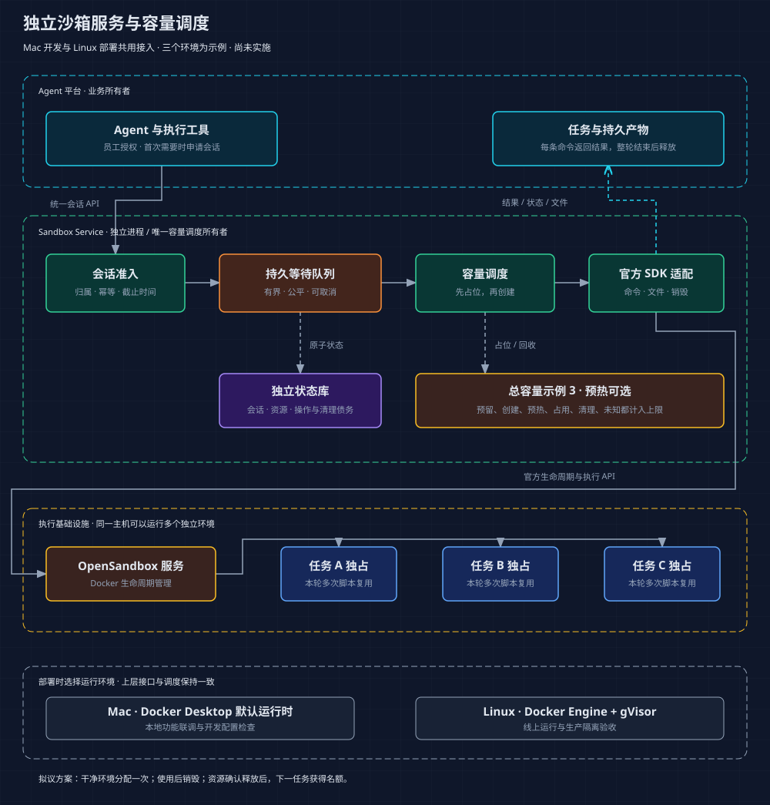
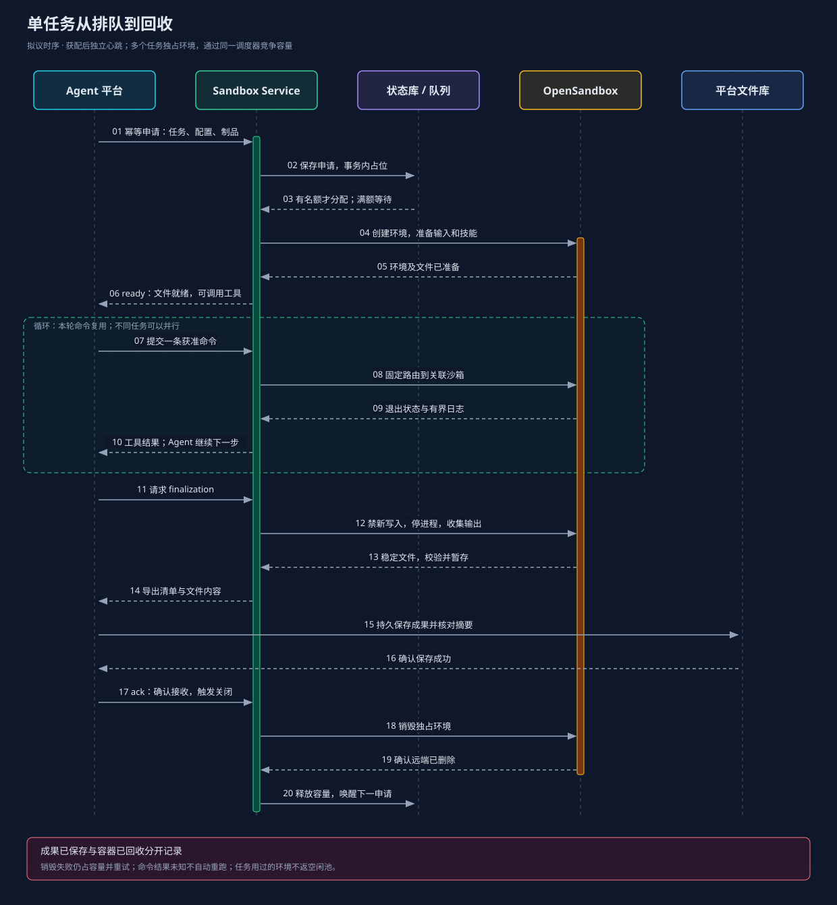

# 独立沙箱服务详细设计

| 项目     | 内容                                                                                                             |
| -------- | ---------------------------------------------------------------------------------------------------------------- |
| 设计状态 | 详细设计草案；目标已明确，额度与接口为设计建议                                                                   |
| 实施状态 | 未实施；本次只编写详细设计和图，未修改应用执行逻辑、启动服务或执行部署                                           |
| 更新日期 | 2026-10-28                                                                                                       |
| 范围     | Mac 本地开发、Linux 线上部署、独立沙箱服务、容量与队列、任务文件及回收                                           |
| 当前入口 | [基础工具契约](../reference/files-and-environments.md)、[部署指南](../guides/agent-tools.md)；它们仍描述现有实现 |

2026-10-29 范围澄清：本文的会话和队列面向 Run 的文件与脚本环境，不能直接当作 stdio MCP 进程池。受管理 MCP 的实例归属、按需启动、隔离和统一容量见stdio 生命周期增量。两类资源复用底层环境管理，分别维护会话与清理；独立服务是本文的部署选项，不是 stdio 协议要求，也不是实现隔离的前提。

## 1. 目标与设计结论

2026-11-08：当前阶段按[Agent 基础文件与沙箱记录](../records/Agent基础文件与沙箱.md)复用 OpenSandbox 服务及社区适配器，不额外建设本文的自研服务和专用队列。本文保留为后续容量与部署扩展候选，不作为首版实施前置。

用户要求一套兼容 Mac 开发和 Linux 线上环境的沙箱机制；沙箱独立运行，容量上限可从两三个开始，请求超过容量时等待，机器升级后可以调整容量，不因扩容重写 Agent 业务。

建议采用独立 Sandbox Service，组合持久化申请队列、全局容量调度和 OpenSandbox SDK。上层只使用会话、文件、命令和释放接口；OpenSandbox 负责真实环境的创建、命令执行、文件传输和销毁，Docker 负责容器运行。Mac 使用 Docker Desktop，Linux 使用 Docker Engine，并在生产配置启用 gVisor。调用接口保持一致，部署配置分别维护。

本设计不受现有沙箱表、API 或进程归属约束；现有代码可按价值复用，而非兼容前置。此页是后续目标，取代旧[自托管方案](../records/README.md)中“仅 Linux 生产配置、沙箱容量满立即拒绝、生命周期与应用同进程”的目标限制；不宣称当前实现已经改变。

“池”先解释为受限的环境容量：`max_total=3` 表示最多占用三份资源，不表示必须始终常驻三个容器。预热数量独立为 `warm_target`，可取 0。两者是本方案建议的配置概念，不是 OpenSandbox 自带字段，也不是已获用户确认的数值。

容量按逻辑沙箱环境计数，不按 Docker 中所有容器的总数计数；一份沙箱可能伴随网络等辅助容器。辅助进程与服务的资源同样需要纳入整机预算。

阅读顺序：先看第 2～4 节架构与流程；实施接口看第 5、12～14 节；部署看第 6、7、15 节；任务拆分与验收看第 10、16、17 节。总容量 2～3、预热为 0、用户配额及期限均为建议起点，主机规格和真实脚本尚未验证。

首版不做多节点高可用、跨任务容器复用、暂停恢复或自动扩缩容。后续扩展保留客户端边界，但需要相应的调度与存储增量。

## 2. 服务与所有权



| 部分                | 所有内容                                           | 边界                                           |
| ------------------- | -------------------------------------------------- | ---------------------------------------------- |
| Agent 平台          | 用户与员工授权、对话、模型循环、任务期限、业务产物 | 不管理 Docker；决定谁能请求哪种执行能力        |
| Sandbox Service     | 会话申请、等待队列、容量、租约、命令记录、资源债务 | 独立进程及独立状态库；不拥有员工、模型或提示词 |
| OpenSandbox 服务    | 官方沙箱生命周期、命令与文件 API                   | 只由受信服务调用；复用官方 SDK，不重写容器管理 |
| Docker 与容器运行时 | 真实进程、文件系统、资源及隔离                     | 部署时配置，模型不能选择关闭隔离               |
| 平台文件存储        | 用户输入、技能内容版本和已发布输出                 | 跨任务持久化；临时容器不充当业务存储           |

首版采用一个服务进程、一个容量调度所有者及独立 SQLite 状态库，持久卷保存队列、资源申请和操作记录。启动获取独占进程锁，第二个实例使用同一状态目录必须失败；数据库不放共享网络盘。不同环境的命令仍可并行，单所有者不表示所有执行串行。所有创建决策由这一处串行协调，事务完成后才发起网络请求。应用增加 HTTP worker 不会增加第二个容量控制器。首版无需额外引入 Redis、消息队列或 Kubernetes。

首版建议两个控制服务都作为宿主上的独立 Python 进程运行：Mac 用统一开发入口，Linux 用进程管理器托管，任务环境由 Docker 运行。这样共用服务代码与配置加载规则，减少控制服务容器化引入的路由差异；以后可单独容器化控制服务，不改变客户端 API。Docker socket 只交给 OpenSandbox 控制服务，不交给 Agent 平台或任务容器。

## 3. 容量、队列与预热

### 3.1 总容量是硬边界

常规创建必须满足：

```text
已预留 + 创建中 + 空闲预热 + 任务占用 + 清理中 + 创建/销毁结果未知 <= max_total
```

创建之前，调度器在事务内登记资源并占用名额；不能先创建再检查容量。清理中和未知资源继续占用名额，确认远端已删除才释放。预热与业务请求经过同一条创建准入链路；清理任务使用独立控制通道，不等待业务容量名额。

同一任务拿到空闲预热环境时，只转移归属，不重复扣名额。待处理业务请求优先于补充预热。`max_total=3` 且已有三轮任务时，空闲预热目标暂时为零，不能额外创建第四个容器。

缩容采用排空：已有环境可暂时高于新的目标，服务显示 draining，停止新增，先销毁空闲环境，再等待活动任务结束；不为立即满足新数值中止任务。

### 3.2 满额等待，有界准入

队列保存“申请一个任务会话”的请求，不给每条脚本重新申请一个环境。首次需要沙箱工作文件或代码执行时才申请；同一会话内的多个命令按顺序执行。

- 总队列和每用户队列都有限额；未满则返回已排队，满额才拒绝新申请。
- 每用户内部按提交顺序调度，用户之间轮询；活动配额包含创建、使用、导出及清理中的资源。超过用户配额时跳过该用户，不阻塞其他用户；轮询游标持久化。用户标识由平台受信身份传递，不接受模型自行指定其他用户。
- 排队时间、环境创建时间和命令执行时间分别记录。排队超时、用户取消或任务截止后移除请求；迟到的创建结果进入回收，不分配给已取消任务。
- 平台等待会话就绪时让出执行线程，不占用一个同步网络请求等待整个队列；由状态查询或事件流获知进度。客户端断开观察不等于取消任务。
- Agent 任务并发与沙箱容量分别控制。模型对话可以有更高并发，但只有获配环境的任务能运行本地脚本。任务总时限必须覆盖允许的排队与执行时间，不能沿用过短的旧执行时限。

例：八个获准任务申请沙箱，容量为三、每用户限制未触发。前三个进入创建/分配，另外五个等待；某一任务释放的环境确认销毁后，下一个请求才获准创建。环境创建和清理耗时会影响交接速度，不承诺始终三份环境都在计算。

### 3.3 预热是可选的延迟优化

首个可交付版本支持 `warm_target=0`，先打通按需创建、排队和硬容量。预热不作为容量可扩展的前提。

需要降低冷启动延迟时再启用干净环境预热：只装入通用镜像，不装用户输入、技能私有内容或凭证。预热环境分配给一轮任务后不回到空闲池；任务结束后销毁，再按容量补充新的干净环境。同一任务内部继续复用已分配环境。

官方 [Client Pool](https://open-sandbox.ai/guides/client-pool) 是可复用的预热实现，但其 `max_idle` 只限制空闲缓冲，不能替代本方案的总容量；空池 acquire 也不提供等待队列。启用预热前需验证锁定 SDK 的 creator/state-store 扩展，确保创建、失败清理和直接创建 fallback 均进入总容量账本。不能接入全局准入时，保持预热关闭，而非放任 SDK 超额创建。只维护一个预热调度所有者，避免两套后台循环争抢名额。

## 4. 会话与执行流程

1. 平台确认员工工具许可，形成受信执行配置和任务关联；会话申请携带调用方幂等键、用户/任务引用、批准的 profile、输入与技能制品引用，以及截止时间。
2. 服务原子保存申请；重复幂等键和相同请求返回同一会话，内容不同则冲突。申请立即获配或进入等待，不重复创建环境。
3. 调度器为合适的排队请求预留容量，提交事务后通过官方 SDK 创建，或消费已受容量约束的干净预热环境。环境必须达到当前 profile 的就绪条件才能交付。
4. 服务把本轮输入、冻结技能包和必要来源复制到受控只读目录，准备可写工作区和输出目录。文件工具与命令操作看到同一份实体文件；技能脚本相对路径在执行环境中真实存在。
5. Agent 调用执行工具。平台复核业务授权，服务复核租约、操作去重键、截止时间及部署上限；将命令提交给沙箱，持续记录有界日志和退出状态。
6. 每条命令完成就把结果或错误返回 Agent，供其决定下一步。沙箱不因此销毁；同一会话后续操作继续使用它。非零退出码是该操作失败，不自动等同于整轮任务失败。
7. 正常交付时进入 finalizing，关闭新命令和文件写入，停止任务进程并确认输出稳定，生成有界导出。平台持久保存文件并核对清单摘要，再幂等确认接收；确认触发关闭与销毁。业务成功由平台决定，不能先确认再保存。
8. 释放时销毁环境。失败、取消、失联和到期同样走终止与回收；容器销毁确认后才释放容量。已经被平台保存的输出不依赖容器继续存在。



申请的用户、任务和 profile 一经绑定不得被另一个调用方改写。心跳保持租约存活，但不能无限延长任务硬截止时间；租约过期后不把旧容器重新交给另一个任务。

## 5. 对外接口与状态

以下是拟议的内部服务接口，不是 MCP、Agent Skills 或 OpenSandbox 官方 API。正式实现生成 OpenAPI，平台不依赖厂商 SDK 对象。

### 5.1 会话与资源状态

会话状态描述使用流程，结束原因单独保存，不把取消、命令失败和清理失败混为一谈。

| phase        | 允许行为                      | 后续                                             |
| ------------ | ----------------------------- | ------------------------------------------------ |
| `queued`     | 查询、取消                    | 获配 → acquiring；取消/排队到期且无资源 → closed |
| `acquiring`  | 查询、心跳、取消              | 创建及实体化通过 → ready；失败/取消 → closing    |
| `ready`      | 心跳、文件、命令、结束        | 正常导出 → finalizing；取消/失联/到期 → closing  |
| `finalizing` | 心跳、查询/读取导出、确认接收 | 接收确认或导出失败/到期 → closing                |
| `closing`    | 查询，后台清理                | 资源确认删除 → closed；否则保留债务              |
| `closed`     | 查询历史摘要                  | 终态，不续租、不重开                             |

`end_reason` 表示 released、cancelled、queue_timeout、lease_expired、task_deadline、provision_failed、interrupted 或 export_failed。命令普通非零退出不自动关闭会话。成果已保存时，平台任务可完成，服务继续 closing 清理；用户不必等 closed 才下载。

| 资源 state | 含义与容量                                         |
| ---------- | -------------------------------------------------- |
| `reserved` | 已占名额，确定尚未提交上游；撤销且确认未提交才释放 |
| `creating` | 创建请求进行中，继续占位                           |
| `warm`     | 干净预热环境，继续占位，借出只转移归属             |
| `leased`   | 已绑定任务，包含文件准备、使用和导出，继续占位     |
| `cleaning` | 正在终止/销毁，继续占位                            |
| `unknown`  | 创建或销毁结果未知，继续占位，不借给新任务         |
| `deleted`  | 确认不存在或确定从未提交，释放容量                 |

会话 acquiring 可以关联 creating 或 leased；远端创建成功不等于文件已准备好。会话 closing 可以关联 cleaning 或 unknown。

### 5.2 API 清单

| 方法与路径                                               | 行为                                                           |
| -------------------------------------------------------- | -------------------------------------------------------------- |
| `POST /v1/sessions`                                      | 保存申请，201 返回 queued/acquiring；同键重试 200 返回同一会话 |
| `GET /v1/sessions/{id}`                                  | 状态、结束/等待原因、租约和截止；不承诺精确排队 ETA            |
| `GET /v1/sessions/{id}/events`                           | 可选 SSE，游标恢复；始终保留轮询查询                           |
| `POST /v1/sessions/{id}/heartbeat`                       | 续报存活，受硬截止限制                                         |
| `POST /v1/sessions/{id}/commands`                        | 幂等接受命令，202 返回操作引用                                 |
| `GET /v1/sessions/{id}/commands/{command_id}`            | 状态、退出码、有界日志及截断标记                               |
| `PUT /v1/sessions/{id}/files/{path}`                     | 只写 workspace/outputs，字节限制，完整成功后原子替换           |
| `GET /v1/sessions/{id}/files/{path}`                     | 受控相对路径读取，不接受宿主任意路径                           |
| `POST /v1/sessions/{id}/finalizations`                   | 幂等设置写入屏障并发起导出，202 返回 export 引用               |
| `GET /v1/sessions/{id}/exports/{export_id}`              | 状态、manifest、长度及摘要                                     |
| `GET /v1/sessions/{id}/exports/{export_id}/files/{path}` | 鉴权读取有期限的暂存成果                                       |
| `POST /v1/sessions/{id}/exports/{export_id}/ack`         | 确认成果已持久化，校验清单摘要，幂等触发关闭                   |
| `DELETE /v1/sessions/{id}`                               | 取消/释放；有资源 202 closing，无资源或已关闭 200              |
| `GET /health/live`、`GET /health/ready`                  | 进程存活及依赖/配置能力                                        |
| `GET /v1/admin/capacity`                                 | 管理身份读取占用、队列、排空及资源债务                         |
| `PUT /v1/admin/capacity`                                 | 管理身份带 expected_revision 原子修改容量/准入额度             |

所有操作先校验服务身份、租户范围及归属。用户和 Run 引用由可信平台提供，模型不能修改归属或 profile。管理端单独授权，不直接向浏览器或公网开放。事件保留期到期时要求重读快照，不使会话状态不可查。

首版使用独立服务凭据与受限网络，同机优先回环，跨主机必须 TLS；管理配置使用单独权限。平台撤销员工执行权时须取消会话并停止心跳，不能只从后续模型工具列表移除执行工具。

### 5.3 幂等、错误与命令重试

申请、命令、finalization 和 ack 要求幂等键，作用域为调用方、接口类别和归属对象。相同键相同规范化正文返回原对象，正文不同返回 409；鉴权先于去重读取。文件 PUT 用路径、租约代数和内容摘要确认重复结果。

| HTTP        | 含义                                 | 客户端处理                         |
| ----------- | ------------------------------------ | ---------------------------------- |
| 401/403/404 | 身份无效、能力不足、对象不可见       | 不自动重试；不泄露其他租户对象详情 |
| 409         | 幂等冲突、旧租约、状态不允许、命令忙 | 查询状态或修正请求                 |
| 410         | 已知且可见会话的使用权过期           | 不重开旧环境                       |
| 422         | profile、路径、字段或期限无效        | 修正请求                           |
| 429         | 总/用户队列或请求速率满              | 按建议退避，不快速无限重试         |
| 503         | 恢复中、停止接单或依赖不可用         | 保留原键有限重试                   |

错误正文固定含 code、可安全展示的 message、retryable 和追踪引用。超时后仍以原操作键查询，不能凭 retryable 生成新命令。同一会话最多一个活动命令；重复同键返回原操作，不同键并发返回 command_busy，不再建命令队列。

命令状态为 accepted → submitting → running → succeeded/failed，另有确认终止的 cancelled/timed_out 和无法判定的 unknown。调用上游前保存 submitting，获得上游操作身份后立即保存。跨越此边界时崩溃不能假定没有执行。能查询同一上游操作则恢复观察，不能确认时不重放，首版关闭会话回收。

命令超时须验证工作进程终止；环境可控才允许下一条操作，否则关闭。幂等键不能保证脚本外部副作用恰好发生一次。SDK 客户端 close 不能代替远端 kill/destroy。

## 6. Mac 与 Linux 的部署配置

OpenSandbox [官方安装说明](https://open-sandbox.ai/getting-started/installation)支持 macOS、Linux；[运行时配置](https://open-sandbox.ai/guides/secure-container)属于服务端设置，SDK 调用无需跟随改写。Docker Desktop 管理其容器所需的运行环境，无需用户另外维护一套手工 Linux 虚拟机。

| 配置面              | Mac 本地开发                                         | Linux 线上部署                             |
| ------------------- | ---------------------------------------------------- | ------------------------------------------ |
| 容器引擎            | Docker Desktop                                       | Docker Engine                              |
| OpenSandbox runtime | Docker                                               | Docker                                     |
| 容器隔离运行时      | 默认 Docker 运行时                                   | 显式配置 gVisor `runsc`                    |
| 网络路由            | 服务不能直连容器 IP 时，经映射端口；按拓扑配置 proxy | 按部署拓扑选择内部地址或映射端口           |
| 服务接口/调度/队列  | 与线上相同                                           | 与本地相同                                 |
| 就绪检查            | 引擎、镜像、执行/文件、配额及通道冒烟；报告实际能力  | 再验证实际 runsc、生产网络和磁盘等隔离要求 |

本地与线上使用一个部署基线加两份环境覆盖配置。镜像按架构构建并固定制品身份；Mac ARM 与 Linux AMD64 可以使用同一镜像构建来源的不同架构制品，不承诺复用同一个单架构镜像摘要。版本与依赖保持对齐。

开发/生产模式由受信部署者明确配置，默认按生产要求；不能由 Skill、模型或单次申请切换。生产缺少必要运行时或验收条件时保持未就绪，不自动切换为开发配置。开发和生产分别保留实际能力报告，不能把本地功能通过写成线上隔离通过。

Mac 网络设置优先使用官方 [Docker 配置示例](https://github.com/opensandbox-group/OpenSandbox/blob/main/server/opensandbox_server/examples/example.config.toml)与[单机路由说明](https://open-sandbox.ai/architecture/network/single-host-network)。客户端通过服务代理访问文件与命令，不另外引入 Mac 专属 Agent 执行器。

## 7. 建议起始配置与扩容

以下是草案建议和调优起点，不是用户已确认额度，也不是经过压测的承诺。

| 参数概念             | 开发起点           | 线上起点                  | 含义                                                     |
| -------------------- | ------------------ | ------------------------- | -------------------------------------------------------- |
| `max_total`          | 2                  | 3                         | 包含创建、空闲、运行、清理和未知资源的总容量             |
| `warm_target`        | 0                  | 0，测得冷启动瓶颈后再启用 | 不与总容量混为同一个池大小                               |
| `queue_capacity`     | 20                 | 30                        | 等待申请数量，不是 HTTP 连接数                           |
| `per_owner_active`   | 2                  | 1，可按业务调整           | 同一用户可占用的活动环境                                 |
| `queue_wait_seconds` | 120                | 120                       | 与任务剩余截止时间取更短者                               |
| 单环境资源           | 1 CPU / 512 MiB    | 1 CPU / 512 MiB           | 示例 profile；须用典型脚本测量                           |
| 单命令时限           | 60 秒              | 60 秒                     | 同时受会话剩余时间限制                                   |
| 会话硬时限           | 300 秒             | 300 秒                    | 从预留名额起，包含创建、思考、执行和导出                 |
| 存活心跳 / 失联时限  | 15 / 45 秒         | 15 / 45 秒                | 从 acquiring 起独立维持，不能被命令阻塞                  |
| 远端环境 TTL         | 剩余硬期限 + 60 秒 | 剩余硬期限 + 60 秒        | 到期回收补偿；预热交付时核对剩余 TTL，续期不越过有限余量 |

扩大机器后，可以在同一节点调整总容量，例如 3 → 6；队列、会话与 Agent API 保持不变。配置更新在唯一调度器里原子生效，新增名额供后续请求使用，已有环境仍按原 profile 执行；单环境资源或镜像更改只影响新环境。

增加数量提升的是可同时服务的任务数和整体吞吐，不保证单条脚本更快或性能线性增长。三份 512 MiB 只是工作负载内存限额合计 1.5 GiB，主机还需应用、服务、隔离运行时与系统余量；结合 CPU、内存、磁盘和队列等待指标定容量。

CPU 与内存限额不等于固定占用，也不表示分配了物理专属核心，具体机制见 [Docker 资源约束](https://docs.docker.com/engine/containers/resource_constraints/)。同一用户想同时使用三个环境，还需将用户活动配额调到至少 3，不能只扩大总容量。

同一服务首版使用一种主要资源 profile，避免大任务挤占造成不可预测的调度。以后增加多种规格时，将资源预算和 profile 选择收在调度器内，客户端接口保留 profile 引用即可。

## 8. 失败、回收与重启

| 情况              | 必须保持的行为                                                                   |
| ----------------- | -------------------------------------------------------------------------------- |
| 排队取消、超时    | 原子移除申请，尚未创建则不消耗环境；获配竞态由同一事务决定                       |
| 创建失败或超时    | 保留创建请求身份、资源占位和远端归属；按 metadata 查询，未知结果不盲目重建       |
| 命令超时          | 终止命令及相关工作进程，返回失败/未知；确认环境可控才允许后续操作                |
| 用户或 Agent 失联 | 心跳过期后终止会话并回收；恢复平台连接不重新开放过期租约                         |
| 服务重启          | 先恢复持久状态并核对远端资源，再开放新分配；队列按期限恢复；运行中未知命令不重放 |
| 销毁失败          | 继续占位，后台按退避重试并告警，远端 TTL 为补偿；不能先释放名额冒险超配          |
| 镜像或配置变更    | 不把旧环境混入新 profile；先排空旧预热，已占用环境按既定期限退出                 |

重启首版将尚未确认结束的活动会话标为中断并回收，避免重新执行未知脚本。服务拒绝本部署之外的资源回收。未知申请只有在远端可确认删除、或经受信维护者核对后才解除占位。

平台成功交付要求输出已持久化；容器消失、客户端关闭或收到模型口头完成都不构成成功证据。服务状态库和平台业务库分别备份，任务临时容器不纳入业务数据备份。

## 9. 权限、文件与观测

平台负责员工是否可执行、可使用哪些输入和工具；服务负责执行配置、租约归属、资源与文件边界。服务凭据只用于受信控制链路；工作负载不持有 Docker socket、管理 Key、平台数据库、环境文件或业务目录挂载。

输入和技能包只读，工作目录与输出目录可写；路径和链接检查覆盖上传、读取、命令环境及导出。命令自身的约束由容器用户、隔离运行时、文件权限和网络策略落实，不能用文件工具参数校验代替 Shell 隔离。保存/导入技能不自动执行或安装依赖；依赖进入预先构建并验证的镜像。

每次申请和命令能关联平台任务；日志有字节上限，记录退出码和截断状态。至少暴露：各资源状态数量、队列深度及等待分位数、冷启动耗时、执行耗时、取消/超时率、清理债务及年龄、单环境和主机资源占用。部署验收记录与实时服务健康分别展示。

## 10. 实施与验收

| 阶段       | 交付范围                                     | 验收重点                                                        |
| ---------- | -------------------------------------------- | --------------------------------------------------------------- |
| S1         | 独立服务、统一客户端、Mac/Linux 配置；无预热 | 本地创建/命令/文件/销毁走通，生产 profile 不被开发配置覆盖      |
| S2         | 持久队列、全局容量、会话、取消与恢复         | 八申请三名额、并发抢占不超限、等待可取消；清理失败继续占位      |
| S3         | 平台执行适配、标准技能与文件、可靠产物       | 同轮脚本共享目录，跨轮隔离；命令结果回 Agent；保存输出后释放    |
| S4         | 容量调优和故障演练；按数据决定预热           | 3 → 6 不改变接口；缩容排空；按典型脚本测吞吐与资源              |
| S5（可选） | 官方 Client Pool 预热适配                    | 空池 fallback、补池和未知创建全部受同一硬容量限制；使用后不返池 |

必须覆盖：重复申请只生成同一会话；并发创建包含预留名额；第三用户公平获得服务；排队与创建时取消；取消后的迟到创建；服务崩溃与 SDK 请求未知；命令不自动重放；容器清理失败；输入和技能不可改写；输出可鉴权下载；Mac 功能与 Linux 生产隔离分别验收。测试在模拟上游与真实环境中分别记录，不能相互替代。

计划新增独立服务包、环境部署覆盖配置和平台客户端适配；这些文件本次均未创建。替换实现时先停止新沙箱任务并排空旧环境，再切客户端端点和执行适配，保留业务消息与产物。回滚恢复旧接入前先核对新服务的活动资源；不让两个容量控制器同时管理同一环境集合。

## 11. 扩展边界与待确认项

- 当前按“最多两三个任务环境，预热可选”解释池；若用户希望常驻空闲池，应进一步确认预热目标和可接受资源成本，接口边界不变。
- 执行 CPU、内存、队列期限及首批镜像需要真实脚本和主机规格校准。增加容量不等于承诺线性提升。
- 官方 Client Pool 为实验 API，网站跟随主分支；启用时核对发布版本并锁定 SDK、服务、execd/egress 镜像，再验证总容量接线，不能仅凭最新文档宣称当前版本已覆盖。
- 同机扩容主要改容量与资源配置。多机、多调度器是后续增量：保持会话 API，改用共享事务状态和节点资源归属；不能把每节点上限误当全局上限，也不承诺跨主机只改一个数字。
- 预热首版关闭，优先完成完整队列与回收；后续不采用 Kubernetes 池、容器跨任务清理复用或自定义工作流引擎作为前置。

## 12. 持久化模型与一致性

### 12.1 最小数据模型

以下为拟议逻辑表，不是已生成的迁移。OpenSandbox 自己的状态库与本服务独立，不能复用同一个数据库。

| 表                  | 核心字段                                                                                                                                            | 约束与用途                                                         |
| ------------------- | --------------------------------------------------------------------------------------------------------------------------------------------------- | ------------------------------------------------------------------ |
| sessions            | caller、owner_ref、run_ref、phase、end_reason、profile_snapshot、accepted_at、queue_deadline、use_deadline、lease_epoch、lease_expires_at、revision | `(caller, run_ref)` 唯一；冻结输入/技能引用和配置，不保存原始凭据  |
| resources           | session_id 可空、state、remote_id 可空、upstream_ref、create_intent_ref、metadata、reserved_at、remote_expires_at、last_error、retry_at             | 每会话至多一个资源；同上游非空 remote_id 唯一；未 deleted 均占位   |
| commands            | session_id、operation_key、request_hash、state、upstream_operation_id、deadline、exit_code、termination_reason、log_ref                             | `(session_id, operation_key)` 唯一；事务保证每会话至多一条活动命令 |
| idempotency_records | caller、scope、key、request_hash、object_ref、expires_at                                                                                            | 组合唯一；保存申请/finalization/ack 的对象身份                     |
| exports             | session_id、state、manifest_hash、staging_ref、bytes、expires_at、ack_at                                                                            | 一次 finalization 对应固定导出；重复 ack 不重复发布                |
| events              | session_id、sequence、type、safe_payload、created_at                                                                                                | `(session_id, sequence)` 唯一，与状态变化同事务保存                |
| control_state       | deployment_id、config_revision、scheduler_cursor、desired_capacity、draining                                                                        | 稳定部署身份、调度游标和配置修订；进程锁另由操作系统持有           |

队列按 sessions 的 queued 状态、owner 和 accepted_at 索引派生，不与另一份消息列表双写。清理按资源 state/retry_at 建索引，命令按 session/state 建索引。大日志和导出内容存于有配额的制品目录，数据库只存引用、摘要与结构化结果。

### 12.2 事务边界

1. 接受申请时，session、幂等记录和首次事件一起提交。
2. 分配时，申请出队、资源占位、归属绑定和轮询游标一起提交。
3. 命令被接受及提交意图先落库，再调用上游；不能在长数据库事务里等待网络。
4. 状态更新与事件同事务，迟到回调按 revision、租约代数和预期状态条件更新。条件不成立则核对/清理，不覆盖取消。
5. 导出确认、接收摘要与关闭意图一起提交；远端销毁在事务外进行，确认删除后另一次事务释放名额。

服务写不进状态库时停止新分配和命令，保留已知身份，尽力终止并告警。平台成果库与服务状态库不做分布式事务，靠先保存、再幂等 ack 衔接。

幂等记录至少覆盖任务最长生命、清理和客户端重试窗口；建议关闭会话及键摘要保留 7 天，未清债务不因保留期到期删除。同一 Run 关闭后不能换键再开一个环境；确需重试整轮任务时由平台创建新 Run。长期业务历史由平台保存。

## 13. 调度算法、截止与重启细则

### 13.1 一次调度的事务顺序

调度由入队、删除确认、配置更新及定时器唤醒。首版单一主要资源规格，避免预先引入加权调度。

1. 获取短写事务，处理已取消、排队到期及平台任务截止的申请。
2. 从资源账本计算总占用及用户活动占用；按持久化轮询游标选下一位合格用户的最早申请。
3. 有匹配的干净预热资源则绑定；否则只有总名额未满才写 reserved。所有新申请经过同一入口，不插队绕过旧合格申请。
4. 原子绑定 session/resource，设置 acquiring、租约代数和使用硬截止，保存冻结 profile 及创建身份，推进游标，提交事务。
5. 创建前将资源改为 creating，然后在事务外调用 SDK。只有确定尚未发出上游请求的 reserved 才能直接撤销名额。
6. 创建结果返回后检查会话是否仍获准；取消/截止则直接清理。创建、输入实体化、权限及必需探针通过后才 ready。
7. 无合格业务等待者时，后续预热版才可在剩余预算内补池。

取消与分配由同一事务竞争：取消先提交则不创建；分配先提交则撤销租约并清理。创建 API、SDK 和反向代理的重试都必须核对，禁止网络超时后隐式再建一个环境。

降低用户配额或队列上限不删除已有任务，只约束后续准入/分配。已有环境遵守冻结配置与期限，新的配置修订不能自动延长它们。未知资源拖住容量时应处理债务，不以不断加大 max_total 掩盖泄漏。

### 13.2 三层截止与租约代数

```text
queue_deadline = min(accepted_at + queue_wait_limit, task_deadline)
use_deadline = min(reserved_at + session_max_seconds, task_deadline)
lease_expires_at = min(last_heartbeat + heartbeat_timeout, use_deadline)
command_deadline = min(command_started_at + command_timeout, use_deadline)
```

排队阶段不要求心跳，由显式取消和 queue_deadline 约束。进入 acquiring 时平台观察到 lease_epoch 后即启动独立心跳，创建阶段也计入失联检测；不能等命令开始才续活。初次分配以当前时间建立首个心跳窗口。

命令观察循环持续检查当前租约，不把命令提交时的短租约期限永久固定为命令终点。这样心跳可以维持正常长命令，但不能延长 command_deadline 或 use_deadline。单命令、创建/实体化、导出均有子期限，最终不能越过使用硬截止。

创建与实体化建议最多 60 秒，计入会话 300 秒。平台请求的绝对任务期限须覆盖排队及执行预算；期限不足的申请应尽早拒绝或明确截止，不在获配后偷偷延长整轮任务。

分配生成递增 lease_epoch；命令、文件写入、续活和 finalization 均校验它。关闭撤销使用权，旧执行请求即使迟到也失败。查询、取消、读取已生成导出及 ack 不要求仍有效租约，但必须校验归属、导出身份、保留期和清单摘要；它们不能重新开放执行环境。

远端 TTL 设置为剩余使用期限加有限清理余量。只有受信服务能按既定硬截止续期，不能无界自动续活；预热交付前核对剩余 TTL。SDK renew 的实际语义以锁定版本验证。TTL 到期不是确认远端删除的证据，释放名额仍须核对。

### 13.3 重启与孤儿资源核对

1. 获取独占进程锁，读取稳定 deployment_id、配置修订和状态库；恢复期间不开放新分配。
2. 恢复未到期队列，关闭已到期申请。首版将原活动会话标为 interrupted，撤销租约并清理，不自动续跑未知脚本。
3. 按保存的 upstream_ref、remote_id 和创建 metadata 查询资源，覆盖创建成功但远端身份尚未落库的窗口。
4. 找到本部署孤儿时补登记占位再清理；其他部署或归属不能验证的资源不自动删除。
5. 完成一次账本核对后开放分配；未决资源继续计入占用。关键创建窗口无法核对时停止新增并告警，不能用空库重置计数。

metadata 和资源列举能力须在锁定版本 PoC。单次查询未找到，不足以证明创建以后不会成功，仍需创建已确定结束或服务端权威状态等证据。无法自动判定时由受信维护者核对服务/Docker 状态解除债务并留审计，不向模型提供强制释放名额接口。

终止、销毁和核对使用独立有限并发通道，不等待业务名额。失败指数退避加抖动并记录 retry_at，持续失败告警。正常停服先停止准入、有限排空，再终止剩余会话；强杀由持久记录和远端 TTL 补偿。资源未清时不得以新 deployment_id 或空状态目录重新启动规避占用。

## 14. 文件、技能与成果交付细则

### 14.1 实体目录与制品入口

拟议容器目录如下，不是宿主挂载清单。

```text
/
├── inputs/                 # 本轮输入，只读
├── skills/
│   └── <skill-version>/    # SKILL.md、scripts、references、assets，只读
├── sources/                # 本轮获准来源快照，只读
├── workspace/              # 默认工作目录，可写
└── outputs/                # 待交付成果，可写
```

平台提交不可变制品引用、长度及摘要，服务通过受信内部制品接口读取；不接受任意下载 URL、宿主路径或模型指定的挂载参数。上传先暂存并校验，再实体化；包解压拒绝路径穿越、越界链接、特殊文件、文件数过多及解压体积超限。

技能版本在会话内冻结，脚本及相邻资源真实存在。相对引用以技能目录为基准，写入使用 workspace/outputs。文件工具与 Shell 指向同一份实体目录，不能用虚拟技能读取成功代替实际脚本接线。

任务以非 root 用户运行，输入/技能由受信初始化身份创建，工作用户不能改写文件或替换其父目录；实际权限需验证。Shell 可以自行操作文件，路径 API 校验不能替代容器内权限和隔离。

固定镜像预装 Python、Node 和批准依赖；创建、导入、读取 Skill 不执行安装脚本。新增依赖构建新镜像 profile 后验收。常规搜索、MCP 工具仍可走平台工具链，不因此给所有 Shell 开外网。

### 14.2 输出冻结与接收握手

finalizing 设置写入屏障、拒绝新命令和文件写入，并停止任务进程。确认输出稳定后仅导出 outputs 下普通文件，校验路径及链接，拒绝设备、套接字等特殊文件。无法确认进程停稳时返回 export_failed 并清理，不宣称已获得稳定快照。

导出 manifest 含相对路径、媒体类型、字节数和摘要。超限明确失败，不静默交付残缺文件。文件先进入服务的有配额暂存目录，平台按清单读取、持久化、核对，再发 ack。暂存路径和沙箱地址不作为用户下载链接。

平台在保存后、ack 前崩溃，可以按同一清单重读或重发确认；平台也按 manifest 身份去重发布。ack 提交后即触发销毁，清理失败不撤销已保存成果，仍继续占用容量。

导出生成及保留执行环境等待接收不能越过 use_deadline。远端关闭后，已生成导出按独立保留期供平台恢复读取和确认；迟到 ack 只登记接收，不重开环境。未 ack 的暂存文件不自动成为业务成果。取消默认不承诺保留部分输出，若产品需要另做显式有限导出。

### 14.3 会话与命令示例

以下为虚构字段值；绝对任务截止由平台生成，凭据和任意镜像不从模型输入接受。

```json
{
  "owner_ref": "user-demo",
  "run_ref": "run-demo",
  "profile_ref": "python-offline-v1",
  "task_deadline": "2026-10-28T03:10:00Z",
  "inputs": [{ "artifact_ref": "input-demo", "target": "inputs/data.csv" }],
  "skills": [{ "artifact_ref": "skill-demo-v1", "target": "skills/report-v1" }]
}
```

排队返回会话引用、phase=queued、wait_reason、queue_deadline；lease_epoch 和 use_deadline 在分配前为空，分配后通过查询获得。就绪后命令请求如下，实际执行固定发生在关联沙箱中。

```json
{
  "lease_epoch": 1,
  "command": "python /skills/report-v1/scripts/report.py --input /inputs/data.csv --output /outputs/report.html",
  "cwd": "/workspace",
  "timeout_seconds": 60
}
```

command 是沙箱内 Shell 输入，服务不能把它拼进宿主命令。文件系统、网络和工作用户约束仍由环境落实；调用方权限不会因提交了此字段自动获得。

## 15. 环境配置与统一启动设计

### 15.1 配置归属与示例

拟议部署目录如下；本次没有创建可执行部署文件。

```text
deploy/sandbox-service/
├── broker.base.yaml           # 本服务的通用设置
├── broker.dev.yaml            # Mac 开发覆盖
├── broker.prod.yaml           # Linux 生产覆盖
├── opensandbox.dev.toml       # 官方服务完整开发配置
├── opensandbox.prod.toml      # 官方服务完整生产配置
└── profiles/
    └── python-offline.yaml    # 批准的镜像、用户、资源和网络能力
```

Broker 合并顺序为 base → 环境覆盖 → 明确白名单的环境变量，未知字段失败。密钥由受限文件或部署环境注入，不进入版本库、工具响应或配置快照。开发与生产使用不同状态目录、凭据和 deployment_id。

```yaml
# 本项目拟议字段，不是 OpenSandbox 官方配置；额度是调优起点。
mode: development
capacity:
  max_total: 2
  warm_target: 0
queue:
  max_waiting: 20
  max_waiting_per_owner: 8
  max_active_per_owner: 2
  wait_seconds: 120
session:
  max_seconds: 300
  heartbeat_interval_seconds: 15
  heartbeat_timeout_seconds: 45
  cleanup_grace_seconds: 60
upstream:
  base_url: http://127.0.0.1:8080
  credential_ref: opensandbox-control
```

以下只展示 OpenSandbox 的环境差异，完整配置还需认证、锁定镜像、状态目录、端口及网络等设置，不能把片段直接作为生产部署文件。字段依据为[官方配置](https://open-sandbox.ai/getting-started/configuration)和[Docker 示例](https://github.com/opensandbox-group/OpenSandbox/blob/main/server/opensandbox_server/examples/example.config.toml)。

```toml
# opensandbox.dev.toml：Mac 上的宿主控制进程
[runtime]
type = "docker"

[secure_runtime]
type = ""

[proxy]
resolve_internal = false

[docker]
network_mode = "bridge"
publish_host = "127.0.0.1"
```

```toml
# opensandbox.prod.toml：Linux 上的宿主控制进程
[runtime]
type = "docker"

[secure_runtime]
type = "gvisor"
docker_runtime = "runsc"

[proxy]
resolve_internal = false

[docker]
network_mode = "bridge"
publish_host = "127.0.0.1"
```

这里两端都让宿主控制服务通过本地映射端口访问，避免 Mac 无法直达 Docker bridge IP 的差异。具体端点以锁定版本验证，不硬编码任务容器 IP。若把 OpenSandbox 控制服务放进容器，则按[官方单机网络说明](https://open-sandbox.ai/architecture/network/single-host-network)设置可达的 host 地址，Linux 补 host-gateway 映射；容器内 localhost 不是宿主，回环发布也不能直接沿用。

### 15.2 启动、验收与停止

1. 启动 Docker；Linux 一次性安装并注册 runsc，Mac 用 Docker Desktop，无需手工维护额外虚拟机。拉取锁定架构的工作镜像、execd 和必要辅助镜像。
2. 准备独立状态目录、秘密和完整环境配置，启动 OpenSandbox 服务。
3. 启动 Sandbox Service，获取独占锁、恢复账本、核对旧资源；恢复期间不开放分配。
4. 对当前配置修订进行能力探针；探针也先占位，不绕过硬容量。验证创建、文件、执行、终止与销毁，生产再核对实际 runsc 和隔离。
5. 服务就绪后，平台连同一内部 API；代码能力仅对有许可的员工开放。日常切换主要是地址、凭据、架构镜像和 runtime 配置。
6. 停止先关闭新准入，再有限排空和回收，最后退出；不先删除状态卷。

下面第一条为 OpenSandbox 官方启动方式；其余为实施时拟新增的统一入口，当前不能直接执行。

```bash
opensandbox-server --config <完整环境配置文件>

# 拟议仓库入口，实施时新增
make sandbox-up SANDBOX_ENV=dev
make sandbox-check SANDBOX_ENV=dev
make sandbox-down SANDBOX_ENV=dev
```

Linux 生产由进程管理器托管相同服务入口，不为每条脚本重启控制服务。更新服务、镜像、runtime 或网络后重新验收对应能力；日常健康检查不为每次命令额外创建探针环境。

### 15.3 Profile 与就绪条件

Profile 固定镜像身份、架构、CPU/内存、执行用户、进程上限、文件/临时存储边界、网络、命令与会话上限。平台只能引用批准的 profile，不能提交任意 Docker 参数。首版一种主要离线规格即可。

建议新增以下有界额度，均需按典型脚本调整：创建与实体化 60 秒；stdout/stderr 各 1 MiB；输入/输出各 32 MiB；每用户等待 8 个；导出暂存 1 小时；关闭会话摘要 7 天。另须限制文件数、解压体积、技能包体积及暂存总预算；不能只设单文件上限。

输入/输出限制约束不了脚本自行写满磁盘。磁盘硬配额依赖 Docker 存储驱动、受控卷或有大小限制的临时文件系统，必须验证锁定 OpenSandbox 版本的接入方式。不能仅在自定义配置写 disk 字段就声称生效。生产必需的存储边界未通过时 profile 不就绪；开发可报告缺口，但不能当成生产通过。

离线 profile 必须验证业务外网、宿主敏感服务、非许可内网及云元数据不可达，覆盖实际可用的 IPv4/IPv6 通路，同时保留管理通道。生产不因能力缺失降级运行时或改走宿主。

就绪报告关联版本、配置修订、镜像、架构和实际 runtime。存活检查只看进程；就绪检查还看恢复和依赖。容量满由队列/占用表达，不假装进程故障。实质配置变化或发现漂移后重新探测，历史通过记录不能替代当前能力。

## 16. 验收矩阵与容量评估

下表是实施验收要求，本次未运行真实沙箱测试。假上游验证状态与竞态，Mac/Linux 实测验证容器能力，分别记录。

| 编号 | 场景                            | 必须观察到的结果                         |
| ---- | ------------------------------- | ---------------------------------------- |
| A01  | 重复申请、相同键不同正文        | 同一会话；正文冲突 409，无重复创建       |
| A02  | 容量 3，八任务同时申请          | 至多三份未删除资源，其余等待、公平推进   |
| A03  | 多个创建慢返回                  | 创建前已占位，不出现第四份资源           |
| A04  | 单用户多任务与多用户竞争        | 配额生效；超额用户不阻塞其他合格用户     |
| A05  | 队列满、到期、排队取消          | 明确拒绝/结束原因，无额外环境            |
| A06  | 分配和取消竞态、创建迟到        | 事务决定归属；迟到环境清理，不 ready     |
| A07  | 创建成功但响应/绑定丢失         | 按 metadata 核对或保留债务，不盲目重建   |
| A08  | 同任务多命令、不同任务并行      | 同任务复用且命令串行，不同任务互相隔离   |
| A09  | 命令去重与提交后断网            | 返回原操作；未知不自动重跑               |
| A10  | 普通失败、超时、残留子进程      | 分类准确；超时停进程树，不可控则关会话   |
| A11  | 心跳维持、失联及旧代数迟到      | 正常长命令不误失联；过期后旧调用拒绝     |
| A12  | 多文件 Skill 读取相邻资源       | 物理文件存在，Shell 与文件工具视图一致   |
| A13  | 输入改写、路径/链接逃逸         | 实际工作用户受限，导出拒绝越界和特殊文件 |
| A14  | 保存后 ack 前崩溃、重复 ack     | 成果持久，可重复确认，不重复发布         |
| A15  | 导出超限/失败或平台未接收       | 不虚报交付，暂存有界，远端按期限回收     |
| A16  | 删除失败、重启与孤儿资源        | 持续占位、可见债务，重试且不误删其他部署 |
| A17  | 同机容量 3 → 6 → 2              | 接口不变，更新原子生效，缩容不杀正常任务 |
| A18  | 两实例共用状态目录              | 第二实例拒绝启动，无双调度器             |
| A19  | Mac 冷启动及全流程              | Docker Desktop 路由和对应架构镜像可用    |
| A20  | Linux 实际 runtime 与缺失       | runsc 可核对，缺失不就绪、不自动降级     |
| A21  | CPU、内存、进程、磁盘及网络探针 | 限制实际生效，管理通道可用               |
| A22  | 强杀服务、关闭 SDK 客户端       | 账本恢复、TTL 补偿；close 不误当销毁     |
| A23  | 可选预热补池/空池/fallback      | 都进入总预算，使用后不返池               |
| A24  | 平台 Run 与沙箱期限/配额组合    | 不被旧平台限额提前阻断而误称队列验收通过 |

每份记录包含服务/SDK/镜像版本、配置修订、主机架构、runtime、方法、预期/实际、删除证据和未覆盖项。模拟成功不能证明真实运行时或网络可用。

容量测试采用同一组典型脚本，分别测 1、2、3 份环境；有余量才测 6。记录排队与完成 p50/p95、任务完成率、CPU、内存峰值、OOM、磁盘及创建/清理耗时。先留出系统、平台及控制服务余量，再估算数量 × 单环境峰值和隔离开销，最终由实测校准。内存应考虑所有环境同时接近限额；CPU 超卖要结合可接受延迟，不能只按一核 512 的标签判断服务器压力。

指标至少区分 occupied/max_total、各资源状态、未知资源最老年龄、队列深度、等待/创建/执行/导出/清理分位数和失联率。指标不直接用每个任务/用户做高基数标签，具体关联进入受限日志；不要默认记录原始输入、完整命令参数或凭据。

## 17. 工程拆分与切换清单

拟议结构如下，仅表达独立职责；本次没有创建这些实现目录。

```text
sandbox-service/
├── pyproject.toml           # 独立依赖与版本锁定
├── src/sandbox_service/
│   ├── api/                 # HTTP、鉴权、DTO、错误
│   ├── scheduler.py         # 唯一容量与公平队列所有者
│   ├── sessions.py          # 准入、状态与租约
│   ├── commands.py          # 幂等提交、观察与终止
│   ├── artifacts.py         # 实体化、文件与导出
│   ├── recovery.py          # 核对、回收与重试
│   ├── opensandbox.py       # 官方 SDK 薄适配
│   └── persistence/         # 事务模型与正式迁移
└── tests/                   # 假上游与实际环境分层验收
```

1. 先做版本能力 PoC，锁定 SDK、服务、execd/egress、工作镜像和 runsc，验证路由、进程终止、权限/配额以及未知创建核对；不追随 latest 自动升级。
2. 实现独立服务与正式迁移，warm=0，先完成申请、容量、队列、租约、命令与回收。
3. 平台增加 SandboxClient 和执行后端：首次申请、异步观察、独立心跳、文件/命令、输出保存、ack、取消及 finally 释放。会话引用持久化，不只存内存/checkpoint。
4. 技能加载提供不可变制品清单，实体化归服务；用户输入与最终成果继续归平台文件库。
5. 补统一启动、环境覆盖、能力报告和生产托管，再完成分层验收与容量测试。预热放在实际测到冷启动瓶颈之后。
6. 切换先停旧准入并排空/终止旧环境，保留业务用户、对话、消息与成果；再切新端点。不让两个生命周期控制器管理同一环境集合。
7. 回滚先停新准入并核对全部新资源，再恢复旧接入；新状态库保留到债务清完，不因重建沙箱删除业务数据。

## 18. 官方依据与维护入口

外部资料核对日期为 2026-10-28。引用确认组件能力，本文的内部 API、状态、额度与调度策略属于项目设计，不冒充官方规范。

- [OpenSandbox 安装](https://open-sandbox.ai/getting-started/installation)、[配置](https://open-sandbox.ai/getting-started/configuration)：跨平台服务与统一 Docker 接入。
- [隔离运行时](https://open-sandbox.ai/guides/secure-container)、[单机网络](https://open-sandbox.ai/architecture/network/single-host-network)：运行时为服务端配置，网络按拓扑处理。
- [gVisor FAQ](https://gvisor.dev/docs/user_guide/faq/)、[Docker 资源约束](https://docs.docker.com/engine/containers/resource_constraints/)：Linux 条件和资源限额的含义。
- [Client Pool](https://open-sandbox.ai/guides/client-pool)、[SDK 能力与生命周期](https://open-sandbox.ai/sdks/)：预热、总容量边界、借出后销毁与版本条件。
- [现行实现](../../backend/app/resources/environments/README.md)、[共享工程约定](../engineering/shared.md)、[文档规范](../documentation.md)：仅作为实施参考，设计不受旧结构约束。

实施后将生效契约和操作说明归入 reference/guides；实际环境验收归入 records。本次文档检查只证明文档与引用质量，不证明新服务或真实运行已实现。
