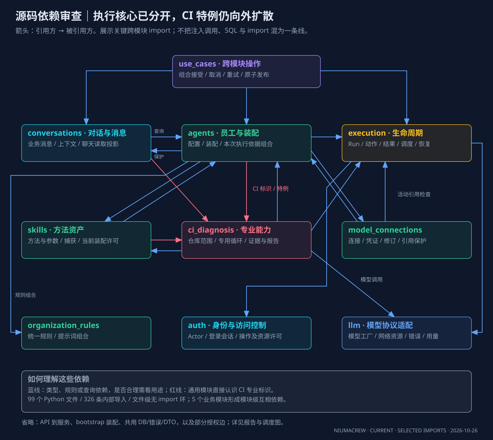
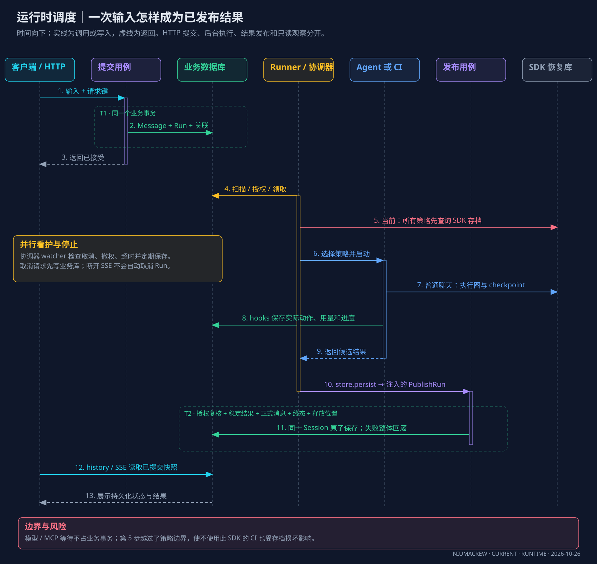
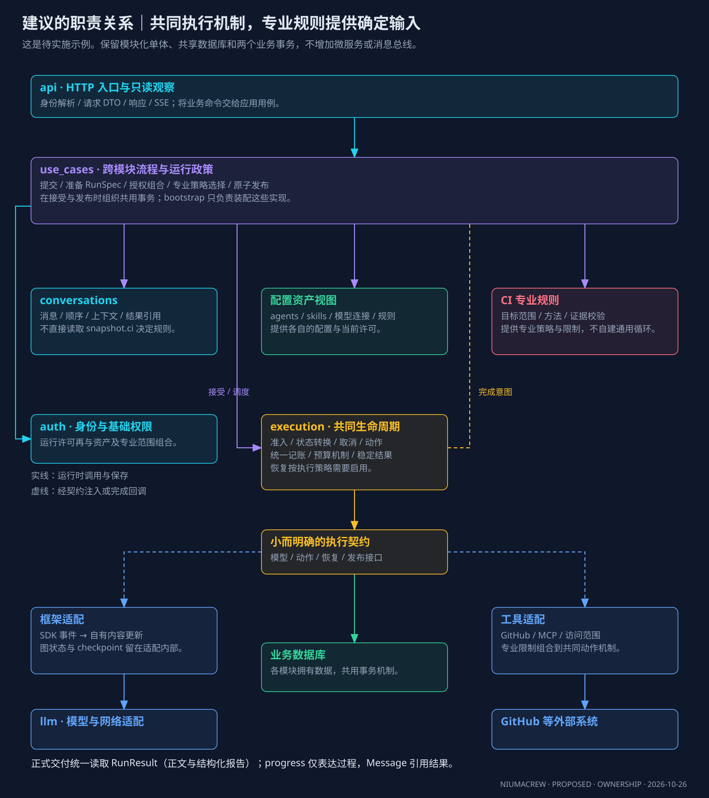

# 后端依赖与调度关系深度评审

源码链接已按当前位置修复；本文保留记录时的名称和结论，当前行为以现行契约为准。

日期：2026-10-26。对象为当前工作区中的后端，包含身份与访问控制已经合入 auth 的版本；仓库尚无提交。本文是一次源码评审和可视化说明，建议图不代表已经实现或已经采纳。本次只新增图文，不修改应用行为。

## 结论

**当前结构适合继续采用模块化单体，执行生命周期与业务消息分开的方向成立；专业能力、执行策略和 SDK 资源之间的隔离还没有完成。** 最应优先解决的是可观察的错误依赖，然后是数据归属和共同执行机制，目录改名排在这些工作之后。

三个最有价值的判断：

1. execution 不直接导入对话、CI 或应用用例；业务接受和发布通过共用事务及注入协作，值得保留。运行时的完成回调不构成源码循环依赖。
2. CI 规则已经进入员工配置、技能捕获和对话上下文；普通 Agent 与 CI 共用 Run 生命周期，但没有共用模型/工具循环、预算计数和恢复机制。
3. 有两处已经验证的数据或故障边界：不使用 LangGraph 的新 CI 仍受其存档损坏影响；CI 专用结果读取使用 progress_payload，而非已有的不可变 RunResult.structured。

## 方法、证据范围与图例

扫描 backend/app 下 99 个 Python 文件，得到 326 条可解析的内部 import 引用记录，去重后为 325 条文件依赖边。使用强连通分量检查互相依赖，随后沿调用方、注入关系、事务和最终读取核对。静态 import 不能代替运行时关系分析，也没有覆盖任意动态导入。

扫描快照摘要为 `d99d40bc3fb5d76d8312bc9933cfe9ce1a344ebb53723626b28c2db188dadbb3`，计算依据为按路径排序的 Python 文件 SHA256 映射；它用于识别本次源码快照，不是 Git 提交标识。

- 源码依赖图：A → B 表示 A 引用 B；只画影响理解的跨模块边。
- 调度图：箭头表示调用、返回或数据保存；HTTP、后台执行和只读观察分别理解。
- 建议图：表达期望的职责，不表示新增了对应接口或已经实现统一循环。
- bootstrap 的装配、数据库 models.py 的元数据注册及配置入口分别审视，不用它们天然较大的依赖范围判断业务模块是否耦合。

## 1. 当前模块怎样互相依赖



[独立 SVG](diagrams/dependency-review/current-dependencies.svg) · [可编辑生成源](diagrams/dependency-review/build-diagrams.py)。省略 API 到各服务、部分共用基础类型、授权和数据库边；图不是完整自动 import 图。

文件层面没有发现多文件 import 环。按业务目录汇总后，agents、skills、model_connections、conversations、ci_diagnosis 五个模块成为一个互相可达的集合。例如：

```text
agents → conversations → agents
agents → model_connections → agents
agents → skills → agents
skills → ci_diagnosis → agents → skills
conversations → ci_diagnosis → agents → conversations
```

这不等于 Python 会循环导入失败。某个模块的 service 可以引用另一个模块的 models，而后者的 service 又引用前者的 models；不同文件仍然可以形成无环依赖。**更需要判断的是：模块之间在共享稳定事实，还是互相掌握对方的业务规则。**

| 关系                                                     | 当前用途                                         | 判断                                                 |
| -------------------------------------------------------- | ------------------------------------------------ | ---------------------------------------------------- |
| agents → skills / model_connections                      | 管理员工装配，核对目标存在、参数合法与可用状态   | 员工拥有装配，读取所引用资产合理                     |
| skills → agents.models.AgentSkill                        | 检查技能是否仍被装配，避免破坏引用               | 单库中的引用保护可以保留，不必为了去掉箭头创建服务层 |
| model_connections → agents / execution.models            | 展示绑定员工，拒绝删除仍被绑定或有活动执行的连接 | 是有明确目的的查询；读取边不等于拥有对方生命周期     |
| conversations → execution                                | 将执行事实组合成聊天视图，选择成功结果作为上下文 | 合理，前提是对话不自行驱动 SDK 或改写通用执行规则    |
| execution → auth / llm / DB 机制                         | 检查发起身份，调用模型适配并保存执行事实         | 当前职责成立；依赖的具体服务契约还不够明确           |
| agents / skills / conversations → ci_diagnosis.contracts | 认识固定 CI 技能、仓库字段和专用输入类型         | 专业规则进入通用模块，是应减少的耦合                 |
| infrastructure/database/models.py → 各业务模型           | 收集 Alembic 元数据                              | 有意的注册入口，不是基础设施执行业务规则             |

依据：[员工管理](../../backend/app/agents/service.py)、[技能管理](../../backend/app/skills/service.py)、[模型连接](../../backend/app/model_connections/service.py)、[聊天投影](../../backend/app/conversations/queries.py)、[模型注册](../../backend/app/infrastructure/database/models.py)。

## 2. 一次输入实际怎样被调度



[独立 SVG](diagrams/dependency-review/runtime-scheduling.svg)。图中 T1 和 T2 是两个不同时间的业务事务，中间的模型与 MCP 调用不占用它们。

### 接受输入：应用用例负责组合，业务模块提供规则

HTTP 从 app.state 取得 RunCommands。提交用例在一个 Session 中检查资源范围、幂等、容量及对话空闲位置，准备配置和成功上下文，保存用户 Message、Run 与 ConversationRun，然后提交。首次创建对话也在这个事务中。

这是合理的跨模块操作：用例知道需要哪些参与者，参与者使用调用方事务，不各自提前 commit。把它拆成「消息服务先提交，再调用执行服务提交」反而会产生消息存在而执行未被接受的中间状态。

依据：[HTTP 命令入口](../../backend/app/api/routes/conversations.py)、[提交用例](../../backend/app/conversations/service.py)、[对话提交规则](../../backend/app/conversations/writes.py)、[执行准入](../../backend/app/execution/admission.py)。

### 后台执行：三种控制职责应该继续分开

| 参与者                | 控制范围                                                   | 不应被混入的职责                     |
| --------------------- | ---------------------------------------------------------- | ------------------------------------ |
| Runner / driver       | 扫描队列、并发看护、进程锁、关闭和故障后的再次收尾         | 专业取证算法、消息正文、SDK 事件格式 |
| ExecutionCoordinator  | 一次尝试的准备、当前授权、总超时、停止、候选结果及故障收束 | 无条件打开某一种策略才需要的资源     |
| 普通 Agent 或 CI 策略 | 本次模型/工具往返和专业处理                                | 绕过宿主动作、许可与共同预算机制     |

普通聊天使用 create_agent、框架中间件和 Run 范围的 checkpoint；CI 使用另一段有界模型/工具循环。两者都通过 RunHooks 保存过程，外层 watcher 同时检查取消、撤权、超时和进度。这能复用生命周期，但还不能称为统一 Agent 执行内核。

依据：[后台驱动](../../backend/app/execution/scheduler.py)、[单次协调](../../backend/app/execution/coordinator.py)、[普通 Agent](../../backend/app/agent_runtime/langchain.py)、[原CI 执行（已退役）](../reference/ci-diagnosis/README.md)。

### 结果发布：运行时返回业务用例是正常协作

候选结果返回协调器后，调用路径是：

```text
ExecutionCoordinator
└── RunStore.persist
    └── 注入的 PublishRun
        ├── RunStore.finish：稳定结果、动作和执行终态
        └── 业务发布器：正式助手消息、关联释放和对话更新时间
```

RunStore 没有 import PublishRun，具体实现由 bootstrap 注入。PublishRun 再使用执行模块的收尾操作，仍由同一个外层 Session 提交。这里虽然出现「执行 → 用例 → 执行」的运行调用顺序，但没有无限递归，也没有源码环；最后一步不会再调用 persist。

因此应该保持共同事务，进一步明确发布接口的类型和职责，而不是为了图上单向而拆开提交。

依据：[持久化与收尾](../../backend/app/execution/store.py)、[发布用例](../../backend/app/conversations/publication.py)、[装配](../../backend/app/bootstrap.py)。

### 读取、取消与恢复分别走什么路径

- history、问题预览、Run 查询及 SSE 从已提交的业务事实读取；它们不驱动模型，也不需要打开 SDK 存档。订阅中断只停止观察。
- 取消通过命令写 queued/running 对应的终止意图。运行中的 watcher 与动作前检查感知 cancelling；发布事务再次让已经接受的取消优先于迟到成功。
- 启动恢复由 Runner 调 RunStore.recover，普通聊天继续同一 Run；CI 当前不自动恢复。SDK 图已完成但业务未发布时可以只补发布，不能因为存档里存在文字就视为正式交付。

这些边界已有意义，应在下一轮整理中保留。当前读取批量组合 ORM 查询也不需要为了形式一致而拆成很多仓储调用。

## 3. 需要处理的边界问题

### F1：公共协调器无条件访问聊天 SDK 的恢复库

**优先级：先修复。存在已复现的故障传播。**

ExecutionCoordinator.run 先执行 `store.checkpoints.for_run(row)`，再调用 `self.select(input)`。虽然 CI 被标为不可自动恢复，它仍走过这个公共存档读取路径。普通聊天的存档文件损坏时，新 CI 也会在进入专业执行之前中断。

隔离实验：使用临时业务库、假模型和假 MCP，只将对应的 `.checkpoints.sqlite` 写成非 SQLite 内容，再提交新的 CI。实际结果为 `interrupted / checkpoint_unavailable`，模型请求和 MCP 调用都为 0。

问题不是「SDK 存档丢失应不应该报错」，而是**这个策略是否本来就需要打开它**。建议先确定执行策略与恢复能力，再由需要该资源的适配器加载；不可恢复的 CI 不应被普通聊天存档健康状态拦住。需要恢复的普通聊天仍要保留缺失状态时明确中断的规则。

依据：[协调器](../../backend/app/execution/coordinator.py)、[存档读取](../../backend/app/agent_runtime/checkpoints.py)、[策略选择](../../backend/app/bootstrap.py)。

### F2：CI 专业知识分布在多个通用模块

**优先级：下一阶段的主要结构调整。**

当前并不只是 CI 模块调用了通用能力，通用模块也在认识 CI：

| 位置                                    | 混入的专业知识                                              |
| --------------------------------------- | ----------------------------------------------------------- |
| agents/schemas.py、agents/service.py    | CI 仓库、固定技能标识、准备状态与固定工具数量               |
| skills/execution.py                     | 排除固定 CI 技能，授权时另外读取 snapshot.ci                |
| agents/execution.py                     | 根据 CI 决定技能路径、附加输入、恢复能力和 partial 输出策略 |
| conversations/schemas.py、submission.py | 专用 Work 类型，以及 CI 不带成功聊天上下文的判断            |
| bootstrap.py                            | CI 策略选择和结果发布前的专门授权组合                       |

当增加另一种专业能力时，修改点会沿这些位置扩散。仅删除一个 CI import 或把常量搬到 common，并没有减少这些规则的依赖。

建议由应用用例组合确定的运行策略：采用何种上下文、哪些能力、专业限制、怎样校验结果、是否支持恢复。对话负责按传入的上下文政策选择内容；资产模块提供自己的视图；CI 提供范围和证据规则。可以使用固定的类型和注册映射，不需要先开发通用插件平台。

依据：[员工输入](../../backend/app/agents/schemas.py)、[员工执行视图](../../backend/app/agents/service.py)、[技能捕获与授权](../../backend/app/agents/service.py)、[上下文选择](../../backend/app/conversations/queries.py)。

### F3：正式结构化报告存在两个载体，读取使用了进度字段

**优先级：在继续扩展结果能力前明确。**

RunStore.finish 将同一份成功 structured 输出同时写入 RunResult.structured 和 Run.progress_payload；CiDiagnosis.read 与 feedback 使用后者。文本交付走稳定 RunResult，专业结构化报告却仍以进度载体为读取依据。

实验中仅在临时库修改 progress_payload 中的报告摘要，保持不可变 RunResult 不变，CI 专用结果接口就返回了修改后的摘要。这证明读取来源，而非证明产品当前存在任意修改报告的入口；当前成功写入路径会同步保存两份数据。

建议明确一个正式交付来源：最终正文与结构化报告由 RunResult 保存，专用 CI 接口按结果读取；progress_payload 只表达运行过程和阶段资料。引用详情继续由专用接口按权限提供，不必把完整证据塞进所有聊天 SSE。

依据：[RunResult](../../backend/app/execution/models.py)、[结果收尾](../../backend/app/execution/store.py)、[原CI 结果与反馈（已退役）](../reference/ci-diagnosis/README.md)。

### F4：sdk 目录隔离了文件，还没有隔离消息协议与工具重放政策

**优先级：与共同执行机制一起整理。**

execution/progress.py 仍直接持有 AIMessageChunk，并用 langgraph_node/langgraph_step 绑定进度；coordinator 和 hooks 依赖它。SDK 类型从文件夹流到了外层执行控制中。因此，把 sdk 改名为 langchain_adapter 本身并不能完成解耦。

另一个例子在 RunStore.start_action：只有工具名为 read_file 时允许同一逻辑调用创建新的实际尝试。允许受限只读操作恢复有安全理由，但持久化层因此认识了具体工具名。新增另一个可重放只读动作时，就要修改通用存取代码。

建议 SDK 适配器负责消息合并和事件识别，对外发出自有内容更新；动作的恢复/重放属性由宿主明确授权和传入，存储层落实它。不能把「可重放」改为所有工具默认允许。

依据：[进度处理](../../backend/app/execution/control.py)、[运行 Hooks](../../backend/app/execution/control.py)、[动作存取](../../backend/app/execution/store.py)。llm 中使用 LangChain 模型类型属于其模型适配职责，不应与执行核心的消息协议泄漏混为一谈。

### F5：跨模块准备和运行政策还散落在员工模块与装配根

**优先级：随 F2 一起收回应用用例。**

AgentExecutionAssembler 同时读取员工、模型预设、统一规则、技能及 CI，并决定 RunSpec 与预算。它已超出「员工提供自己的执行视图」，实际是在准备一次完整运行。bootstrap.authorize_result 也在查询 RunAction、识别 CI，并组合结果发布许可；它包含业务政策，已经超出单纯组装对象。

与此同时，协调器、技能授权、CI 授权和发布授权都在组合一部分当前许可。多次检查本身是必要的，因为提交、动作和发布发生在不同时间；需要共用的是政策组成方式，不是取消检查时机。

建议在 use_cases 中明确准备和运行政策：分别调用资产模块的窄视图，形成冻结依据；动作前和发布前复用同一组政策定义。auth 继续负责身份和基础操作权限，CI/资产保留专业范围和当前状态规则。bootstrap 只选择并注入这些实现。

依据：[执行准备](../../backend/app/agents/service.py)、[结果授权装配](../../backend/app/bootstrap.py)、[协调器授权](../../backend/app/execution/coordinator.py)、[技能当前许可](../../backend/app/agents/service.py)。

### F6：通用状态的写入入口与执行记账仍不完全统一

**优先级：建立第二个业务入口之前收紧。**

RunCommands.cancel 直接修改 Run.status 和 revision；PublishRun 决定取消是否覆盖候选成功；RunStore 负责领取、恢复、动作结束和终态。当前事务和竞争测试约束了行为，但新入口仍可能复制一套状态修改顺序。

普通 Agent 调 hooks.reserve_model 递增 Run.model_calls，CI 使用自己最多 4 轮的循环，不走这个计数。隔离实验中，CI 冻结快照的 max_model_calls 为 1 时仍完成了 2 次模型请求，Run.model_calls 为 0。**当前配置注释与运维文档已明确该限制用于普通 Agent，CI 有独立预算，所以这不能误报为新发现的统一上限失效。** 它表明共同预算和动作记账尚未完成。

建议执行模块提供明确的接受、领取、取消、恢复与完成操作，应用用例组合它们而不是自行写状态字段；普通与专业调用使用共同的模型/工具记账入口。专业能力仍可有更窄限制，例如 CI 最多读取两份日志，最终执行取共同预算与专业限制的交集。

依据：[取消](../../backend/app/conversations/service.py)、[发布](../../backend/app/conversations/publication.py)、[生命周期存取](../../backend/app/execution/store.py)、[普通模型调用](../../backend/app/agent_runtime/middleware.py)、[现行预算范围](../guides/backend-operations.md#真实对话与运行器)。

## 4. 一份职责更清晰的图结构示例



[独立 SVG](diagrams/dependency-review/proposed-boundaries.svg)。这里的「配置资产视图」是 agents、skills、model_connections、organization_rules 提供的数据与规则的集合，不要求把它们合成一个大模块。「小而明确的执行契约」也不要求新增一个多层框架。

读图时沿三个问题走：

1. **谁决定这次做什么？** 应用用例组合用户输入、业务对象、资产配置和专业策略。Conversation 负责交流历史，CI 负责专业范围和证据规则。
2. **谁保证一次尝试怎样运行？** execution 统一生命周期、状态、动作、预算机制和稳定结果。专业策略可以收紧限制，但不另建一套基础计数与收尾规则。
3. **谁知道第三方框架怎样工作？** 具体适配器处理消息、图状态、模型网络和 MCP。所需资源按策略启用，适配器把过程转为本系统契约；执行核心不因某个专业能力或 SDK 格式变化而直接修改。

### 推荐的数据与规则所有权

| 对象或规则                       | 所有者                  | 其他模块怎样使用                         |
| -------------------------------- | ----------------------- | ---------------------------------------- |
| 员工身份、岗位和装配             | agents                  | 读取确定配置及当前装配状态               |
| 技能方法、参数规范及内容         | skills                  | 捕获方法视图，由执行适配器加载           |
| 连接与凭证                       | model_connections       | 授权后解析本次调用配置，不向历史返回秘密 |
| 组织规则                         | organization_rules      | 在准备运行时组合并冻结                   |
| 消息、顺序与上下文               | conversations           | 应用用例接受输入，发布器引用稳定结果     |
| Run、实际动作、预算计数及结果    | execution               | 用例调用状态操作，策略经受控入口记录执行 |
| 仓库范围、证据和报告校验         | CI 专业实现             | 提供方法、专业限制、工具需求和结果验证   |
| 发起身份与基础权限               | auth                    | 提交、动作和发布时分别复核当前身份       |
| 原子接受、运行政策组合、原子发布 | use_cases               | 使用同一业务事务协调各所有者             |
| SDK checkpoint                   | 具体执行适配器          | 只供需要它的尝试恢复，不承担产品历史     |
| 提交、回滚和锁机制               | infrastructure/database | 供业务用例共用，不拥有业务状态           |

## 5. 建议的推进顺序与验收

| 顺序 | 增量                                 | 应观察到的结果                                                     |
| ---- | ------------------------------------ | ------------------------------------------------------------------ |
| 1    | 修正策略与恢复资源的边界             | 损坏普通聊天 SDK 存档不阻止新的 CI；需要该存档的普通恢复仍明确报错 |
| 2    | 明确正式报告的唯一读取来源           | 终态 CI 结果与反馈依据稳定 RunResult；进度修改不会改变正式交付     |
| 3    | 收拢准备与授权组合，显式表达专业策略 | 专业上下文和许可不再由多个通用模块分别判断 snapshot.ci             |
| 4    | 共用模型/工具调用记账，保留专业限制  | 不同执行策略的计数、错误、未知用量和动作关联具有一致含义           |
| 5    | 收紧状态操作与 SDK 内容契约          | 新业务入口不直接拼写状态更新；执行控制不消费 LangChain 消息对象    |
| 6    | 根据最终职责调整文件名与类型检查范围 | 文件名覆盖实际职责；检查能约束真实依赖，不只约束目录名字           |

Task、Plan、Goal 的增加会引入新的业务入口和持续控制。应先完成上述核心边界，不把它们用来掩盖当前两套执行机制的差异。这里不要求兼容现有 Demo 命名，也不以重命名替代行为上的收口。

## 验证结果与限制

本次实际运行 [执行边界](../../backend/tests/test_execution_boundaries.py)与 [原CI 诊断（已退役）](../reference/ci-diagnosis/README.md)共 33 项，全部通过。另外使用已有 fixture、临时数据库和假上游进行了 3 项探索实验，分别确认独立 CI 预算/计数、存档故障传播、结构化结果读取来源；3 项观察断言均通过。实验不是新增到正式测试套件中的回归承诺。

已渲染并目视核对三张 SVG 的 PNG，SVG XML 校验通过；图生成源的 Ruff 与格式检查、Markdown 的 Prettier 检查均通过。文档链接检查覆盖 130 份文档、1437 个本地链接，错误为 0。未运行全量回归，未调用真实模型或 GitHub，未访问或升级开发数据库；这些结论不包含上游可用性、并发性能、多进程部署或所有安全边界的证明。
