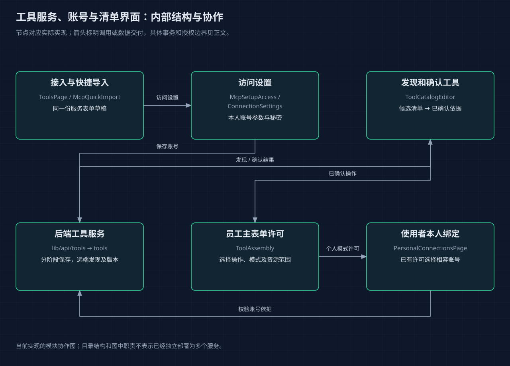

# 工具服务、账号与清单界面

工具界面帮助用户登记服务、设置访问身份、发现并确认具体操作。员工工具许可在岗位配置中授予；使用者可为已有的个人模式许可绑定本人相容账号。服务、账号、目录确认和员工许可分别有明确保存时机。

服务、账号与员工装配遵循[统一对象与动作语言](../../design-system/resource-language.md)。停用服务/连接、应用包含移除或定义变化的目录、切换或解除已有本人绑定时先说明实际影响并确认；取消不写入。首次添加、读取目录与普通输入保留直接操作，既有永久删除确认和后端引用保护继续生效。

## 模块设计



箭头表示接入阶段与员工使用的连接关系。员工许可保存归主表单，本人绑定独立提交，后端负责归属与相容性。 [PNG 导出](diagram/module-design@2x.png)。

### 接入表单为何只保留一份

`ToolsPage` 组织服务新增/编辑以及账号和清单状态，快捷导入只把选定 JSON/文件中的条目回填同一表单，不另建一套保存流程。多项先选择，覆盖已有输入明确确认；`McpSetupAccess` 根据声明字段组织访问参数及秘密。

远程 HTTP 与可信 stdio 是不同分支，可信程序只有管理员且部署允许时可登记。Token/环境秘密仅暂存在当前输入，提交成功清空，不进入普通持久草稿。

### 保存并测试不是一个远端事务

新增的「保存并测试」顺序保存服务定义、账号访问设置，再握手发现。某一步失败需要说明前面已保存什么，并保留后续重试入口；不能声称三步一起回滚。编辑服务、替换凭据、启停账号、发现及确认目录分别提交。

`ToolCatalogEditor` 展示候选与已确认操作，允许改显示名称/说明但保留原标识。发现完成还需用户确认，确认不扩大员工现有许可。这样远端变化不会直接变成员工可调用的新工具。

### 岗位许可与本人账号怎样连接

共享 `ToolAssembly` 在员工表单中选择已确认操作、账号模式和范围，面板完成只更新主表单草稿。`PersonalConnectionsPage` 只为当前使用者选择相容账号，后端检查同服务和工具定义；它没有共享员工编辑权。

页面刷新读取平台已有清单，不自动向远端发现。真正 MCP 请求发生在后台工具服务，浏览器不直接持有长期连接或解密后的凭据。

## 目录与职责

```text
tools/
├── ToolsPage.tsx                  # 组织服务表单、账号列表、发现/确认及分阶段反馈，明确部分保存与下一步重试
├── McpQuickImport.tsx             # 解析接入 JSON/文件，供选择后回填现有表单，保护已有草稿不被隐式覆盖
├── McpSetupAccess.tsx             # 按接入声明编辑非秘密参数与当前秘密，区分 HTTP 和可信程序的输入
├── ConnectionSettings.tsx         # 编辑本人账号的访问设置、启停和凭据替换，使用各自版本提交
├── ToolCatalogEditor.tsx          # 展示候选/确认操作并编辑显示注释，保留原始操作名及定义依据
├── PersonalConnectionsPage.tsx    # 列出员工已有个人许可，为当前用户选择/解除本人相容连接
└── DeleteToolDialog.tsx           # 说明服务删除影响并处理提交/错误，引用保护继续由后端执行
```

## 与其他模块协作

模块使用 [tools API](../../lib/api/tools.ts)、身份与共享 UI，目录变化通知 WorkspaceData 重新检索。员工装配由 [ToolAssembly](../../components/tools/ToolAssembly.tsx) 复用，[后端 tools](../../../../backend/app/tools/README.md) 管服务/账号/清单/调用，后端 agents 管许可和本人绑定。

## 路由与验证入口

`/tools` 提供新增/导入，`/tools?service=…` 管指定服务，`/tools?native=1` 为受控工作区登记入口；`/agents/:id/connections` 是本人绑定页面。业务规则见[MCP 契约](../../../../docs/reference/mcp.md)和[工具契约](../../../../docs/reference/agent-tools.md)，[工具页面测试](ToolsPage.test.tsx)与[装配测试](../../components/tools/ToolAssembly.test.tsx)核对页面阶段和主表单边界。
