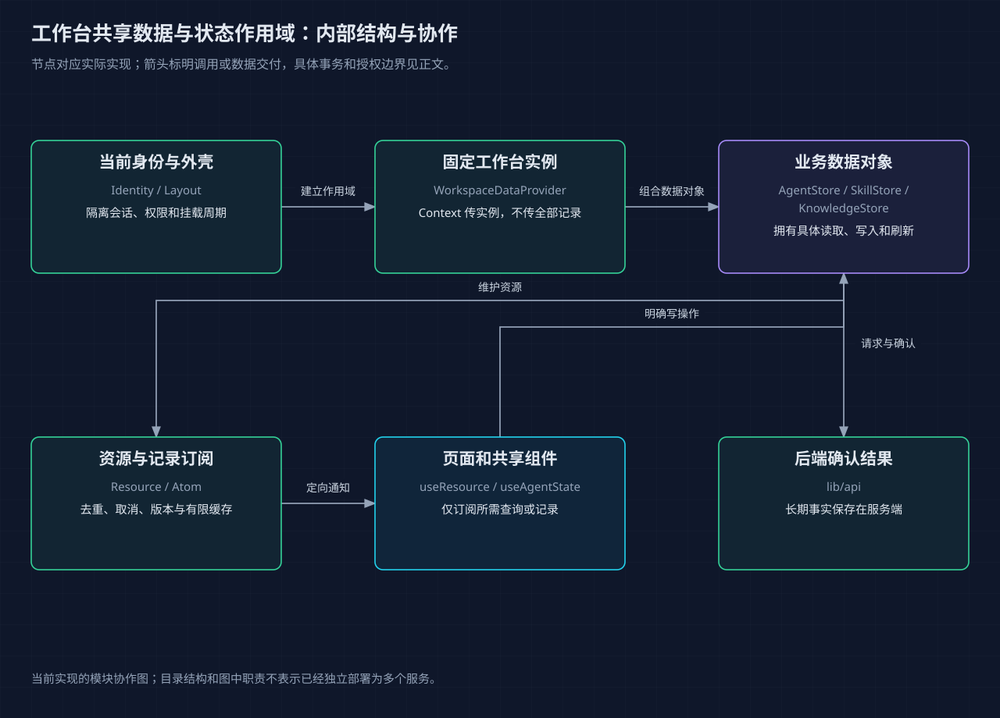

# 工作台共享数据与状态作用域

用户在目录收藏一位员工，侧栏也应显示相同结果；保存技能或上传知识文档后，相关列表和详情应重新核对。这里保存当前身份下可复用的服务端读取副本，并将身份、主题和编辑保护按不同生命周期分开管理。

## 模块设计



箭头表示当前身份内的数据拥有和读写关系。主题及编辑保护另按各自生命周期组织，对话观察不塞进目录缓存。 [PNG 导出](diagram/module-design@2x.png)。

### Provider 传实例，数据对象拥有读写

`WorkspaceDataProvider` 按身份、会话和权限建立作用域，Context 只传一份固定 WorkspaceData。普通 TypeScript 数据对象分别维护员工、技能和知识读取与操作，React 通过 `useSyncExternalStore` 订阅具体记录或查询。

这样正文/表单输入不会让整个工作台 Context 变化，共同读取也无需被每个页面复制。服务端仍是长期事实来源，内存缓存不持久化到 localStorage；URL 持有筛选/分页，页面持有草稿和弹窗，对话维护自己的高频观察。

### 一次读取怎样开始和结束

Resource 在第一个订阅到来时请求，同条件共享一个生命周期，刷新保留已确认内容和明确 loading/error。最后一个订阅离开后取消未完成读取，有限缓存保留最近条件，正在显示的查询不淘汰。固定数量入口随工作台存活，查询列表保存顺序及 total，员工摘要按 ID 保存。

页面通过资源 Hook 读取，并在切换条件时保留上次成功结果；迟到响应和较旧修订不覆盖新状态。关闭工作台会释放订阅及缓存；新身份使用新实例，旧写入结果不更新新实例。

### 写操作怎样影响其他读取

写入属于业务数据对象：员工保存/收藏/启停由 AgentStore 组织，技能保存/导入/同步由 SkillStore 组织，知识创建/上传/移除由 KnowledgeStore 组织。对象控制提交锁，消费已确认返回，并使必要查询失效后按订阅重新读取。

WorkspaceData 集中声明跨业务关系，例如技能更新影响能力目录、员工装配摘要、数量和搜索；知识数据对象在自身 knowledge 标签下刷新组织库、文档、处理与检索数据；员工选库和使用策略随 AgentStore 的统一员工保存及修订刷新。页面只处理输入、进度和导航，不能再广播一套全局版本或自行重复刷新。

KnowledgeStore 的 `evidence(run,evidence,offset)` 缓存指定 Run 登记的有界片段，`evidenceReferences(run)` 仅缓存该 Run 的来源目录，供旧链接精确映射。两者与其他知识读取共享身份作用域；卡片打开才订阅正文，每次重新打开刷新，关闭后取消无人订阅的请求。等待复核或失败时隐藏旧摘录；Sources 展开不预取正文。旧链接缺少消息 Run 上下文或未匹配时不开放任意文档读取。

员工选库草稿由员工配置表单持有，`EmployeeKnowledge` 是受控编辑组件，随主表单统一保存。KnowledgeStore 不维护 `employeeBindings`、个人写锁或独立设置修订。身份作用域释放时取消读取并忽略迟到结果，不能将上一身份的证据缓存带入新实例。

### 身份、主题和编辑保护为什么独立

身份决定当前访问和数据作用域；主题是跨身份的浏览器偏好；编辑保护收集当前编辑器真实 dirty/saving 状态和丢弃回调。把三者塞进同一个全局数据容器，会混淆退出清理、主题持久化和草稿恢复时机，所以分别提供接口。

## 目录与职责

```text
state/
├── workspace/
│   ├── WorkspaceDataProvider.tsx  # 按当前身份创建固定工作台数据实例，挂载/卸载时维护存活和清理
│   ├── workspaceData.ts          # 组合员工、技能、知识和检索资源，集中声明跨业务更新关系及固定计数
│   ├── workspaceContext.ts       # 提供固定实例 Context，避免业务记录变化重建全体消费方
│   └── useWorkspaceData.ts       # 让页面取得当前工作台实例，读取仍通过具体资源订阅
├── shared/
│   ├── resource.ts               # 实现同条件请求、保留旧内容刷新、取消、订阅及有限查询缓存
│   ├── atom.ts                   # 提供细粒度外部状态及通知基础，供具体记录管理使用
│   └── useResource.ts            # 将普通 Resource 连接到 React，按需要保留上一份成功内容
├── agents/
│   ├── agentStore.ts             # 按 ID 管员工摘要及查询，统一收藏、启停、保存、删除和每人提交状态
│   └── useAgentData.ts           # 订阅指定员工与目录相关状态，让卡片和侧栏读取同一记录
├── skills/
│   └── skillStore.ts             # 分别管理技能摘要/完整详情及保存、导入、删除和来源同步
├── knowledge/
│   ├── knowledgeStore.ts         # 管组织库、文件、处理、检索及Run证据，统一身份隔离与刷新
│   └── uploadQueue.ts            # 在身份内持有上传写入、File和取消控制，站内切页或收起面板不取消
├── auth/
│   ├── IdentityProvider.tsx      # 初始化及更新当前会话身份，决定授权页面的数据作用域
│   ├── identityContext.ts        # 传递当前身份读取和更新能力，供访问边界及业务入口消费
│   └── useIdentity.ts            # 提供当前用户/游客与权限信息的 React 读取入口
├── editing/
│   ├── useEditing.ts             # 登记各编辑器未保存/提交状态和真实丢弃回调，协调导航及关闭提示
│   └── useSaveOperation.ts       # 为页面组合明确保存生命周期，避免不同操作重复提交或错误共享
└── theme/
    ├── themeController.ts         # 维护用户主题偏好、系统监听、持久化与根元素同步，跨身份独立存活
    └── useTheme.ts                # 订阅主题实际状态并提供统一切换入口，页面无需各自监听系统偏好
```

## 与其他模块协作

页面和共享业务组件消费状态，普通数据对象依赖 [lib/api](../lib/api) 及基础类型，不反向导入页面私有实现。Layout 挂载工作台与编辑作用域，身份提供隔离键，主题按应用生命周期运行。

后端拥有长期事实，状态层只管理读取副本和操作确认。新增资源是否进入 WorkspaceData，取决于真实跨页面共享与生命周期，不因目录相似就提升所有表单或对话正文。

## 收藏、竞争与失败

收藏提前切换星标，这个临时值不写入已确认摘要，也不提前改变收藏列表成员。接口成功后采用返回的员工及 revision，所有订阅者读取同一记录；筛选不再匹配的卡片移除，再核对当前页补位及末页回退。启停等待服务端确认后显示。

每个员工共用一把提交锁，防止收藏、启停和完整保存重叠；不同员工可以并发。写入期间取消跨越写入的员工列表读取，必要的新读取延后，防止旧响应恢复卡片或重复增减 total。较低 revision 不覆盖较新记录；接口完整详情经过明确映射才进入摘要，不能把摘要当完整表单提交。

明确拒绝会撤销收藏临时值并在卡片提示。409、网络断开或服务端错误先 GET 该员工核对，不自动重复 PATCH；核对失败保留该员工锁和“重新核对”入口，重试仅执行 GET，其他员工及目录仍可使用。完整表单保存失败保留输入，并沿用已有冲突处理流程。

## 接入与验证入口

页面通过 `useWorkspaceData` 取得实例，再通过 Resource Hook 订阅，写操作调用所属对象的明确方法。跨客户端变化在重新读取时可见，目前不是全局实时推送。新业务按实际共享范围复用 Resource，在组合处声明影响关系。

[资源测试](shared/resource.test.ts)、[员工状态测试](agents/agentStore.test.ts)、[Provider 测试](workspace/WorkspaceDataProvider.test.tsx)及[跨业务测试](workspace/workspaceData.test.ts)核对请求、订阅、旧结果和身份生命周期。

## 上传队列与页面订阅

KnowledgeUploadQueue在身份作用域持有File、固定目标库、请求标识和取消控制，页面与全局浮层只订阅。切页或收起浮层不取消上传；身份退出清队列并尽力中止，迟到响应不写入新身份。刷新/关页可能中断未确认传输，需重新核对服务器记录，不能从客户端取消推断服务器未保存。持久处理批次另由后端拥有。

## 向量后台任务

向量构建由后端持久任务拥有，不登记成长时间的编辑或导航锁。KnowledgeStore缓存最近任务记录、短暂提交状态和未确认提交的幂等标识；结果不明时保留原模型及标识，明确受理或拒绝后才释放，身份退出清理。库详情页统一订阅活动任务并轮询，切换文档、检索设置或检索测试页签不会停止观察；离开知识库只停止观察，不取消后台执行，再次进入重新读取服务器记录。任务状态变化使库和文档状态失效，失败、中断或取消后明确提交新任务，后端复用仍有效的片段向量缓存。清除索引同时取消活动任务并清除向量缓存，前端需独立确认。
